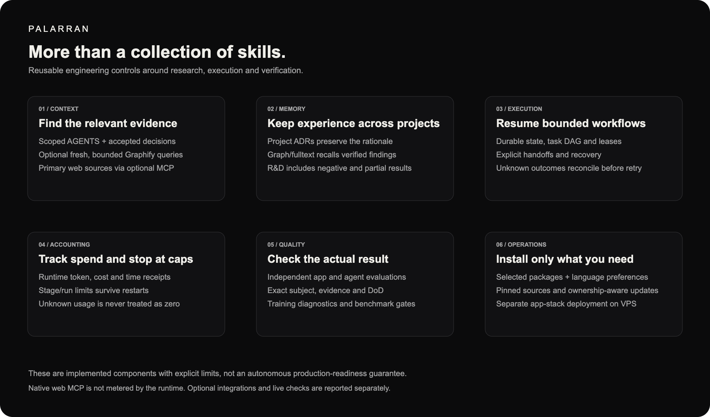

<p align="center">
  
</p>

<p align="center">
  <strong>Evidence-driven skills. Shared research memory. Bounded execution.</strong>
</p>

<p align="center">
  <a href="https://github.com/zxc0zxc0zxc/palarran-framework/actions/workflows/validate.yml"></a>
  <a href="docs/product-factory/README.md"></a>
  <a href="skills/README.md"></a>
  <a href="docs/skills/graph-context.md"></a>
</p>

Palarran brings research, product planning, UX/UI, engineering, infrastructure, ML and independent verification into a shared workflow for Codex and Claude:

**Sources → specification → authorized implementation → verification → reusable findings.**

Choose the skill packages your project needs. Keep decisions and plans in a hidden `.palarran/` directory. Reuse verified engineering and research findings across projects through self-hosted graph memory.

[Documentation](docs/README.md) · [Skill catalog](skills/README.md) · [Setup](docs/setup/README.md) · [Contracts](docs/skills/README.md) · [Contributing](CONTRIBUTING.md)

<a id="skills-usage"></a>
## Start with your agent

Tell Codex or Claude:

> Set up Palarran from https://github.com/zxc0zxc0zxc/palarran-framework in this project. Start with docs/setup/README.md. Ask which packages and languages I need, preserve my settings and local edits, check global memory, and explain the available commands.

Installation supports English, Russian and Serbian Latin preferences independently for agent interaction, new code comments and generated documentation. The canonical skill and guide source is English. [Configuration and precedence](docs/setup/configuration.md).

From a trusted complete checkout:

```sh
python3 scripts/project_setup.py setup --target /ABSOLUTE/project --client codex \
  --packages backend frontend app \
  --skills-language en --code-language en --docs-language en --plan
```

Review the proposal, then repeat without `--plan` to install. Choose `--client claude` or `both` when appropriate. Setup detects existing installations and uses an ownership-aware update; conflicting edits stop replacement. Updates retain the installed package selection. The generated `.ai-tools/USAGE.md` lists actual installed commands. `.ai-tools/` remains the compatible internal library store; `.palarran/` owns project context and preferences.

## Self-host Palarran infrastructure

Run private cross-project memory on your own VPS: Neo4j Community, a small Python API and an SSH tunnel from your workstation. Agent skills stay local; Keenable remains an optional external service.

Ask your agent:

> Deploy Palarran's private memory stack from this repository to my VPS using SSH alias SERVER. Follow docs/setup/self-host.md, inspect existing workloads, prepare the stack and rollback, keep service ports private, configure my local connection, and verify it. Do not install agent skills on the VPS or reveal credentials.

[Step-by-step self-hosting guide](docs/setup/self-host.md) · [Memory operations](docs/memory/operations.md) · [Infrastructure profiles](docs/infra/plan/README.md)

## Beyond skills

Palarran adds durable decisions, reusable research findings, scoped context retrieval, resumable workflows and independent acceptance. Runtime stages track usage against explicit budgets; ownership-aware installation preserves project settings and local edits.



## How it fits together

Your project keeps its code, contracts and local decision history. The local agent uses Palarran's selected skills and guides, optionally retrieves primary sources through Keenable, and recalls reviewed findings from private graph memory on your VPS. Secrets stay in the private global profile.


The diagram describes the Palarran configuration layout; existing global installations require a coordinated migration before changing their runtime paths. [Configuration](docs/setup/configuration.md) · [Memory architecture](docs/memory/architecture.md).

## Development workflow

Move from product evidence and UX/UI concepts to versioned engineering plans, implementation and independent checks. Delivery follows its own authorization and rollout gates; a passing build does not trigger deployment by itself.


[Editable diagram sources](assets/README.md) · [Runtime](docs/product-factory/README.md) · [Execution progress](docs/skills/execution-progress.md)

## Pick your packages

| Package | Purpose |
| --- | --- |
| `product` | Product definition, market, competitors, revenue, acquisition, B2B/B2C |
| `ux`, `ui` | Responsive experience and visual concepts |
| `frontend`, `backend` | SDD planning and implementation, contracts and progress |
| `infra`, `ci-cd`, `vps` | Infrastructure, delivery and authorized server operations |
| `ml`, `science` | Experiments, data, training diagnostics, benchmarks and preprints |
| `app`, `agent` | Independent acceptance, agent evaluation and regression improvement |
| `mcp`, `memory` | Agent tools and reusable cross-project findings |
| `setup` | Installation and safe updates; always included |

Use `--packages all` only when you want the whole library. Shared documentation and support helpers remain available for cross-domain references. [Machine-readable catalog](skills/catalog.json).

## Commands

| Task | Unified Claude plugin | Codex native |
| --- | --- | --- |
| Set up or update | `/palarran:setup` | `$palarran-setup` |
| Infrastructure | `/palarran:infra:plan low` | `$palarran-infra-plan low` |
| CI/CD | `/palarran:ci-cd github` | `$palarran-ci-cd github` |
| UX / UI | `/palarran:ux:design`, `/palarran:ui:design` | `$palarran-ux-design`, `$palarran-ui-design` |
| Frontend | `/palarran:frontend:plan`, `/palarran:frontend:build` | `$palarran-frontend-plan`, `$palarran-frontend-build` |
| Backend | `/palarran:backend:plan`, `/palarran:backend:build` | `$palarran-backend-plan`, `$palarran-backend-build` |
| Product | `/palarran:product:define` and research profiles | `$palarran-product-define` and profiles |
| ML | `/palarran:ml:plan` through benchmark | `$palarran-ml-plan` and profiles |
| Memory | `/palarran:memory:recall`, `/palarran:memory:learn` | `$palarran-memory-recall`, `$palarran-memory-learn` |
| Verification | `/palarran:app:verify`, `/palarran:agent:eval` | `$palarran-app-verify`, `$palarran-agent-eval` |

Infrastructure accepts `low|med|high`; CI/CD accepts `github|gitlab`. See [all commands and flags](skills/README.md). Standalone Claude skill discovery uses names such as `/palarran-backend-plan`; namespaced aliases require the plugin.

Build a portable Claude plugin from reviewed resources:

```sh
python3 scripts/package_plugin.py palarran --output /NEW/palarran-plugin
claude --plugin-dir /NEW/palarran-plugin
```

Individual plugin selectors include `palarran-backend`, `palarran-frontend` and `palarran-ml`. Packages exclude target decisions, secrets and runtime state. [Migration notes](docs/setup/palarran.md).

<a id="agent-entry"></a>
## Agent entry

1. Read [AGENTS.md](AGENTS.md), target `.palarran/INDEX.md` (when present) and relevant accepted decisions. In older projects, also read `.ai-development/INDEX.md`; preserve its history.
2. Read AGENTS for every affected module and the applicable [domain contracts](docs/skills/domain-contracts.md), then the mandatory profile guides.
3. Keep the installed library and target project separate. Write rationale, plans, progress and findings in the target `.palarran/` before dependent changes.
4. Treat memory as evidence to verify against current sources. Preserve conditions, baselines, metrics, uncertainty, negative results and limitations. [Global memory](docs/skills/global-memory.md) · [Research findings](docs/skills/research-memory.md).

<a id="catalog"></a>
## Explore the documentation

| Area | Entry points |
| --- | --- |
| Product and first customers | [Product](docs/product/README.md), [pipeline](docs/product/pipeline.md) |
| UX and UI | [UX](docs/ux/README.md), [UI](docs/ui/README.md) |
| Engineering | [Frontend](docs/frontend/README.md), [backend plan](docs/backend/plan/README.md), [backend build](docs/backend/build/README.md) |
| Infrastructure and delivery | [Infrastructure](docs/infra/plan/README.md), [CI/CD](docs/ci-cd/README.md) |
| ML and data | [ML](docs/ml/README.md), [data](docs/ml/data/README.md), [diagnostics](docs/ml/debugging/README.md) |
| Acceptance and agent quality | [App verification](docs/app/verify/README.md), [evals](docs/agent/eval/README.md), [improvement](docs/agent/improve/README.md) |
| Tools and shared knowledge | [MCP](docs/mcp/build/README.md), [memory](docs/memory/README.md), [web retrieval](docs/skills/context-retrieval.md) |
| Experiment reporting | [Science preprints](docs/science/README.md) |

<a id="runtime"></a>
## Bounded runtime

[Product Factory](docs/product-factory/README.md) provides durable state, task dependencies, leases, CLI adapters, independent verifiers, token/cost accounting and recovery. Products live in separate target repositories; private runtime state stays outside their source trees.

```sh
python3 -m orchestrator --help
```

The runtime includes engineering, product and ML workflows, local data gates, diagnostics, a Modal adapter, app verification and agent evaluation/improvement harnesses. Local fixtures do not prove production readiness, model quality, an operational SLA or market validation. Missing checks remain `NOT_RUN`; unknown spend or outcomes require reconciliation instead of replay or automatic budget increases. Existing runs retain their original source pins and budgets.

Cross-project memory uses self-hosted Neo4j graph/fulltext, without an LLM or embedding API dependency. Global preferences and private credentials belong under `~/.palarran/`; project preferences belong in `.palarran/config.json`. MCP and persistent SSH tunnel setup require explicit global scope. Optional Keenable search has a separate provider quota; native MCP usage is not yet wired into the orchestrator's cost ledger or hard budget gate. [Operations](docs/memory/operations.md).

<a id="graphs"></a>
## Graph navigation

[Graphify](https://github.com/Graphify-Labs/graphify), by Graphify Labs, provides the optional local graph navigation used by this integration. Thanks to its maintainers for the project. Palarran uses a pinned code-only profile: **check freshness → query a bounded subset → read original files, AGENTS and decisions**. Use scoped search when missing or stale. Never load the whole graph into the prompt or enable semantic/cloud extraction implicitly. A graph does not authorize an action. [Graph contract](docs/skills/graph-context.md).

<a id="layout"></a>
## Repository map

```text
skills/          prefixed skills and machine catalog
plugins/         unified and optional domain plugin manifests
commands/        distributable command adapters
docs/            primary sources, guides and shared contracts
scripts/         installers, packaging, validators and bounded helpers
orchestrator/    workflows, verification and accounting
memory/          self-hosted graph/fulltext service
mcp/             reference tool profiles
templates/       inert starting points
examples/        examples with explicit execution boundaries
tests/           offline fixtures and regression tests
.palarran/       private local context; ignored by Git
```

<a id="checks"></a>
## Verification and contributions

```sh
python3 scripts/validate_repo.py
python3 -m unittest discover -s tests -v
python3 scripts/factory_acceptance.py
```

Tests do not launch paid models or GPUs. Optional browser/tokenizer checks use an already available environment; skips are reported separately. Python 3.9+, Git and POSIX are required for core tools. [Contributing](CONTRIBUTING.md).

A license has not been selected. Preparing this repository for a possible open-source release does not change its visibility or grant a license.

### Cross-machine incident coordination

`/palarran:infrastructure:incident {what happened}` assigns parallel investigation lanes and preserves an evidence timeline, mitigation scope and independent recovery checks. Optional [Core coordination](packages/core/coordination/docs/README.md) connects agents from different developer machines through a private VPS API and local MCP clients, with distinct identities, project-wide resource claims and durable receipts. Chat does not grant production permissions or fence external tools. See [operations](packages/core/coordination/docs/operations.md); live deployment is checked separately.
