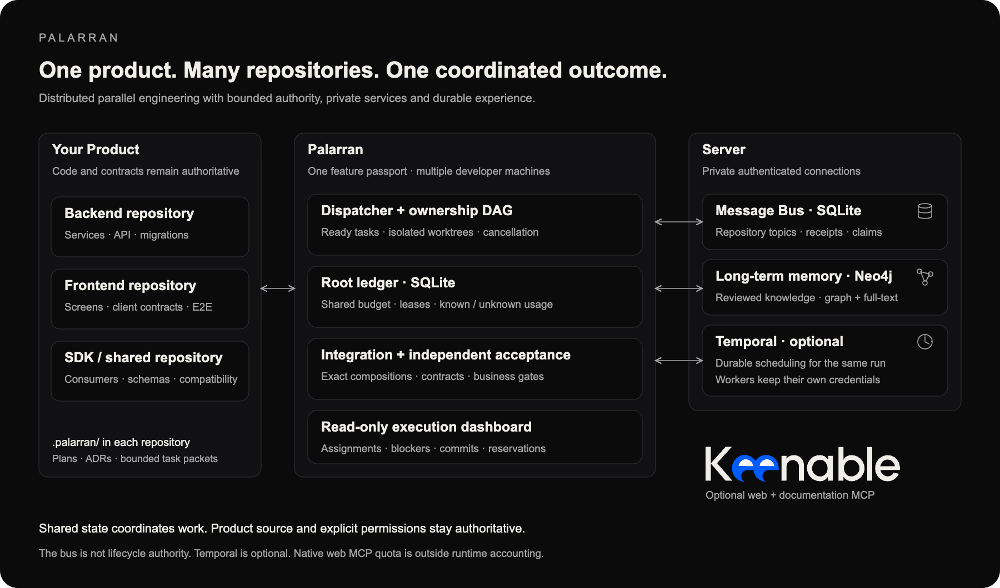
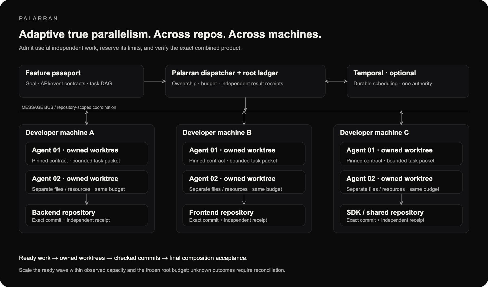
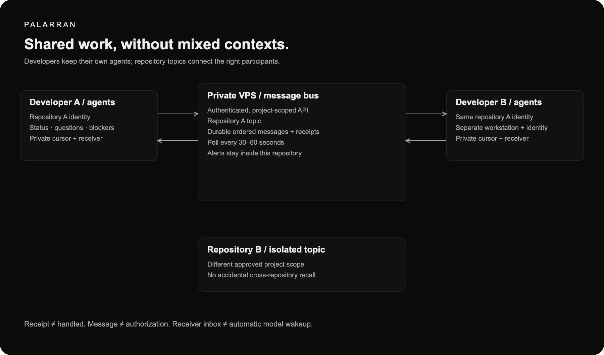

<p align="center">
  
</p>

# Just be parallel. Brutal.

<!-- ENGINE ROOM / PALARRAN
One ship. Many minds. Nobody gets to declare land from the crow's nest alone.
If you found this in source: welcome aboard, fellow context-window sailor.
Ship lore only; the acceptance gates still have the last word.
-->

<p>
  <a href="LICENSE"></a>
  <a href="https://github.com/zxc0zxc0zxc/palarran-framework/actions/workflows/validate.yml"></a>
  <a href="https://docs.temporal.io/"></a>
  <a href="https://neo4j.com/docs/"></a>
  <a href="https://www.sqlite.org/docs.html"></a>
  <a href="packages/README.md"></a>
</p>

**Palarran is a distributed parallel agent engineering framework for Codex and Claude.** Coordinate independent work across repositories and developer machines, preserve one task and budget authority, and accept the combined product against explicit contracts.

- **Parallel execution:** dependency DAGs, isolated Git worktrees, owned resources and adaptive admission of ready tasks.
- **Distributed coordination:** optional Temporal workflows, authenticated worker access and a durable repository-scoped message bus.
- **Shared experience:** project-local decisions and compact handoffs, optional Graphify code navigation, and cross-project Neo4j graph/full-text recall.
- **Visible control:** read-only execution dashboards, cumulative usage and reservations, explicit blockers and exact verified commits.
- **Acceptance beyond CI:** API, migration and business checks on the final composition, with repair work routed to its owner.

The bounded Python runtime coordinates approved adapters; agents and their credentials stay on developer machines. Native chat instructions guide behavior, while managed entrypoints control registered task lifecycles. More workers share the same budget rather than creating new limits.

<a id="skills-usage"></a>
## Install for your project

Tell your agent:

> Set up Palarran from https://github.com/zxc0zxc0zxc/palarran-framework in this project. Follow packages/core/setup/docs/runbooks/README.md. Ask which packages and languages I need, use the default local installation, preserve my configuration and local edits, check global memory only if selected, and explain the available commands and any deferred checks.

Or start from a trusted complete checkout:

```sh
python3 scripts/project_setup.py setup --target /ABSOLUTE/project --client codex \
  --packages code validation \
  --skills-language en --code-language en --docs-language en --plan
```

Review the plan, then repeat without `--plan`. Supply all package/language preferences through flags or checked configuration; missing choices return a safe JSON diagnostic. Choose `claude` or `both` for the client when needed.

Fresh setup defaults to **local mode** in an existing Git project: selected native skill links, private `.palarran/` state and Claude's `CLAUDE.local.md`. Git-local excludes protect generated files; tracked `AGENTS.md`, `CLAUDE.md`, `.mcp.json` and `.gitignore` stay unchanged. Existing tracked local instructions are preserved and reported as not activated. Codex skill discovery does not imply automatic instruction or MCP activation; follow `.ai-tools/USAGE.md` and any actual client trust/restart requirements.

Use explicit `--mode project` when shared instruction/MCP edits are intended. Existing installations retain their receipt mode, settings and local changes through ownership-aware updates; conflicting replacements stop for review.

Memory is optional: the example above returns `NOT_SELECTED` without a memory probe. Add `memory` to the package selection when its configured service is needed. An explicitly selected unhealthy service returns `*_MEMORY_NOT_READY`/exit 2 even when files installed successfully; inspect the safe diagnostic and rerun doctor after resolving the prerequisite. Setup never installs or repairs global services automatically.

Select English, Russian or Serbian Latin independently for agent interaction, code comments and documentation. Canonical skills and guides remain English. Generated review artifacts use the project's documentation language, including captions and controls, with no language selector.

[Installation runbooks](packages/core/setup/docs/runbooks/README.md) · [Configuration](packages/core/setup/docs/configuration.md) · [Command catalog](skills/README.md). Core is included with every package. `.ai-tools/` remains the compatible installation store; `.palarran/` holds project preferences, plans and decisions.

## Self-host on your server

Your server can host private cross-project memory, the agent message bus, an optional custom-package registry and an optional Temporal deployment. Skills and agents stay on developer machines. Service ports stay private; workstations connect through SSH tunnels. Keenable is an optional external source service, not a dependency of self-hosted memory.

Tell your agent:

> Deploy the Palarran services I select to my server using SSH alias SERVER. Follow the versioned installation runbooks, inspect existing workloads, prepare the exact configuration and rollback, keep ports private, configure my local connection, and verify it. Do not install agent skills on the server or reveal credentials.

[Container deployment runbook](packages/infrastructure/hosting/docs/runbook.md) · [Self-hosting](packages/core/setup/docs/self-host.md) · [Service runbooks](packages/core/setup/docs/runbooks/services.md) · [Memory operations](packages/memory/knowledge/docs/operations.md) · [Message bus operations](packages/core/coordination/docs/operations.md).

A runbook defines supported inputs and exact checks. An unsupported host or an uncertain previous operation needs reconciliation or a reviewed procedure extension before changes.

## Overall architecture

Palarran is designed for distributed, parallel engineering: split independent work, execute it on approved developer machines, and scale participation while keeping one coordinator and one root ledger. A product can span multiple repositories; its feature passport binds owners, contracts, dependencies and the exact composition to accept.



**Python + SQLite** provide bounded dispatch, durable accounting and recovery. **Temporal is optional** durable scheduling for the same run; workers use the shared authority rather than copying its ledger. The **message bus** carries repository-scoped notices and claims. **Neo4j Community** stores reviewed experience with graph and full-text retrieval. Neither messages nor recalled knowledge grant execution permission.

[Keenable](https://keenable.ai/) is our preferred MCP integration for web and documentation search: find primary sources and fetch their content without treating retrieved text as instructions. It is optional and has a separate provider quota; native MCP usage is outside the runtime's hard cost gate.

Project source and contracts remain authoritative. `.palarran/` holds project preferences, plans and decisions; `~/.palarran/` holds private global configuration. [Dispatcher](packages/core/parallelism/docs/contract.md) · [Cross-repository features](packages/core/parallelism/docs/features/README.md) · [Memory architecture](packages/memory/knowledge/docs/architecture.md).

## Adaptive true parallelism

The main chat can also supervise a [pool of headless sessions](packages/core/parallelism/docs/session-pool.md), each with an explicitly bounded native team. Reports distinguish observed session/subagent activity, shared spend, held reservations and blockers; native UI integration and provider telemetry coverage remain explicit.


Start a small wave of independent ready tasks, then admit more work when dependencies, observed capacity and the remaining budget allow. Each writer gets an owned Git worktree and explicit file/resource boundaries. Tasks can span backend, frontend and SDK repositories while sharing contracts and one feature goal.



The dispatcher validates task packets, reserves limits before execution and tracks cancellation, heartbeats and unknown outcomes. Optional Temporal manages durable scheduling; the bus lets participants exchange changes and blockers. A lost heartbeat retains ownership and reservations until reconciliation. Parallelism is adaptive admission, not a claim of optimal scheduling or measured speedup.

The plan distinguishes pending, implemented, integrated and independently verified work. A worker finishing its branch does not accept the product. [Execution contract](packages/core/parallelism/docs/contract.md) · [Worktree ownership](packages/core/agents/docs/parallelism.md) · [Progress](packages/core/agents/docs/execution-progress.md).

## Developers and agents working together

Several developers can contribute from different machines with their own accounts, credentials and approved resources. Agents exchange bounded messages on repository topics, report blockers and coordinate shared resources without copying entire conversations.



`/palarran:core:coop` receives selected repository messages with a durable cursor; `--alert` reaches active participants in that repository. The receiver polls every 30–60 seconds. Its local inbox does not itself wake an idle model. Messages and receipt acknowledgements remain evidence, never approval or proof of completion. [Cooperation status](packages/core/coop/README.md) · [Message bus](packages/core/coordination/docs/contract.md).

`/palarran:core:share` hands a task or exact Git checkpoint to another developer after both confirm the plan and scope. One assignment generation owns execution; separate sessions preserve known and unknown cumulative spend. [Consent-bound handoff](packages/core/coordination/docs/sharing/README.md).

### See the work, blockers and spend

The read-only execution panel shows assignments, dependency blockers, exact independently verified subjects, reported usage, outstanding reservations and where review is needed. A small Python server renders the dashboard; a compact Markdown report fits Codex or Claude conversations. Multiple machines read the same authority, not copied databases.

```sh
# Disposable fixture; no models or remote services.
python3 -m packages.core.parallelism.dashboard demo
```

Open the printed loopback address. Real runs use an existing private ledger or authenticated authority connection. Stale and unknown states stay visible. Native custom UI embedding is not assumed. [Dashboard and protected access](packages/core/parallelism/docs/dashboard.md).

## Memory across tasks, sessions and projects

Keep fast context small, retain the reasons behind decisions, and recall verified experience where it applies.

| Layer | Technology and purpose |
| --- | --- |
| Working context | Bounded task packets, module `AGENTS.md`, relevant contracts and source files. |
| Project memory | Private `.palarran/` notes, plans, accepted ADRs, progress and evidence references. |
| Code navigation | Optional local **Graphify** graph: check freshness, query a bounded subset, then read original source. |
| Session handoff | Validated compact JSON files for another agent or developer; optional long-term storage. |
| Cross-project memory | **Neo4j Community graph + full-text** recall of reviewed ADRs, incidents, patches and R&D findings. |

Compaction preserves constraints, decisions, pending work and evidence instead of replaying a full session. Session files support portable handoff; they do not transfer credentials or execution authority. Long-term publication includes provenance, privacy review and deduplication. Raw sessions, customer data and secrets are not uploaded automatically. Storage and recall require no embedding or LLM API.

[Memory package](packages/memory/README.md) · [Session handoffs](packages/memory/sessions/README.md) · [Graphify by Graphify Labs](https://github.com/Graphify-Labs/graphify) · [Bounded graph context](packages/core/agents/docs/graph-context.md).

Model roles and per-stage budgets reduce repeated expensive work. Tokens, estimated cost, reported provider usage and invoices stay distinct; failures and restarts retain cumulative spend. No universal token-saving percentage is claimed. [Model budgets](packages/core/orchestration/docs/model-budgets.md).

<a id="layout"></a>
## Accept the product, not just the branches

A green service CI run cannot prove that its consumer expects the same API or that a migration works during rollout. Palarran binds independent acceptance to exact commits, contracts, configuration and test evidence for the combined feature.

The integration queue applies verified changes in an owned branch, reruns affected API, migration and business gates, and returns concrete mismatches to the responsible owner. Final acceptance checks the complete composition. A changed component invalidates readiness; unknown or missing checks remain visible.

Cross-repository features also define intermediate old/new service combinations, migration order, flags, stop thresholds and recovery. Project-specific independent verifiers check business invariants; matching schemas alone do not prove correct behavior. Release readiness, authorized deployment and observed acceptance remain separate states.

[Integration queue](packages/core/parallelism/docs/integration.md) · [Feature passport and workflow](packages/core/parallelism/docs/features/workflow.md) · [Acceptance and release](packages/core/parallelism/docs/features/acceptance.md) · [Independent application verification](packages/validation/application/docs/README.md).

## Your own packages

Core Packaging keeps third-party extensions separate from the trusted built-in catalog. Create a namespaced capability with documentation, a plan, implementation and tests; select public/private visibility and publish an immutable version to your chosen registry only when authorized. Search and install exact version/SHA256 pins, update without overwriting local changes, and remove only receipt-owned files.

The optional registry uses a small Python API, SQLite metadata and content-addressed filesystem storage, with an explicit S3 client adapter. No package hooks or MCP servers activate during installation. Owner delist/delete is separate from local uninstall. Native Claude skills start with `/palarran-package-create`; unified plugin aliases use `/palarran:package:create`. [Packaging guide](packages/core/packaging/README.md) · [Registry operations](packages/core/packaging/docs/operations.md).

## Skills ready for parallelism

Select the modules you need. Their workflows use shared ownership, decision memory and verification contracts; planning stages remain planning, and useful independent implementation can be dispatched to agents.

| Module | Engineering responsibility |
| --- | --- |
| [Core](packages/core/README.md) | Dispatch, orchestration, coordination, setup and package contracts. |
| [Memory](packages/memory/README.md) | Context tiers, compact sessions and reviewed cross-project knowledge. |
| [Product](packages/product/README.md) | Evidence-backed hypotheses, markets, economics and customer plans. |
| [Design](packages/design/README.md) | Responsive UX flows and reusable UI concepts. |
| [Code](packages/code/README.md) | Specification-driven frontend/backend work and Git delivery. |
| [Machine Learning](packages/machine-learning/README.md) | Bounded experiments, data, training diagnostics and benchmarks. |
| [Docs](packages/docs/README.md) | Navigable technical documentation and interactive review artifacts. |
| [Science](packages/science/README.md) | Evidence-grounded research reports from existing experiments. |
| [Validation](packages/validation/README.md) | Independent acceptance, agent evals and regression-driven improvements. |
| [Infrastructure](packages/infrastructure/README.md) | Infrastructure planning, delivery, VPS operations and incidents. |
| [Security](packages/security/README.md) | Evidence-backed infrastructure, code, ingress/egress, logging and CVE audits. |

[Using skills and pipelines](packages/core/agents/docs/usage-and-pipelines.md) · [Complete command catalog](skills/README.md) · [Package structure and extension](packages/README.md).

<a id="agent-entry"></a>
## For agents

Read [AGENTS.md](AGENTS.md), the target `.palarran/INDEX.md`, relevant accepted decisions and the affected package instructions. Use the applicable [domain contract](packages/core/agents/docs/domain-contracts.md) and mandatory guides. Evaluate independent ready work at task boundaries, preserve the active run and budget, and keep integration under one coordinator.

```sh
python3 scripts/validate_repo.py
python3 -m unittest discover -s tests -v
python3 scripts/factory_acceptance.py
```

Tests do not launch paid models or GPUs. Local fixtures do not establish production readiness, live multi-machine acceptance, operational SLA or market validation. [Contributing](CONTRIBUTING.md) · [Documentation index](docs/README.md) · [Editable diagrams and attribution](assets/README.md).

Licensed under the [MIT License](LICENSE). Third-party names, logos and separately licensed dependencies retain their owners' rights and notices.
