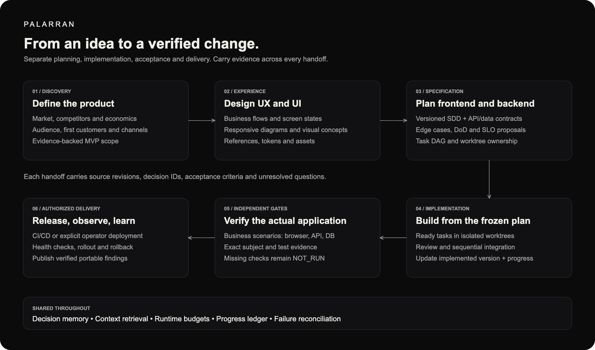

<p align="center">
  
</p>
<p align="center"><strong>Modular skills. Parallel agents. Durable shared experience.</strong></p>
<p align="center">
  <a href="https://github.com/zxc0zxc0zxc/palarran-framework/actions/workflows/validate.yml"></a>
  <a href="packages/README.md"></a>
  <a href="skills/README.md"></a>
  <a href="packages/core/agents/docs/graph-context.md"></a>
</p>

Palarran helps Codex and Claude take an idea through research, design, implementation and independent checks. Agents work in parallel, keep the reasons behind their decisions, and reuse verified findings across projects. Choose the packages your project needs; keep its code and private context in your own repository.

**Research → specification → authorized implementation → verification → reusable experience.**

| Module | What it helps you do |
| --- | --- |
| [Core](packages/core/README.md) | Shared agent foundations, runtime, setup and safe package discovery. |
| [Memory](packages/memory/README.md) | Local notes, session context and optional reviewed cross-project knowledge. |
| [Product](packages/product/README.md) | Evidence-backed product definition, market and customer planning. |
| [Design](packages/design/README.md) | Adaptive UX concepts and visual UI design. |
| [Security](packages/security/README.md) | Readonly security audits with explicit evidence and fresh advisory checks. |
| [Code](packages/code/README.md) | Specification-driven frontend and backend planning and implementation. |
| [Machine Learning](packages/machine-learning/README.md) | Bounded experiment design, data, training and independent benchmarks. |
| [Docs](packages/docs/README.md) | Human-readable documentation and portable review artifacts. |
| [Science](packages/science/README.md) | Evidence-grounded scientific reporting from existing experiments. |
| [Validation](packages/validation/README.md) | Independent application acceptance and measured agent evaluation. |
| [Infrastructure](packages/infrastructure/README.md) | Infrastructure design, delivery, VPS operations and scoped incidents. |

<a id="skills-usage"></a>
## Install for your project

Tell your agent:

> Set up Palarran from https://github.com/zxc0zxc0zxc/palarran-framework in this project. Follow packages/core/setup/docs/runbooks/README.md. Ask which packages and languages I need, preserve my configuration and local edits, check the configured global memory connection, and explain the available commands.

Or start from a trusted complete checkout:

```sh
python3 scripts/project_setup.py setup --target /ABSOLUTE/project --client codex \
  --packages code validation memory \
  --skills-language en --code-language en --docs-language en --plan
```

Review the plan, then repeat without `--plan`. Choose `claude` or `both` for the client when needed. Setup detects an existing installation and uses an ownership-aware update. Local changes and settings are preserved; conflicting replacements stop for review.

Select English, Russian or Serbian Latin independently for agent interaction, code comments and documentation. Canonical skills and guides remain English. Generated review artifacts use the project's documentation language, including captions and controls, with no language selector.

[Installation runbooks](packages/core/setup/docs/runbooks/README.md) · [Configuration](packages/core/setup/docs/configuration.md) · [Command catalog](skills/README.md). Core is included with every package. `.ai-tools/` remains the compatible installation store; `.palarran/` holds project preferences, plans and decisions.

## Self-host on your server

Your VPS can host private cross-project memory and the optional agent message bus. Skills and agents stay on developer machines. Service ports stay private; workstations connect through SSH tunnels. Keenable is an optional external source service, not a dependency of self-hosted memory.

Tell your agent:

> Deploy the Palarran services I select to my VPS using SSH alias SERVER. Follow the versioned installation runbooks, inspect existing workloads, prepare the exact configuration and rollback, keep ports private, configure my local connection, and verify it. Do not install agent skills on the server or reveal credentials.

[Container deployment runbook](packages/infrastructure/hosting/docs/runbook.md) · [Self-hosting](packages/core/setup/docs/self-host.md) · [Service runbooks](packages/core/setup/docs/runbooks/services.md) · [Memory operations](packages/memory/knowledge/docs/operations.md) · [Message bus operations](packages/core/coordination/docs/operations.md).

A runbook defines supported inputs and exact checks. An unsupported host or an uncertain previous operation needs reconciliation or a reviewed procedure extension before changes.

## Overall architecture

Your project owns its source, contracts and local decision history. The agent loads selected Palarran capabilities, optionally retrieves current documentation through Keenable, and recalls applicable findings from your private memory service. Shared memory supplies evidence to check against current code; it never overrides project instructions.


[Keenable](https://keenable.ai/) is our preferred search integration for the web and technical documentation. Its MCP tools let agents search for primary sources and fetch page content as they research a product, check an API or verify an engineering approach. Optional, with a separate provider quota.

Global preferences and private credentials belong under `~/.palarran/`; project preferences belong in `.palarran/config.json`. Existing installations require a coordinated migration of pinned runtime and tunnel references before changing their global paths. [Architecture details](packages/memory/knowledge/docs/architecture.md).

## Parallel agents in Git worktrees

A coordinator turns a specification into independent tasks with explicit file ownership, dependencies and acceptance criteria. Ready tasks run in separate Git worktrees. Agents can inspect and test their part concurrently; the coordinator integrates changes and checks the combined result.


The plan records what is pending, implemented, integrated and independently verified, together with its revision and commit evidence. A completed agent task does not make the whole feature verified. [Parallelism](packages/core/agents/docs/parallelism.md) · [Execution progress](packages/core/agents/docs/execution-progress.md).

## Orchestration for development and research

Use separate product, engineering and ML workflows with typed handoffs. Research keeps its sources and open questions; implementation follows the specification; acceptance checks the resulting subject. The bounded runtime tracks task dependencies, leases, cumulative usage and recovery instead of treating a successful model exit as success.



Product research can end in an MVP plan, a validation experiment, a pivot or a stop. ML workflows preserve learning goals, data and checkpoint lineage, training diagnostics, generations and independent benchmarks. Missing evidence stays visible; unknown spending or job outcomes block automatic replay.

```sh
python3 -m orchestrator --help
```

[Runtime](packages/core/orchestration/docs/README.md) · [Product pipeline](packages/product/research/docs/pipeline.md) · [ML pipeline](packages/machine-learning/experiments/docs/pipeline.md).

## Developers and agents working together

Two developers can work on the same repository from different machines without relying on a single agent session. The optional private message bus keeps repository topics separate. Agents share what they are changing, ask questions, report blockers and coordinate shared resources.


`/palarran:core:coop` is the cooperative receiver entrypoint: poll the selected repository topic every 30–60 seconds and retain a durable cursor. `/palarran:core:coop --alert {message}` addresses active agents in that repository. The local receiver and host-side subagent have separate lifecycles; writing an inbox does not by itself wake an idle model. See the [capability and implementation status](packages/core/coop/README.md).

Messages are untrusted context, not commands to execute. Receipt acknowledgements do not approve an action or prove it was handled. Resource claims coordinate agents but cannot fence external tools. Production authority and unknown-operation reconciliation remain explicit. This is especially useful during [multi-developer incident response](packages/infrastructure/incident/docs/README.md).

[Message bus contract](packages/core/coordination/docs/contract.md) · [Operations](packages/core/coordination/docs/operations.md). Optional service deployment is verified separately from local tests.

## Long-term cross-project memory

Keep useful experience after a branch or a chat ends: accepted architectural decisions, incident findings, patches, research results and failed hypotheses with their conditions and evidence. A later project can recall the relevant case, follow its graph links and inspect why it applies.

The self-hosted service uses **Neo4j Community with graph and full-text search**. No embedding or LLM API is required for storage and retrieval. Reviewed learning uses provenance, privacy checks and deduplication; raw sessions, secrets and customer data are not uploaded automatically.

Use `/palarran:memorize short|long`, `/palarran:remember`, session handoffs and reviewed `/palarran:memory:learn` / `recall`. The [Memory package](packages/memory/README.md) explains local versus VPS context and retention. Selecting the package does not deploy its server.

## Spend less context on finding the right code

Optional [Graphify](https://github.com/Graphify-Labs/graphify), by Graphify Labs, helps agents locate relevant code relationships without loading the entire repository. Palarran checks freshness, queries a bounded part of the graph, then reads the original files, module instructions and decisions. Missing or stale graphs fall back to scoped search.

Short-term notes, compact task packets and durable handoffs reduce repeated context. Runtime budgets track tokens and estimated model cost by stage, with cumulative spending across failures and restarts. Planning and simple execution can use different model roles within the approved budget.

These controls do not establish a universal token-saving percentage. Provider estimates, reported usage and invoices remain separate; native Keenable MCP usage is not yet wired into the runtime's hard cost gate. [Graph contract](packages/core/agents/docs/graph-context.md) · [Model budgets](packages/core/orchestration/docs/model-budgets.md).

<a id="layout"></a>
## A modular repository

Each capability owns the resources needed to use and maintain it:

```text
packages/
  core/
    agents/          skills, contracts and tool profiles
    parallelism/     execution progress
    orchestration/   durable runtime
    coordination/    private message service
    coop/            repository-scoped cooperative receiver
    setup/           installation and update runbooks
  memory/
    memorize/        quick and long-lived context workflows
    remember/        recall and graph navigation
    sessions/        structured handoffs
    knowledge/       graph service and reviewed findings
  <package>/
    <capability>/
      skills/  docs/  runtime/  scripts/  templates/  commands/  plugins/
```

Directories exist when the capability has real resources. The [eleven-package catalog](packages/catalog.json) declares ownership and dependencies. Root `docs/` and `skills/` are navigation indexes; root CLI and import entrypoints preserve compatibility. Implementation and guides live inside their owning capabilities; `scripts/palarran_paths.py` is the deliberate root bootstrap exception. [Package map](packages/README.md) · [Source-path migration](packages/core/packages/docs/layout.md).

## Skills for the development lifecycle

Start with a specific task or move between compatible stages. Skills cover product definition, market and customer research, adaptive UX/UI, frontend/backend planning and implementation, infrastructure and CI/CD, ML experiments and diagnostics, independent acceptance, agent evaluation, scientific reports and review artifacts.

| Work | Commands |
| --- | --- |
| Product | `/palarran:product:define`, `market`, `compare`, `revenue`, `acquisition`, `b2b`, `b2c` |
| Design | `/palarran:ux:design`, `/palarran:ui:design` |
| Security | `/palarran:security:infrastructure`, `ingress`, `log`, `egress`, `code`, `cve` |
| Code | `/palarran:frontend:plan`, `frontend:build`, `backend:plan`, `backend:build`, `git:commit`, `git:history`, `git:conflicts`, `git:mr` |
| Infrastructure | `/palarran:infra:plan low|med|high`, `/palarran:ci-cd github|gitlab`, `/palarran:infrastructure:incident` |
| ML | `/palarran:ml:plan`, `hypotheses`, `model`, `data`, `cost`, `train`, `benchmark` |
| Acceptance | `/palarran:app:verify`, `/palarran:agent:eval`, `/palarran:agent:improve` |
| Reports | `/palarran:science:preprint`, `/palarran:docs:artifact` |
| Cooperation | `/palarran:core:coop`, `/palarran:core:coop --alert {message}` |

See [all native names and arguments](skills/README.md). Codex uses names such as `$palarran-backend-plan`; unified Claude commands require the portable plugin. Standalone discovery and namespaced plugin commands are different interfaces.

Build a self-contained plugin from reviewed public resources:

```sh
python3 scripts/package_plugin.py palarran --output /NEW/palarran-plugin
claude --plugin-dir /NEW/palarran-plugin
```

Individual plugin selectors follow package IDs, such as `palarran-code` or `palarran-machine-learning`. Packages exclude private journals, runtime state and credentials.

<a id="agent-entry"></a>
## Agent entry and verification

Read [AGENTS.md](AGENTS.md), the target `.palarran/INDEX.md`, relevant accepted decisions and the affected package instructions. Use the applicable [domain contract](packages/core/agents/docs/domain-contracts.md) and mandatory guides. Planning does not authorize application execution, paid calls, deployment or publication.

```sh
python3 scripts/validate_repo.py
python3 -m unittest discover -s tests -v
python3 scripts/factory_acceptance.py
```

Tests do not launch paid models or GPUs. Fixture success is distinct from model quality, production readiness, operational SLA and market validation. [Contributing](CONTRIBUTING.md) · [Documentation index](docs/README.md) · [Editable diagram sources](assets/README.md).

A license has not been selected. Preparing the repository for an open-source release does not change its visibility or grant a license.
