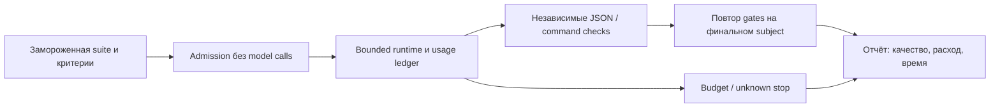

# Полигон /agent:eval

Полигон оценивает связку task + agent/skill/model + harness, а не абстрактную модель. Сначала [источники](sources.md), [методика](methodology.md), затем [контракт](contract.md) и [операции](operations.md). Обязателен общий [журнал решений](../../skills/decision-memory.md).

Вход: frozen suite с задачами plan/build/review/context, явными критериями, доверенными независимыми graders и условиями исполнения. Выход: точный subject, PASS/FAIL/INCONCLUSIVE/NOT_RUN по каждой задаче, все попытки, tokens/cache/cost/time, знаменатель и ограничения вывода. Самооценка модели не grader. JSON checks проверяют только заданные свойства: семантическое качество свободного плана требует отдельно согласованного review.

v1 использует существующий bounded runtime, один serial fail-fast run, max_attempts=1, без автоматической эскалации/повторов. Командные fixtures проверяют harness бесплатно; они не измеряют качество модели. AI execution требует явных ai_policy/usage_policy и разрешения запуска; неизвестный расход блокирует продолжение. State/receipts остаются вне Git. Ни training, ни deploy, ни публикация не следуют из eval.

