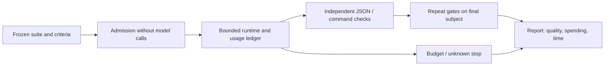

# /palarran:agent:eval evaluation harness

The harness evaluates task + agent/skill/model + harness, not an abstract model. Read [sources](sources.md), [methodology](methodology.md), then [contract](contract.md) and [operations](operations.md). The shared [decision journal](../../skills/decision-memory.md) is mandatory.

Input: a frozen suite of plan/build/review/context tasks with explicit criteria, trusted independent graders and execution conditions. Output: exact subject, per-task PASS/FAIL/INCONCLUSIVE/NOT_RUN, all attempts, tokens/cache/cost/time, denominator and conclusion limits. Model self-assessment is not a grader. JSON checks verify specified properties only: semantic quality of free-form plans needs separately agreed review.

v1 uses the existing bounded runtime, one serial fail-fast run, max_attempts=1, no automatic escalation/retries. Command fixtures test the harness for free; they do not measure model quality. AI execution requires explicit ai_policy/usage_policy and launch authorization; unknown spending blocks continuation. State/receipts stay outside Git. Eval implies no training, deploy or publication.

