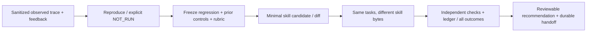

# /agent:improve — улучшения из реальных ошибок

Вход: неудачный run/approved trace, замечание пользователя, expected outcome и exact skill/harness revision. Выход: воспроизводимый regression case, узкий candidate diff, повтор прежних задач и отчёт качества/tokens/cost/time с ограничениями. Сначала [sources](sources.md), [methodology](methodology.md), [contract](contract.md), [operations](operations.md), [ML case](ml-learning-goal.md) и [decision memory](../../skills/decision-memory.md).

Skill выполняет разрешённое исследование/локальные reproduction/tests и scoped изменения. Флаг --plan оставляет только planning artifacts. Runtime v001: `python3 -m orchestrator.agent_improve prepare/compare` генерирует private paired suites и проверяет existing `agent_eval` reports, не dispatch/auto-apply/merge/deploy. Paid calls/training не подразумеваются. Model quality и экономия неизвестны без настоящих сопоставимых model trials; fixture результат — проверка самого механизма.
