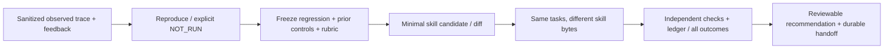

# /palarran:agent:improve — improvements from real failures

Input: failed run/approved trace, user feedback, expected outcome and exact skill/harness revision. Output: reproducible regression case, narrow candidate diff, rerun of prior tasks and quality/tokens/cost/time report with limitations. First read [sources](sources.md), [methodology](methodology.md), [contract](contract.md), [operations](operations.md), [ML case](ml-learning-goal.md) and [decision memory](../../skills/decision-memory.md).

The skill performs authorized research/local reproduction/tests and scoped changes. --plan permits planning artifacts only. Runtime v001: `python3 -m orchestrator.agent_improve prepare/compare` generates private paired suites and checks existing `agent_eval` reports; no dispatch/auto-apply/merge/deploy. Paid calls/training are not implied. Model quality/savings remain unknown without actual comparable model trials; fixture results test the mechanism itself.
