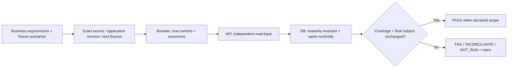

# Independent application acceptance

`/palarran:app:verify {target/scenarios} [--plan]` links business requirement → user actions → browser/API/DB observations → verdict. First read [sources](sources.md), [methodology](methodology.md), [contract](contract.md), [operations](operations.md), [evidence](evidence.md), target AGENTS/INDEX/accepted ADRs. Do not fix implementation during acceptance; return discovered defects to the builder with repro, then verify a new subject/revision and repeat affected/critical scenarios after fixes.

V1 CLI implements a trusted local HTTP app + optional existing Playwright Chromium + readonly SQLite. Other databases, remote/staging and native/mobile scenarios use separately authorized existing tools/manual protocols; they are not verified CLI adapters. No model/paid-judge calls, installs, deploy, production writes or automatic retries.

The app portable package includes CLI source, templates and Node bridge. Operators install browser dependencies separately; missing browser means NOT_RUN, not an HTTP substitute. Captured screenshots are not visual review. Fixture PASS establishes no scientific/operational SLA, security audit or production readiness.
