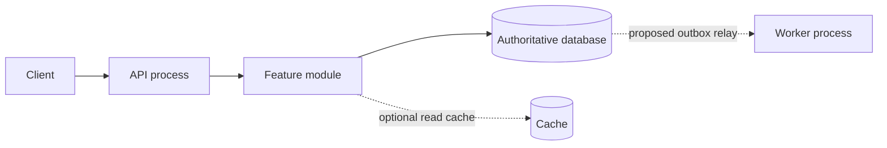

# Архитектура: выбирать по ограничениям, развивать по сигналам

Ни число пользователей, ни количество строк сами по себе не выбирают архитектуру. Сначала workload, доменные инварианты, команда, deploy cadence, failure/isolation requirements и эксплуатационный бюджет. Ниже — **наши decision criteria**, а не правила, которым следуют все упомянутые компании.

## Deployment и модульность — разные оси

| Подход | Когда рассматривать | Цена/ограничения | Сигнал следующего шага |
|---|---|---|---|
| Простой монолит с понятными слоями | Небольшая команда, меняющийся домен, один deploy/DB, ограниченный host | Нужно удерживать зависимости и тестируемость; общий release/failure domain | Измеренная связность мешает изменениям — выделить domain modules |
| Модульный монолит | Несколько business capabilities, общая транзакционная модель, независимые части кода | Один deploy остаётся; границы надо обеспечивать imports/interfaces/ownership tests | Конкретный module требует отдельного scale/deploy/isolation и владелец готов его поддерживать |
| Несколько deployables, например API + worker | Синхронные запросы и тяжёлые jobs имеют разные CPU/latency/retry потребности | Queue/worker supervision и idempotency; это ещё не обязательно микросервисы | Разные bounded contexts и independent ownership |
| Микросервисы по доменам | Доказанная независимость release/scale/security, команды-владельцы, observability и operations | Network failures, versioned contracts, cross-service consistency, delivery overhead | Новая boundary должна устранять конкретный bottleneck, не умножать synchronous chatter |
| Serverless/managed backend | Burst/event workloads, подходящий provider/runtime и operational модель | Limits/cold-start/cost/lock-in, внешние state boundaries | Проверить tail latency, workload и exit cost |

**Многомодульность** — организация кода/сборки, не синоним microservices. В одном deploy можно иметь modules с публичными interfaces; monorepo может содержать много deployables, polyrepo — один тесно связанный процесс. Package/module boundaries выбирать по business ownership/data invariants, не создавать отдельный service для каждой таблицы.

В [Shopify](https://shopify.engineering/deconstructing-monolith-designing-software-maximizes-developer-productivity) описан путь структурирования крупного монолита вокруг компонентов. Полезный вывод для нас: domain boundaries можно улучшать без немедленного сетевого разделения. [Uber DOMA](https://www.uber.com/blog/microservice-architecture/) отвечает на сложность уже крупной service architecture через доменную организацию. Это не доказательство необходимости Uber-scale topology для нового VPS. [Monolith First](https://martinfowler.com/bliki/MonolithFirst.html) — позиция Martin Fowler, не отчёт конкретного бигтеха и не абсолютный запрет на services с первого дня.

## Внутри выбранной формы

- Layered/transaction script — компактный CRUD с простыми rules. Не создавать domain framework ради одного endpoint.
- Ports/adapters — несколько внешних integrations или необходимость изолировать policy от transport/storage. Число interfaces определяется реальной boundary, не папками шаблона.
- Rich domain model — сложные состояния/инварианты и язык предметной области; описать aggregate/transaction boundary, не механически всё переводить в DDD.
- Async/event-driven — долгие jobs, fan-out, independent consumers, tolerated lag. Явно описать ordering, delivery, dedup/replay/backpressure. Queue не исправляет неверный transaction design.
- CQRS/read projections — измеренная разница write/read models или дорогие views. Для простой выдачи не нужны отдельные stores.
- Event sourcing — нужен authoritative event history/replay с понятной evolution и retention; не путать с audit log/outbox. Цена reconstruction/privacy/schema evolution должна быть оправдана.

Для каждой применимой альтернативы записать constraint fit, ожидаемую пользу, operational cost, rejected alternatives и **измеримый trigger пересмотра**. Небольшой single-host проект не получает Kafka/mesh/multi-region просто из-за фичи. Высокая критичность на малом host может потребовать изменения инфраструктуры: отметить gap, а не обещать HA внутри одной машины.

## Схемы плана

Сделать deployment/data ownership diagram и sequence для основного и сбойного сценария; ER/state diagram при соответствующей фиче. Обозначить sync/async, transaction boundary, source of truth и failure domains. Только существующие/предлагаемые нужные компоненты; следующий пример показывает обозначения, не универсальную архитектуру:

В конкретном плане отсутствие cache/worker обозначить решением, а не добавлять их ради схемы.
