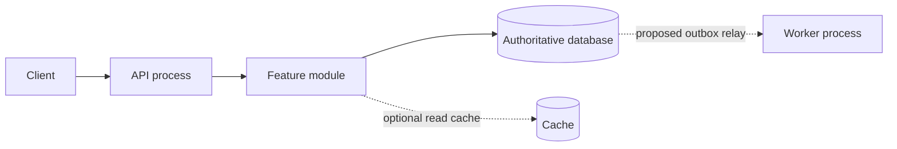

# Architecture: choose by constraints, evolve by signals

Neither user count nor line count alone chooses architecture. Start with workload, domain invariants, team, deployment cadence, failure/isolation requirements and operational budget. These are **our decision criteria**, not rules followed by every named company.

## Deployment and modularity are separate axes

| Approach | When to consider | Cost/constraints | Next-step signal |
|---|---|---|---|
| Simple monolith with clear layers | Small team, changing domain, one deployment/DB, limited host | Maintain dependencies/testability; shared release/failure domain | Measured coupling obstructs changes: introduce domain modules |
| Modular monolith | Several business capabilities, shared transactional model, independent code areas | Still one deployment; enforce boundaries through imports/interfaces/ownership tests | A specific module needs separate scaling/deployment/isolation and its owner can operate it |
| Multiple deployables, such as API + worker | Synchronous requests and heavy jobs have different CPU/latency/retry needs | Queue/worker supervision and idempotency; not necessarily microservices yet | Distinct bounded contexts and independent ownership |
| Domain microservices | Demonstrated release/scale/security independence, owning teams, observability and operations | Network failures, versioned contracts, cross-service consistency, delivery overhead | New boundaries must remove specific bottlenecks, not multiply synchronous chatter |
| Serverless/managed backend | Bursty/event workloads with suitable provider/runtime and operational model | Limits/cold starts/cost/lock-in, external state boundaries | Check tail latency, workload and exit costs |

**Multiple modules** organize code/builds; they are not synonymous with microservices. One deployment can contain modules with public interfaces; monorepos can contain many deployables and polyrepos one tightly coupled process. Select package/module boundaries by business ownership/data invariants, never one service per table.

[Shopify](https://shopify.engineering/deconstructing-monolith-designing-software-maximizes-developer-productivity) describes organizing a large monolith around components. Our takeaway: domain boundaries can improve without immediate network separation. [Uber DOMA](https://www.uber.com/blog/microservice-architecture/) addresses an already large service architecture's complexity through domain organization, not proof that new VPS projects need Uber-scale topology. [Monolith First](https://martinfowler.com/bliki/MonolithFirst.html) is Martin Fowler's position, not a specific big-tech report or an absolute ban on services from day one.

## Inside the chosen shape

- Layered/transaction script: compact CRUD with simple rules. Do not build domain frameworks for one endpoint.
- Ports/adapters: multiple external integrations or separating policy from transport/storage. Actual boundaries, not template folders, determine interface count.
- Rich domain model: complex states/invariants and domain language; describe aggregate/transaction boundaries rather than mechanically applying DDD everywhere.
- Async/event-driven: long jobs, fan-out, independent consumers, tolerated lag. Specify ordering, delivery, dedup/replay/backpressure. Queues do not fix bad transaction design.
- CQRS/read projections: measured write/read-model differences or expensive views. Simple reads do not need separate stores.
- Event sourcing: authoritative event history/replay with understood evolution/retention; distinguish audit logs/outboxes. Justify reconstruction/privacy/schema-evolution costs.

For each applicable alternative record constraint fit, expected benefits, operational cost, rejected alternatives and **measurable reconsideration triggers**. A feature alone does not justify Kafka/mesh/multi-region in small single-host projects. Critical workloads on small hosts may need infrastructure changes: record gaps rather than promising single-machine HA.

## Plan diagrams

Create deployment/data-ownership diagrams and main/failure scenario sequences; add ER/state diagrams when applicable. Mark sync/async, transaction boundaries, source of truth and failure domains. Include only needed existing/proposed components; the example illustrates notation, not universal architecture:

In concrete plans record cache/worker absence as a decision instead of adding them for diagram completeness.
