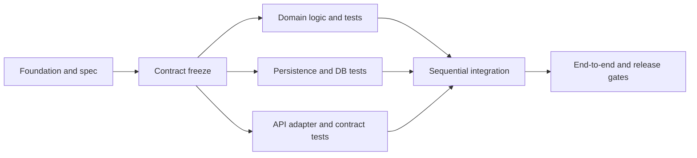

# SDD, DoD и future worktree parallelism

[GitHub Spec Kit](https://github.com/github/spec-kit) описывает Spec-Driven Development как требования → спецификация → технический план → actionable tasks → реализация. Мы используем принцип **spec до кода**; установка toolkit и его команды не обязательны. Existing `specs/`, `.specify/` или другой project convention сохраняется, canonical ADR остаются в `.ai-development/`. Этот skill заканчивается на плановых artifacts, не выполняет implement/merge/converge.

## Traceability и gates

Stable IDs: `R-*` requirement, `AC-*` acceptance, `INV-*` invariant, `C-*` contract, `T-*` test, `TASK-*` agent task. Матрица связывает их с design/ADR, code touch sets (план), rollout checks и DoD. Это наша удобная нотация, не стандарт GitHub. Изменение spec требует impact map и версии, не молчаливое исправление contract в одной lane.

- **Foundation ready**: stack/architecture/data/contracts/infra fit определены или явно reused; критичные unknowns разрешены.
- **Plan ready**: feature scope/AC/invariants, architecture/data/cache/performance/reliability, tests/rollout/recovery, task DAG и ownership достаточно конкретны для следующего агента. Blocking spec decisions → draft/conditional; не выдавать за готовое исполнение.
- **Future task DoD**: in-scope implementation, linked AC/tests, actual check outcomes, contract/migration compatibility, safe evidence и review; коммит/артефакт в своём branch, без посторонних изменений.
- **Future feature DoD**: integrated code на integration baseline, все critical AC/invariants/edges, contract/data/concurrency/load/recovery gates и agreed SLA/SLO проверены в нужном environment; rollout readiness/runbook. Непроверенные SLA/performance не становятся PASS из-за completed tasks.

## DAG вместо «пять агентов пишут всё»

Сначала contract/schema owner фиксирует общий baseline. После него независимы, например, domain logic, persistence adapter и API adapter tests в разных touch sets. Task, которому нужен ещё не готовый interface, ждёт contract freeze либо работает только в согласованном stub scope; tests на stub не доказывают real integration.

Это пример, не обязательные три lanes для любого проекта. Указать critical path, max concurrent agents по CPU/RAM/DB/CI budget, ожидаемые независимые работы и serial conflicts. Для маленькой фичи допустим max=1 с причиной и явно названными отсутствующими независимыми lanes; иначе overhead worktrees съест ускорение. Не обещать кратный speedup без evidence.

## Worktree plan (не исполнять)

[Git worktree](https://git-scm.com/docs/git-worktree) даёт отдельные working trees/index/HEAD с общей частью Git repository. Это изоляция source checkout, **не** secrets, OS processes, ports, databases, caches, remote refs или cloud state. Поэтому для каждой future lane задать:

- Base commit SHA и integration branch policy; dirty/untracked parent changes не попадают автоматически в новый worktree. Указать какие source artifacts должны быть зафиксированы до старта, не коммитить чужую работу за пользователя.
- Уникальные branch и worktree path, allowed/forbidden files/modules; schema migration numbers, API schema/codegen, lockfile и shared configs имеют одного owner/serial task.
- Isolated DB/schema/test tenant, queue/cache namespace, ports/temp/output directories, sandbox credentials references без значений; total connection/worker budget. Не разделять destructive tests одной DB.
- Input spec/contract revision, dependencies, task outputs и exact future checks/DoD; safe evidence и handoff для integrator. Agent prompt не просит самовольно менять source contract.
- Integration order, baseline updates и conflict resolution owner; после merge/cherry-pick (по project policy) rerun affected suite + integrated end-to-end. Индексы/ADR также merge ownership, чтобы агенты не затирали контекст.
- Cleanup только после сохранения/интеграции результатов и проверки dirty/untracked. План не содержит автоматического `remove --force`, удаления чужих branches или credentials.

В плане можно привести будущую последовательность `git worktree add -b <task-branch> <isolated-path> <frozen-base-sha>` с заполняемыми значениями; **не выполнять** её сейчас. Worktree checkout не заменяет dependency order. Задачи выдаются пакетами по [шаблону](../../../templates/backend/agent-task.md); implementation agents в `/backend:plan` не запускаются.
