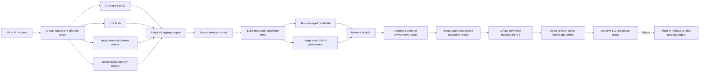
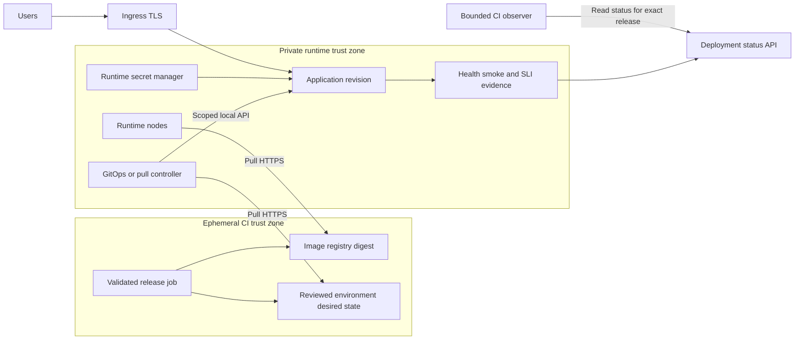

# SSH-free CI/CD architecture

## Shared DAG

PR/MR and release candidates have different trust levels. Green source-branch checks do not prove merge-result testing. For a protected release commit, rerun required checks or reuse evidence only after proving identical inputs/trust context. PR images may be built early for feedback without automatically becoming publishable trusted releases.

Release-image builds may run alongside tests for latency when resources/budget allow; eligibility and promotion still wait for gates. Build once means one candidate for specific source+toolchain+build inputs, not a ban on separate test builds. Production-package tests need not include development tools in production images: an external harness can target the running candidate.

Automated versioned builds, dependency resolution, tests and release metadata draw on [Google release engineering](https://sre.google/sre-book/release-engineering/). OCI, manifest format and trust-zone separation are our choices.

## Three backend options

| Target | Automation | CI permissions | Prerequisites |
|---|---|---|---|
| Kubernetes/K3s | Argo CD or Flux reads desired state and applies within the cluster boundary | Narrow identity updating GitOps path/release record; no cluster-admin | Installed controller, scoped RBAC, registry pull, secret delivery, ingress/storage |
| Managed containers/serverless/PaaS | Provider deployment API starts an artifact revision | OIDC/federation for a specific project/service/environment; scoped token without OIDC | Service/IAM, private registry integration, health/rollback API |
| Separate VM/Compose | Pull-controller fetches a signed authorized release manifest and applies a fixed local workflow | Release publication only to an authorized repository/channel | Agent/system service already installed, trust roots, registry access, local secret provider, audit and rollback |

Exclude SSH, Docker remote sockets over SSH/TCP without a strict API model and “connect once from the pipeline to install an agent.” A cloud remote-command API exposing arbitrary root shell is not a narrow deployment controller: it is a separate powerful privilege, not the default. Do not put general-purpose GitHub/GitLab runners on production VMs for convenience.

The single-host pull-controller is a **future integration contract, not a daemon implemented here**. Without a suitable existing solution, retain an explicit blocker or choose managed deployment. The agent accepts only signed schema-validated manifests from trusted publishers; it executes authorized operations/paths, not `script:` from application repositories or arbitrary hooks. Docker sockets effectively grant extensive privileges: isolate this trusted component from application and CI. Include poll interval, registry/Git failures and offline rollback in RTO.

## GitOps and traffic separation

Registry and GitOps HTTPS are management egress; application public ingress is separate. CI neither opens management ingress on VMs nor scans hosts. A private observer uses a separate trusted management runner pool or authenticated status callback/API. Callbacks validate identity, release/environment and replay protection.

[GitLab GitOps](https://docs.gitlab.com/user/clusters/agent/gitops/) describes Flux pull; a GitLab agent's presence does not automatically configure GitOps. Choose Flux/Argo based on the existing platform.

## Successful deployment

Sequence: verify eligibility → lock environment → compare expected previous release → update desired state/API → wait for the exact required commit/digest/revision → readiness/availability → safe external smoke → metric-evaluation window → deployment record. With insufficient traffic, canary is INCONCLUSIVE: extend the window, use synthetic load or another agreed gate instead of PASS.

GitOps rollback changes desired state to the previous authorized digest; a direct live rollback without Git changes will be reversed by the reconciling controller. For [Argo auto-sync](https://argo-cd.readthedocs.io/en/stable/user-guide/auto_sync/), account for sync/self-heal modes and rollback restrictions; do not promise `argocd rollback` with automation enabled. Application fails on timeout, digest mismatch or failed smoke; merge/push alone do not establish green deployment.
