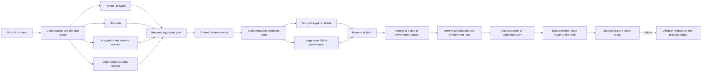
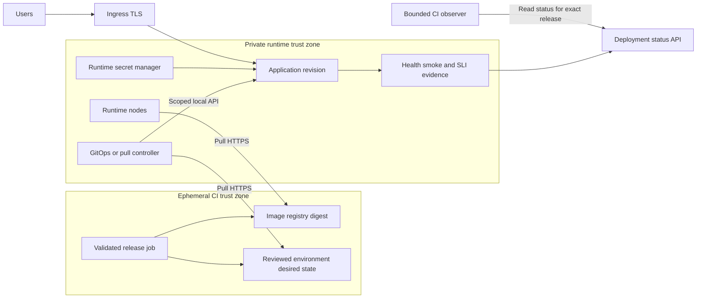

# Архитектура CI/CD без SSH

## Общий DAG

PR/MR и release candidate — разные trust levels. Green проверки исходной ветки не доказывают тестирование merge result. Для protected release commit обязательные проверки выполняются повторно или evidence переиспользуется только при доказанном совпадении всех входов/контекста доверия. Образы PR можно собирать заранее для feedback, но они не становятся автоматически publishable trusted release.

Release image можно собирать параллельно тестам ради latency при ресурсе/бюджете; eligibility и promotion всё равно ждут gates. Build once означает один кандидат на конкретные source+toolchain+build inputs, не запрет отдельных test builds. Tests production-пакета не требуют включения dev tools в production image: возможен внешний harness против запущенного кандидата.

Сборка, dependency resolution, тесты и release metadata автоматизированы и версионированы по мотивам [Google release engineering](https://sre.google/sre-book/release-engineering/). OCI, формат manifest и разделение trust zones — наш выбор.

## Три backend варианта

| Target | Автоматизация | Какие права получает CI | Prerequisites |
|---|---|---|---|
| Kubernetes/K3s | Argo CD или Flux читает desired state и применяет его внутри cluster boundary | Узкая identity обновления GitOps path/release record; не cluster-admin | Установленный controller, scoped RBAC, registry pull, secret delivery, ingress/storage |
| Managed containers/serverless/PaaS | Provider deploy API запускает revision из artifact | OIDC/federation для конкретного project/service/env; scoped token, если OIDC нет | Service/IAM, private registry integration, health/rollback API |
| Отдельная VM/Compose | Pull-controller забирает подписанный разрешённый release manifest и применяет локальный fixed workflow | Только публикация release в разрешённый repository/channel | Agent/system service уже установлен, trust roots, registry access, локальный secret provider, audit и rollback |

SSH, Docker remote socket over SSH/TCP без строгой API-модели и «зайти один раз из pipeline поставить agent» исключены. Облачный remote-command API с произвольным root shell не выдавать за узкий deploy-controller: это отдельный сильный privilege, не default. Не ставить универсальный GitHub/GitLab runner на production VM ради удобства.

Pull-controller single-host — **контракт будущей интеграции, не разработанный здесь демон**. Если подходящего готового решения нет, явно оставить blocker или выбрать managed deployment backend. Agent принимает только подписанный schema-validated manifest из trusted publisher; выполняет разрешённые операции/пути, не `script:` из app repo; не исполняет произвольные hooks. Docker socket фактически даёт высокие права: доверенный компонент отделён от app и CI. Poll interval, отказы registry/Git и offline rollback учитываются в RTO.

## GitOps и разделение traffic

Registry и GitOps HTTPS — management egress, public ingress приложения отдельный. CI не открывает management ingress на VM и не сканирует host. Private observer размещается в отдельном доверенном management runner pool либо получает статус через authenticated callback/API. Callback проверяет identity, release/env и replay protection.

[GitLab GitOps](https://docs.gitlab.com/user/clusters/agent/gitops/) описывает pull-модель с Flux; наличие GitLab agent не означает автоматически настроенный GitOps. Выбор Flux/Argo зависит от уже имеющейся платформы.

## Что означает успешный deploy

Порядок: проверить eligibility → lock environment → compare expected previous release → обновить desired state/API → дождаться именно нужного commit/digest/revision → readiness/availability → безопасный внешний smoke → окно оценки метрик → deployment record. При недостаточном трафике canary даёт INCONCLUSIVE: продлить окно, synthetic load либо иной согласованный gate, а не PASS.

При GitOps rollback меняется desired state на предыдущий разрешённый digest; прямой live rollback без изменения Git будет отменён reconciling controller. Для [Argo auto-sync](https://argo-cd.readthedocs.io/en/stable/user-guide/auto_sync/) учитывать режимы sync/self-heal и ограничения rollback; не обещать `argocd rollback` при включённой автоматизации. Применение неуспешно при timeout, несовпадении digest или отказе smoke; merge/push сами по себе не дают зелёный deployment.
