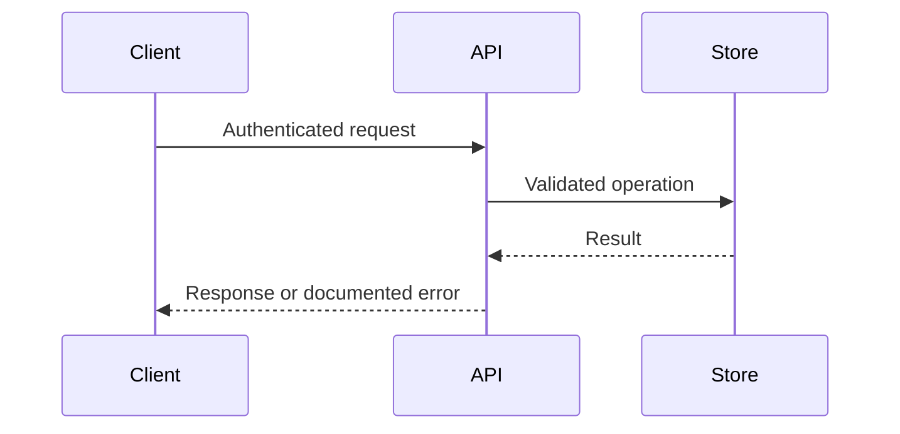

# API documentation

Inspect actual routes, schemas, authorization and contract tests. Prefer the existing machine-readable OpenAPI document or Postman collection; do not invent undocumented endpoints or replace the established specification format without a reason. Pin the API schema version supported by the project's tooling rather than automatically upgrading to the newest OpenAPI release.

Document base paths/environment placeholders, authentication/scopes, required/optional fields and defaults, responses/errors, pagination, idempotency, limits and representative sanitized requests/responses. Identify new env names and test prerequisites. Include a short request sequence diagram. Verify examples against existing contract/schema checks where execution is authorized; otherwise mark them unexecuted.

For OpenAPI/Swagger, maintain the canonical spec and link the existing UI/render path. For Postman, use variables and placeholder values; keep tokens and private populated environments out of Git. Do not create a cloud workspace or publish a collection implicitly. Machine-readable syntax validation and actual endpoint behavior are different checks.

Sources checked2026-10-24: [OpenAPI specification](https://spec.openapis.org/oas/latest.html) and [Mermaid syntax](https://mermaid.js.org/intro/syntax-reference.html), both rolling references. Use the target's pinned compatible version; these links do not prove its current conformance.
