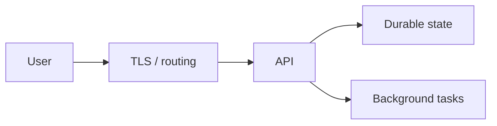

# Architecture documentation

Answer: what the system does, where requests/data go, what owns state, and how failures are handled. Inspect actual modules, entry points, deployment manifests and contracts. Use a fresh bounded code graph to locate relevant sources, then read originals; do not label inferred edges as observed runtime behavior.

Keep a concise overview, component/responsibility table, request/data paths, storage ownership and consistency, ingress/egress/auth boundaries, deployment shape, key limits and recovery dependencies. Link APIs, operational runbooks and stable ADR IDs. Label proposed topology and unverified production assumptions. Explain why an architectural choice matters using saved rationale rather than reconstructing intent.

Use a simple component flow and a sequence diagram only when it clarifies a concrete request. Avoid giant graphs with dozens of nodes. Example structure below is illustrative, not target evidence:

Bind the document to an inspected source revision and list missing evidence. Review links, names, network arrows and failure behavior against source before handoff. Canonical documentation belongs in the project's ordinary docs tree; private drafting history stays in .palarran.
