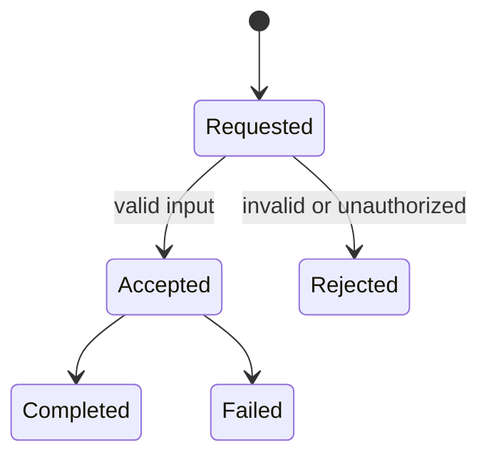

# Feature documentation

Bind a feature document to its stable code, plan/spec revision and current implementation. Explain the user problem, supported flow, inputs/outputs, permissions, state transitions and important edge cases. Include concrete examples and limits. Separate proposed behavior, implemented behavior and independently verified behavior; link actual checks and remaining work.

Reuse architecture/API pages instead of copying their full content. Link applicable ADR IDs and operational setup such as env names, migrations, feature flags or rollout/rollback needs, without secrets. Keep acceptance criteria and test prerequisites easy to find. Update this page when behavior changes, not merely when a task closes.

Replace this illustrative state machine with the feature's actual states. Do not invent async stages or claim failure recovery from a diagram alone. Follow the project's documentation language preference and [storage/retrieval](memory.md) rules.
