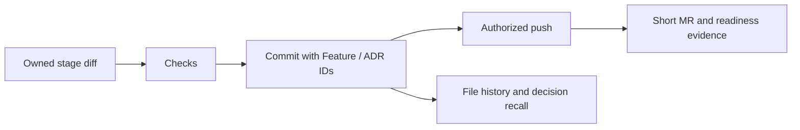

# Git package design

Design-stage package for `/palarran:git:commit`, `git:history @file`, `git:conflicts {target-branch}` and `git:mr`. Follow [feature lifecycle](../skills/feature-lifecycle.md), [decision memory](../skills/decision-memory.md), target AGENTS and actual project conventions. This design does not itself create commits, push, merge or open an MR.

## Commit

Inspect staged/unstaged changes and ownership. After each coherent implementation stage, run its required checks and commit only owned files/hunks. Use a concrete imperative subject, usually within72 characters, and a short body explaining the problem, resulting behavior and relevant validation. Prefer the repository convention; Conventional Commits is optional unless required there. Avoid invented impact, generic “improve everything” wording, raw logs or decorative boilerplate. Include Feature and ADR trailers for traceability. Never sweep unrelated changes into a stage commit or silently bypass hooks/signing.

## File history

Resolve @file inside the target, then use bounded `git log --follow -- path`, relevant diffs and, where useful, blame. Report author/committer, commit/date, actual changes and stated rationale. Blame identifies a line's last recorded change, not its complete causal history or ownership. Follow Feature/ADR trailers to local private decisions and bounded long-term findings. If rationale is absent, say unknown; do not infer intent from a patch alone. Graphify helps locate current dependencies, not replace Git history.

## Conflicts

Fetch the explicit target branch and record exact source/target SHAs. Preserve unrelated work; resolve in the owned feature branch or isolated worktree. Follow project merge/rebase policy; do not rewrite shared history or force-push without actual authorization. Read both changes, associated contracts and ADRs. Resolve semantic behavior, regenerate derived files through the trusted project toolchain when authorized, and run affected regression/integration checks. Preserve both requirements where compatible; escalate actual business ambiguity. No unresolved markers or index entries. Conflict resolution is not authorization to merge the MR.

## MR or PR

After an authorized push, inspect the actual diff against the intended target SHA. Write a concise title and problem/result description, with three mandatory fields:

- **Environment:** new/changed env names, required/default/secret scope, rollout actions; state none explicitly. Never values.
- **Testing:** prerequisites, exact scenarios reviewers need to test, observed checks and NOT_RUN gaps.
- **Production readiness:** ready/conditional/not ready, with migrations, rollout/rollback, blockers and missing production evidence. Green local tests alone do not establish readiness.

Add Feature/ADR IDs without exposing private journal content. Do not claim the MR exists until the platform returns its URL; attach every created PR to the task. Publishing, reviewer messages and merging follow actual user authorization. Use the platform template when it adds required fields.

## Sources

Official guides checked2026-10-24: [Git contribution guide](https://git-scm.com/book/en/v2/Distributed-Git-Contributing-to-a-Project), [GitHub conflict resolution](https://docs.github.com/en/pull-requests/how-tos/merge-and-close-pull-requests/resolving-a-merge-conflict-using-the-command-line), [Git log](https://git-scm.com/docs/git-log), [Git trailers](https://git-scm.com/docs/git-interpret-trailers). Exact field/branch policies above are owner requirements, not universal vendor rules.

