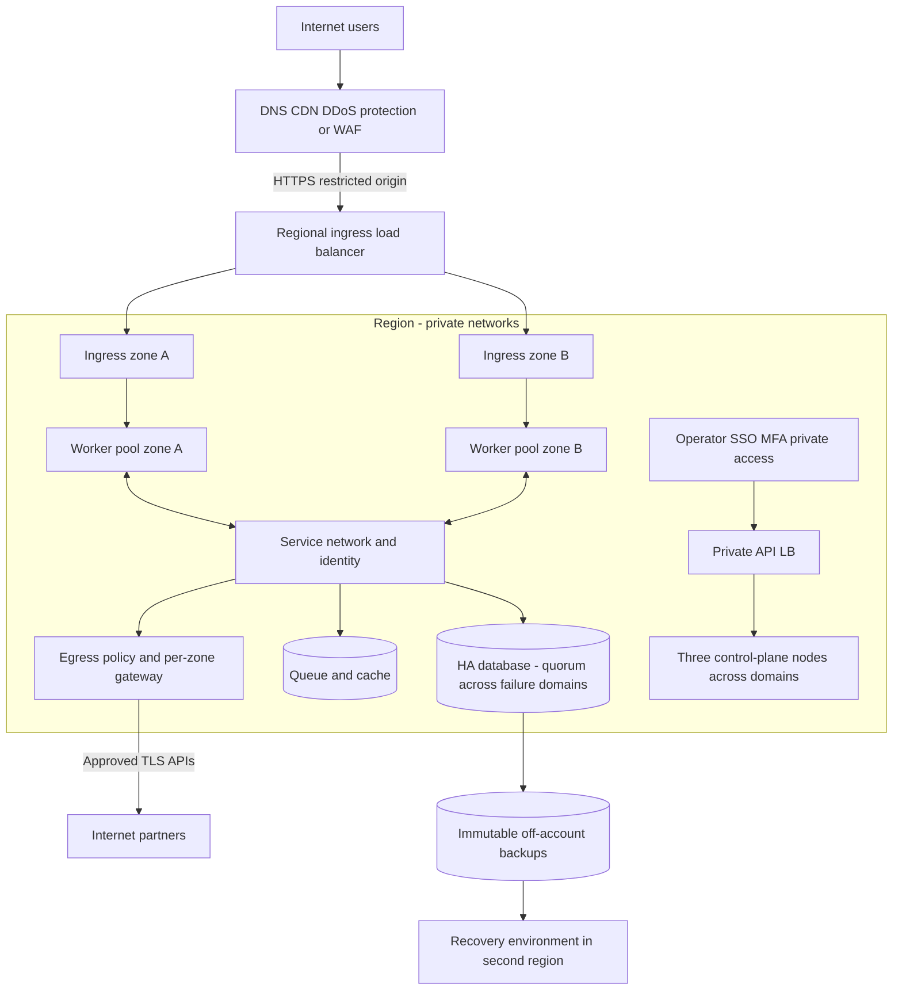
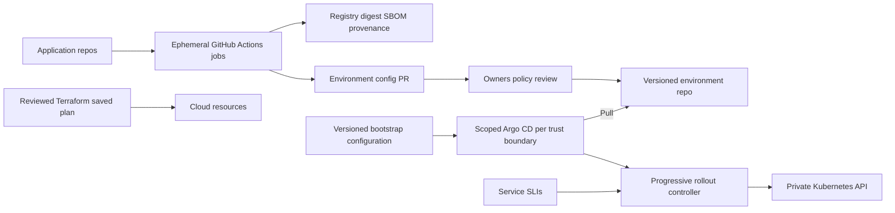

# High: большая инфраструктура

Размер определяется SLO, failure model, нагрузкой, изоляцией и командой эксплуатации. Одна очень мощная машина не даёт отказоустойчивую инфраструктуру. Если доступен только один target, описать его подготовку сейчас и отдельный целевой HA-план с недостающими узлами; не маскировать пробел.

## Базовая архитектура

Предпочесть managed Kubernetes, если регион/контроль/стоимость подходят: меньше собственного обслуживания control plane. Self-managed — минимум три control-plane/etcd узла в независимых отказных доменах, стабильный private API endpoint/LB, отдельные worker pools по workload, private subnets, управляемый ingress и исходящий путь. Для K3s учитывать [quorum](https://docs.k3s.io/datastore/ha-embedded); другие дистрибутивы требуют собственного validated design.

Схема концептуальная: для трёх зон показать фактическое размещение quorum, ingress и workers в каждом домене в конкретном плане. Приложения минимум в двух доменах, запас после потери крупнейшего домена. Control plane quorum не обеспечивает HA database или доступность NAT/LB автоматически.

## Capacity и availability

- Согласовать SLI (успешные запросы, latency, durability), измерение на пользовательской границе, SLO/error budget и freeze policy ([Google SLO](https://sre.google/workbook/implementing-slos/)). Значения вроде 99.9% — предложение для обсуждения, не следствие выбора Kubernetes.
- Модель capacity: рабочая пиковая нагрузка + deploy surge + резерв на потерю зоны; проверить scheduling, requests/limits, HPA signals, cluster autoscaler limits, quotas и время запуска новых nodes. Autoscaling не устраняет мгновенный дефицит capacity.
- Topology spread/anti-affinity, readiness/startup/liveness, graceful termination, PDB для voluntary disruption. PDB не предотвращает физическую потерю узла.
- Retry budget, deadlines, backpressure, очереди и load shedding важнее бесконечных retries. Провести нагрузочное тестирование с наблюдаемыми пределами до заявления о пропускной способности.

## Сеть, identities, blast radius

Раздельные prod/non-prod cloud projects/accounts и credentials, при необходимости отдельные clusters для сильной tenant изоляции. NetworkPolicy по namespaces и workload identity; service mTLS применять там, где threat model/требования оправдывают certificate lifecycle. [Meta](https://engineering.fb.com/2019/05/29/security/service-encryption/) показывает важность identity, rotation и поведения при сбоях; service mesh — наш возможный инструмент, не обязательное копирование их реализации.

Для public ingress: DDoS/CDN/WAF по угрозам, origin ACL/TLS, trusted proxy headers, rate/body/time limits и корректный client IP. Обход origin по прямому IPv4/IPv6 должен быть закрыт. East-west encryption/authorization, private API, RBAC/SSO/MFA, time-bound admin, audit logs и break-glass с журналом проверяются отдельно.

Egress: отдельные per-zone gateways/NAT или отказоустойчивые proxies, фиксированные IP там, где нужны партнёрам, flow logs/alerts. Учитывать SNAT ports, conntrack, DNS, зависимость от IdP, registry, secret manager и certificate issuer. IP-based L3/L4 allowlist не эквивалентен hostname/identity policy; FQDN routing и TLS policy проектировать явно. Management, nodes и pods имеют отдельные allowlists.

## Delivery и управление

IaC, platform GitOps и app GitOps разделены по правам/ownership, но имеют прослеживаемые commit/digest. Terraform state защищён IAM/encryption/locking; CI использует короткие credentials при поддержке провайдера. GitOps repo не хранит plaintext secrets. Argo projects не дают tenant приложениям создавать cluster-wide RBAC и управлять namespace Argo.

Релиз на subset, автоматическое прекращение при ухудшении SLIs и возможность отката опираются на [Google canary practice](https://sre.google/workbook/canarying-releases/); пороги/окна — наши настройки под сервис. Для bootstrap, CNI, CRD и storage upgrades нужны отдельные rollout/rollback runbooks; обычный app rollback их не заменяет.

## Data plane и DR

Managed DB/PITR как стартовая опция; self-hosted operators — при наличии экспертизы и ресурсов. Для каждой DB/очереди/cache/storage class зафиксировать consistency, quorum, fencing/failover, durable acknowledgements, cross-zone latency, replication lag, RWO/RWX, encryption/key recovery и backup scope. Репликация переносит логическое удаление — требуется отдельное backup retention.

Региональный HA и межрегиональный DR — разные решения. Начать с backup/restore или warm standby, если это покрывает цели; active-active требует разрешения конфликтов и подтверждённой модели данных. Измерить RTO от начала отказа до восстановленного сервиса с данными, DNS, secrets, identities и зависимостями. Копии в независимом account/регионе, immutable retention по возможностям storage, минимальные restore credentials. DR проводить на отдельном target без повреждения production.

## Приёмка и открытые решения

До deploy: threat model, стоимость/egress, on-call/владельцы, SLO/RPO/RTO, доступ к rescue и backup, capacity и rollback. После: loss-of-node/zone exercise в разрешённом окне, cert/secret rotation, отрицательные network/RBAC tests, canary abort, restore и measured RPO/RTO, alert delivery. Chaos testing начинать только после определения blast radius и abort conditions.

Обсудить managed/self-managed, zones/regions, cluster-per-team/shared, mesh/no mesh, DB operator/managed, distributed storage/external data, GitOps controller blast radius. Не добавлять Kafka/Ceph/Vault/service mesh только из-за слова «high»; альтернативы и условия пересмотра фиксировать в [ADR](decisions.md).
