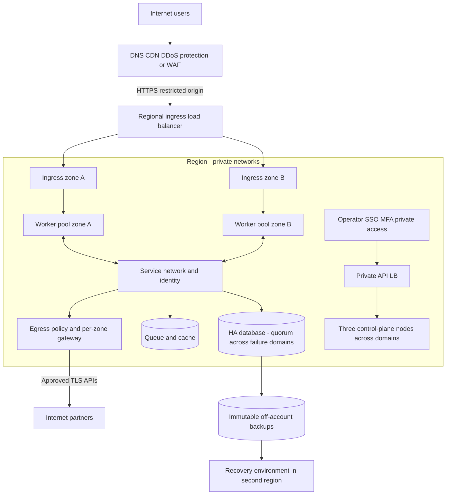
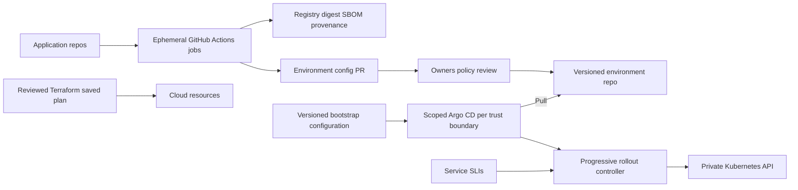

# High: large infrastructure

Size follows SLO, failure model, load, isolation and operations team. One very powerful host does not provide resilient infrastructure. If only one target is available, describe its preparation now and a separate target HA plan with missing nodes; do not disguise the gap.

## Baseline architecture

Prefer managed Kubernetes when region/control/cost fit: it reduces control-plane maintenance. Self-managed requires at least three control-plane/etcd nodes in independent failure domains, stable private API endpoint/LB, separate worker pools by workload, private subnets, managed ingress and outbound path. For K3s, account for [quorum](https://docs.k3s.io/datastore/ha-embedded); other distributions require their own validated designs.

This diagram is conceptual: for three zones, show actual quorum, ingress and worker placement in each domain in the concrete plan. Applications span at least two domains with spare capacity after losing the largest domain. Control-plane quorum does not automatically provide HA databases or NAT/LB availability.

## Capacity and availability

- Agree on SLIs (successful requests, latency, durability), measurement at the user boundary, SLO/error budget and freeze policy ([Google SLO](https://sre.google/workbook/implementing-slos/)). Values such as 99.9% are proposals for discussion, not consequences of choosing Kubernetes.
- Capacity model: operational peak load + deployment surge + zone-loss reserve; check scheduling, requests/limits, HPA signals, cluster-autoscaler limits, quotas and new-node startup time. Autoscaling does not remove instantaneous capacity shortages.
- Topology spread/anti-affinity, readiness/startup/liveness, graceful termination and PDB for voluntary disruption. PDB does not prevent physical node loss.
- Retry budgets, deadlines, backpressure, queues and load shedding matter more than infinite retries. Run load tests with observable limits before claiming throughput.

## Network, identities and blast radius

Separate prod/non-prod cloud projects/accounts and credentials; use separate clusters when strong tenant isolation requires it. NetworkPolicy by namespace and workload identity; use service mTLS where threat model/requirements justify certificate lifecycle management. [Meta](https://engineering.fb.com/2019/05/29/security/service-encryption/) demonstrates the importance of identity, rotation and failure behavior; service mesh is one possible tool we choose, not a requirement to copy their implementation.

Public ingress: DDoS/CDN/WAF according to threats, origin ACL/TLS, trusted proxy headers, rate/body/time limits and correct client IP. Block direct IPv4/IPv6 origin bypass. Verify east-west encryption/authorization, private API, RBAC/SSO/MFA, time-bound administration, audit logs and recorded break-glass separately.

Egress: separate per-zone gateways/NAT or resilient proxies, fixed IPs where partners require them, flow logs/alerts. Account for SNAT ports, conntrack, DNS and dependencies on IdP, registry, secret manager and certificate issuer. An IP-based L3/L4 allowlist is not hostname/identity policy; explicitly design FQDN routing and TLS policy. Management, nodes and pods have separate allowlists.

## Delivery and management

IaC, platform GitOps and application GitOps have separate permissions/ownership with traceable commits/digests. Protect Terraform state with IAM/encryption/locking; CI uses short-lived credentials where supported by the provider. GitOps repositories contain no plaintext secrets. Argo projects must not let tenant applications create cluster-wide RBAC or manage the Argo namespace.

Subset release, automatic termination on worsening SLIs and rollback capability build on [Google canary practice](https://sre.google/workbook/canarying-releases/); thresholds/windows are our service-specific settings. Bootstrap, CNI, CRD and storage upgrades need separate rollout/rollback runbooks; normal application rollback does not replace them.

## Data plane and DR

Managed DB/PITR is an initial option; self-hosted operators require expertise and resources. For every DB/queue/cache/storage class, record consistency, quorum, fencing/failover, durable acknowledgements, cross-zone latency, replication lag, RWO/RWX, encryption/key recovery and backup scope. Replication propagates logical deletion; separate backup retention is necessary.

Regional HA and cross-region DR are different decisions. Start with backup/restore or warm standby if they meet objectives; active-active requires conflict resolution and a confirmed data model. Measure RTO from failure onset to recovered service including data, DNS, secrets, identities and dependencies. Keep copies in an independent account/region, immutable retention as storage supports, and minimal restore credentials. Run DR on a separate target without damaging production.

## Acceptance and open decisions

Before deployment: threat model, cost/egress, on-call/owners, SLO/RPO/RTO, rescue/backup access, capacity and rollback. Afterward: node/zone-loss exercise within an authorized window, cert/secret rotation, negative network/RBAC tests, canary abort, restore/measured RPO/RTO and delivered alerts. Start chaos testing only after defining blast radius and abort conditions.

Discuss managed/self-managed, zones/regions, per-team/shared clusters, mesh/no mesh, DB operator/managed, distributed storage/external data and GitOps-controller blast radius. Do not add Kafka/Ceph/Vault/service mesh merely because the profile says “high”; record alternatives and reconsideration conditions in [ADRs](decisions.md).
