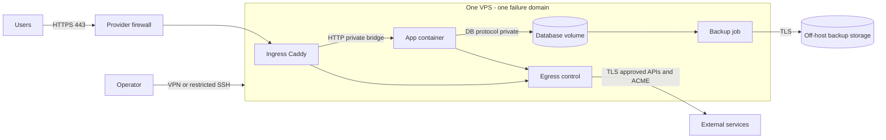
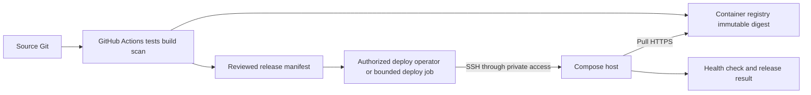

# Low: небольшой VPS

Прочитать вместе с [общими правилами](README.md) и [workflow](workflow.md). Начальный ориентир: 1–2 vCPU, 1–4 GiB RAM, SSD; реальная вместимость подтверждается измерением приложения. На 1 GiB не размещать вслепую DB, приложение и полный observability stack.

## Предпочтительная архитектура

Поддерживаемый Linux LTS + Docker Engine/Compose + Caddy (либо знакомый команде поддерживаемый proxy). Приложения и DB в разных сетевых сегментах Compose, наружу публикуются только proxy-порты. Kubernetes и Argo CD не обязательны. Это наша адаптация [Google simplicity](https://sre.google/sre-book/simplicity/) и поддерживаемого [single-server Compose](https://docs.docker.com/compose/how-tos/production/).

Bridge между proxy/app — отдельная trust boundary от DB сети; не добавлять DB к ingress network. Контейнеры на одном хосте не являются изоляцией от администратора/root хоста.

## Ресурсы и контейнеры

- Сначала бюджет RAM: OS/runtime + app peak + DB cache/connections + deploy headroom + backup compression. Сумма не должна рассчитываться по idle-потреблению; зафиксировать запас и пороги.
- Не собирать образы на production VPS. Фиксировать image digest, arch, resource limits, restart policy, healthcheck. Приложение: non-root, drop capabilities, no-new-privileges, read-only filesystem где совместимо, writable tmpfs/volume только по потребности.
- Docker daemon и docker group дают высокий доступ к хосту; socket не монтировать в app/proxy. Rootless — возможный вариант с отдельной проверкой портов, cgroups и ограничений ([Docker](https://docs.docker.com/engine/security/rootless/)).
- [Пример Compose/Caddy](../../../templates/infra/README.md) требует подставить образы и адаптировать приложение; секреты читать из защищённых файлов, Compose secrets сами по себе не vault.

## Сеть и безопасность

| Поток | Доступ | Контроль |
|---|---|---|
| Internet → proxy | TCP 443; TCP 80 только redirect/ACME при выбранном challenge | Provider firewall + host rules; IPv4 и IPv6 |
| Operator → SSH | TCP выбранный SSH port из VPN/admin CIDR | Verified key; rescue path |
| Proxy → app | Только app port по bridge | Нет public app/DB ports |
| App → DB | Только DB port и отдельный DB account | DB не публикуется на host |
| App → Internet | Только выбранные API через proxy/host forwarding controls | Явные destinations, DNS, TLS |
| Host → dependencies | DNS TCP/UDP 53 к resolver, NTP UDP 123 к time server, HTTPS 443 к repos/registry/backup | Отдельный host egress allowlist |

В default Docker bridge исходящие соединения обычно разрешены. `internal: true` изолирует backend сеть, но app с дополнительной outbound-сетью всё ещё может выходить в Интернет. В конкретном плане реализовать egress proxy с политикой либо backend-aware forwarding rules; пример Compose **не реализует строгий egress allowlist**. На старте допустима документированная временная host HTTPS-exception с owner/deadline, но не заявление о default-deny.

Не полагаться только на UFW для опубликованных контейнерных портов: [Docker описывает обход UFW](https://docs.docker.com/engine/network/packet-filtering-firewalls/). Для iptables backend учитывать `DOCKER-USER`; для nftables — правила выбранного backend, не смешивать инструкции. Снаружи проверить закрытые 5432/6379/8080 и IPv6, если включён. Не отключать управление правилами Docker без полноценной замены.

## Deploy, данные и операции

GitHub Actions: tests → build → scan → push digest → проверяемый release manifest. Deploy отдельным шагом через приватный доступ, с ограничением полномочий; обычному app CI не нужен root SSH. Публичный self-hosted runner на production не ставить. Для single replica Compose recreate обычно означает простой; blue/green только при достаточной RAM и совместимых миграциях.

DB на локальном volume допустима при принятом риске потери хоста. Для исходного плана предложить RPO 24 h / RTO 4 h как **обсуждаемые цели** для некритичного проекта; интервалы и restore замерить, не обещать по наличию cron. Для важных денег/данных рассмотреть PITR или managed DB уже на low. Snapshots не заменяют DB-consistent backup и off-host копию ([PostgreSQL](https://www.postgresql.org/docs/current/backup.html)).

Минимум эксплуатации: внешний uptime probe, alert на disk/inodes, OOM/restarts, TLS expiry, ошибки/latency, возраст и ошибки backup. Логи ротировать; агенты по ресурсу; внешняя проверка должна переживать отказ VPS. Runbooks: потеря хоста, переполнение диска, восстановление DB, откат image, обновление OS и сертификатов.

## Открытые кейсы и приёмка

План обязан обсудить: локальная/managed DB; Compose/rootless; deploy downtime или blue/green; строгий egress либо временное исключение; почему Kubernetes пока не окупается. Обоснования — [ADR-каталог](decisions.md), выбранные альтернативы и критерии пересмотра.

Готовность: новая SSH-сессия работает; наружу только утверждённые ports; app после restart поднимается; rollback на предыдущий digest проверен; backup восстановлен на отдельном target; alert доставлен; фактические downtime/RPO/RTO записаны. Потеря единственного хоста означает остановку сервиса — это явный SPOF, а не HA.
