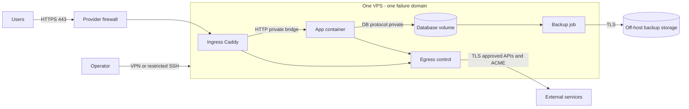
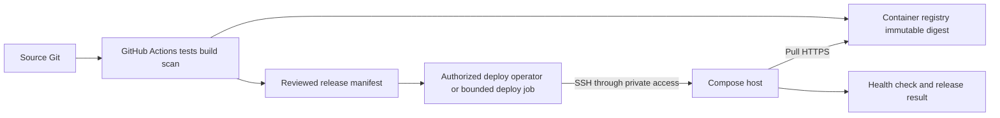

# Low: small VPS

Read alongside [shared rules](README.md) and [workflow](workflow.md). Starting guideline: 1–2 vCPU, 1–4 GiB RAM, SSD; actual capacity requires application measurements. Do not blindly place a DB, application and full observability stack on 1 GiB.

## Preferred architecture

Supported Linux LTS + Docker Engine/Compose + Caddy (or a supported proxy familiar to the team). Applications and DB use separate Compose network segments; expose only proxy ports externally. Kubernetes and Argo CD are optional. This is our adaptation of [Google simplicity](https://sre.google/sre-book/simplicity/) and supported [single-server Compose](https://docs.docker.com/compose/how-tos/production/).

The proxy/app bridge is a separate trust boundary from the DB network; do not add the DB to the ingress network. Containers on one host do not isolate workloads from that host's administrator/root.

## Resources and containers

- Budget RAM first: OS/runtime + application peak + DB cache/connections + deployment headroom + backup compression. Do not calculate the total from idle consumption; record headroom and thresholds.
- Do not build images on the production VPS. Pin image digest, architecture, resource limits, restart policy and healthcheck. Application: non-root, drop capabilities, no-new-privileges, read-only filesystem where compatible, writable tmpfs/volumes only as needed.
- Docker daemon and docker group grant extensive host access; do not mount the socket in applications/proxies. Rootless is an option requiring separate port, cgroup and limitation checks ([Docker](https://docs.docker.com/engine/security/rootless/)).
- The [Compose/Caddy example](../../../templates/infra/README.md) requires actual images and application adaptation; read secrets from protected files. Compose secrets alone are not a vault.

## Network and security

| Flow | Access | Control |
|---|---|---|
| Internet → proxy | TCP 443; TCP 80 only for redirect/ACME under the selected challenge | Provider firewall + host rules; IPv4 and IPv6 |
| Operator → SSH | TCP selected SSH port from VPN/admin CIDR | Verified key; rescue path |
| Proxy → application | Application port only over bridge | No public application/DB ports |
| Application → DB | DB port and separate DB account only | DB not published on host |
| Application → Internet | Selected APIs only through proxy/host forwarding controls | Explicit destinations, DNS, TLS |
| Host → dependencies | DNS TCP/UDP 53 to resolver, NTP UDP 123 to time server, HTTPS 443 to repos/registry/backup | Separate host egress allowlist |

Default Docker bridges usually allow outbound connections. `internal: true` isolates a backend network, but an application with an additional outbound network can still reach the Internet. Implement an egress proxy with policy or backend-aware forwarding rules in the concrete plan; the Compose example **does not implement a strict egress allowlist**. A documented temporary host HTTPS exception with owner/deadline is acceptable initially, but not a default-deny claim.

Do not rely solely on UFW for published container ports: [Docker documents the UFW bypass](https://docs.docker.com/engine/network/packet-filtering-firewalls/). For the iptables backend, account for `DOCKER-USER`; for nftables, use the selected backend's rules without mixing instructions. Externally check closed 5432/6379/8080 and IPv6 if enabled. Do not disable Docker rule management without a complete replacement.

## Deployment, data and operations

GitHub Actions: tests → build → scan → push digest → verifiable release manifest. Deployment is a separate step through private access with limited authority; normal application CI does not need root SSH. Do not install a public self-hosted runner on production. For a single replica, Compose recreate usually means downtime; blue/green requires sufficient RAM and compatible migrations.

A DB on a local volume is acceptable with acknowledged host-loss risk. For an initial noncritical-project plan, propose RPO 24 h / RTO 4 h as **objectives for discussion**; measure intervals and restore time rather than promising them because cron exists. For important financial/data workloads, consider PITR or managed DB even at low scale. Snapshots do not replace DB-consistent backups and an off-host copy ([PostgreSQL](https://www.postgresql.org/docs/current/backup.html)).

Minimum operations: external uptime probe; alerts for disk/inodes, OOM/restarts, TLS expiry, errors/latency, backup age/failures. Rotate logs; size agents to available resources; external checks must survive VPS failure. Runbooks: host loss, disk full, DB restore, image rollback, OS and certificate updates.

## Open cases and acceptance

The plan must discuss local/managed DB; Compose/rootless; deployment downtime versus blue/green; strict egress versus temporary exception; why Kubernetes does not yet justify its cost. Rationale uses the [ADR catalog](decisions.md), chosen alternatives and reconsideration criteria.

Readiness: a new SSH session works; only approved ports are public; the application starts after restart; rollback to previous digest tested; backup restored on a separate target; alert delivered; actual downtime/RPO/RTO recorded. Losing the only host stops service: this is an explicit SPOF, not HA.
