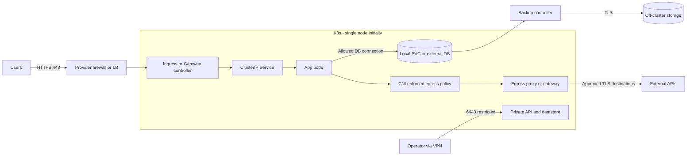
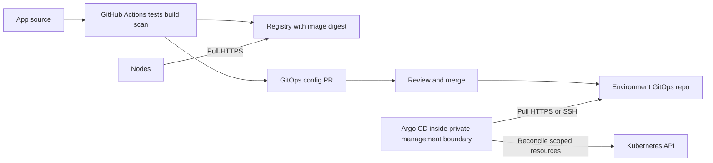

# Med: VDS и средняя инфраструктура

Ориентир 4–8 vCPU, 8–32 GiB RAM на стартовом узле — бюджет для планирования, не требование K3s. Считать отдельно ресурсы control plane, Argo CD, CNI, ingress, telemetry, workloads и data. Если Kubernetes API и много сервисов не нужны, обосновать Compose. [K3s requirements](https://docs.k3s.io/installation/requirements) дают технические минимумы; это не sizing приложения.

## Архитектура и граница HA

Предпочтительный вариант при потребности в Kubernetes — K3s + containerd + поддерживаемый ingress/Gateway controller + Argo CD. Начальный single-node может быть разумным, но node/диск/maintenance остаются SPOF. Для embedded etcd HA нужны как минимум три server-узла и нечётный quorum; два сервера не дают желаемой устойчивости ([K3s HA](https://docs.k3s.io/datastore/ha-embedded)). Три VM на одном физическом хосте не независимые отказные домены.

## Сеть и host

- API TCP 6443 только management/control/worker CIDR по назначению. Datastore, kubelet и overlay недоступны из Internet; перечень port/protocol строить по выбранному backend из [K3s requirements](https://docs.k3s.io/installation/requirements).
- Начальный CNI: Flannel + встроенный K3s network-policy controller, если достаточно L3/L4. Для FQDN egress/flow visibility рассмотреть Cilium и проверить совместимость kernel/K3s/MTU. При смене CNI корректно отключить конфликтующие компоненты по [K3s network options](https://docs.k3s.io/networking/basic-network-options); изменение CNI — отдельная миграция.
- Default-deny ingress **и egress** в app namespaces, потом разрешения для ingress controller → app, app → DB, DNS TCP/UDP к cluster resolver, telemetry, нужных API. Политики работают только с enforcement; проверить отрицательным тестом, а не наличием YAML ([Kubernetes NetworkPolicy](https://kubernetes.io/docs/concepts/services-networking/network-policies/)).
- NetworkPolicy не заменяет host firewall, mTLS и RBAC; node/hostNetwork traffic проверять отдельно. Core NetworkPolicy не задаёт FQDN allowlist. Внешний HTTPS требует egress proxy или CNI-специфичного механизма, иначе получится широкий IP allowlist.
- Согласовать pod/service/node CIDR с VPN и private network; проверить overlap, DNS, MTU, обратный маршрут и IPv6. LB/ServiceLB/NodePort/hostPort объяснить в flow matrix; не открывать весь NodePort range «на всякий случай».

## Контейнеры, безопасность, данные

App namespaces: Pod Security `restricted`, namespace RBAC, отдельные service accounts, token automount выключен если API не нужен, requests/limits, probes, read-only rootfs по совместимости. Platform controllers с повышенными правами — явные исключения. K3s не делает всю host hardening сам; включить secrets encryption, audit с ротацией и ограниченными правами по [K3s hardening](https://docs.k3s.io/security/hardening-guide).

Local-path PVC не переживает потерю узла с данными и обычно привязывает workload к storage-узлу. Нельзя обещать failover DB добавлением app replicas. Варианты: local DB + off-host consistent backup/PITR, отдельная DB машина либо managed DB. Реплицированное storage на одном узле не создаёт HA. Ресурсы оператора/дисков и quorum считать отдельно.

У single-server K3s со стандартным SQLite datastore применяется свой backup workflow; **не предписывать etcd snapshot** до проверки datastore. Для embedded etcd хранить snapshots и server token раздельно и безопасно: token нужен для восстановления ([K3s backup](https://docs.k3s.io/backup-restore)). Эти копии не включают данные всех PVC.

## Delivery plane

CI не хранит cluster-admin kubeconfig. Argo CD bootstrap выполняется отдельно после установки кластера/CNI; сначала CRD, затем platform namespaces/controllers, policies и secrets, далее приложения. Не допустить deadlock: default-deny без разрешений к Git/DNS/registry может остановить bootstrap. Argo UI/API — private access/SSO/RBAC; AppProject ограничивает repo/destination/kinds. Не оставлять широкий `default` project для tenant workloads ([Argo projects](https://argo-cd.readthedocs.io/en/stable/user-guide/projects/)).

Автосинхронизация — на согласованной ветке и после review; pruning stateful/platform ресурсов только после отдельной оценки риска. БД-миграции совместимые expand/contract; откат Git не отменяет удаление данных. Progressive delivery только с достаточной ёмкостью и метриками; само наличие Argo CD canary не делает.

## Приёмка и рост

Измерить резерв RAM/CPU/disk IO, окно обновления узла, восстановить datastore и DB отдельно на тестовом target, проверить запрещённые межсервисные и исходящие потоки, rollback и внешний alert. PDB на single-node не делает обслуживание беспростойным и может блокировать drain — описать maintenance procedure.

Открытые решения: single-node или три независимых узла; local/managed DB; Flannel/Cilium; ingress API/Gateway API; self-hosted/внешняя observability. Для каждой ветки указать [источник и ADR](decisions.md). Переход к high нужен по SLO/отказным сценариям, команде и бюджету, а не только по количеству контейнеров.
