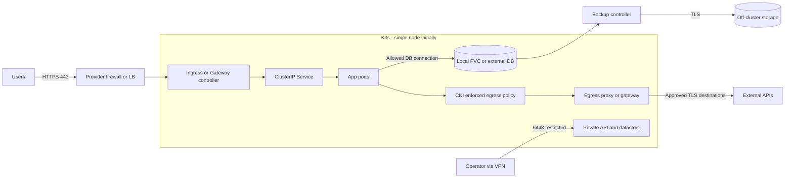
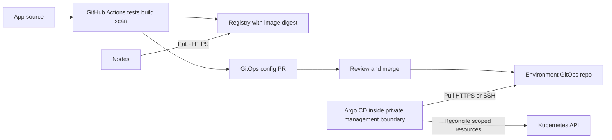

# Med: VDS and medium infrastructure

A guideline of 4–8 vCPU, 8–32 GiB RAM on the initial node is a planning budget, not a K3s requirement. Budget control plane, Argo CD, CNI, ingress, telemetry, workloads and data separately. If Kubernetes API and many services are unnecessary, justify Compose. [K3s requirements](https://docs.k3s.io/installation/requirements) give technical minimums, not application sizing.

## Architecture and HA boundary

When Kubernetes is needed, prefer K3s + containerd + supported ingress/Gateway controller + Argo CD. An initial single node may be sensible, but node/disk/maintenance remain SPOFs. Embedded etcd HA needs at least three server nodes and an odd quorum; two servers do not provide the intended resilience ([K3s HA](https://docs.k3s.io/datastore/ha-embedded)). Three VMs on one physical host are not independent failure domains.

## Network and host

- API TCP 6443 only for management/control/worker CIDRs as applicable. Datastore, kubelet and overlay remain inaccessible from the Internet; derive the port/protocol list for the chosen backend from [K3s requirements](https://docs.k3s.io/installation/requirements).
- Initial CNI: Flannel + K3s's built-in network-policy controller if L3/L4 is sufficient. For FQDN egress/flow visibility, consider Cilium and verify kernel/K3s/MTU compatibility. When changing CNI, disable conflicting components correctly under [K3s network options](https://docs.k3s.io/networking/basic-network-options); CNI changes are a separate migration.
- Default-deny ingress **and egress** in application namespaces, then allow ingress controller → application, application → DB, DNS TCP/UDP to cluster resolver, telemetry and required APIs. Policies work only with enforcement; verify through negative tests, not YAML presence ([Kubernetes NetworkPolicy](https://kubernetes.io/docs/concepts/services-networking/network-policies/)).
- NetworkPolicy does not replace host firewall, mTLS and RBAC; check node/hostNetwork traffic separately. Core NetworkPolicy does not define FQDN allowlists. External HTTPS needs an egress proxy or CNI-specific mechanism; otherwise the IP allowlist becomes broad.
- Align pod/service/node CIDRs with VPN/private network; check overlap, DNS, MTU, return route and IPv6. Explain LB/ServiceLB/NodePort/hostPort in the flow matrix; do not open the entire NodePort range “just in case.”

## Containers, security and data

Application namespaces: Pod Security `restricted`, namespace RBAC, separate service accounts, token automount disabled if API is unnecessary, requests/limits, probes, read-only rootfs where compatible. Elevated platform-controller privileges require explicit exceptions. K3s does not perform all host hardening automatically; enable secrets encryption and audit with rotation/limited permissions under [K3s hardening](https://docs.k3s.io/security/hardening-guide).

Local-path PVC does not survive loss of its data-bearing node and usually binds workloads to the storage node. Do not promise DB failover by adding application replicas. Options: local DB + off-host consistent backup/PITR, separate DB host or managed DB. Replicated storage on one node creates no HA. Budget operator/disk resources and quorum separately.

Single-server K3s with its standard SQLite datastore has its own backup workflow; **do not prescribe etcd snapshots** before checking the datastore. For embedded etcd, store snapshots and server token separately and securely: the token is required for restore ([K3s backup](https://docs.k3s.io/backup-restore)). These copies do not contain all PVC data.

## Delivery plane

CI stores no cluster-admin kubeconfig. Bootstrap Argo CD separately after cluster/CNI installation: first CRDs, then platform namespaces/controllers, policies and secrets, then applications. Prevent deadlock: default-deny without Git/DNS/registry access can stop bootstrap. Argo UI/API uses private access/SSO/RBAC; AppProject limits repositories/destinations/kinds. Do not leave a broad `default` project for tenant workloads ([Argo projects](https://argo-cd.readthedocs.io/en/stable/user-guide/projects/)).

Autosync applies to an agreed branch after review; pruning stateful/platform resources requires separate risk assessment. DB migrations use compatible expand/contract; reverting Git does not reverse data deletion. Progressive delivery requires sufficient capacity and metrics; Argo CD's presence alone does not create canary delivery.

## Acceptance and growth

Measure spare RAM/CPU/disk I/O and node-update windows; restore datastore and DB separately on a test target; check denied interservice/outbound flows, rollback and external alerts. A PDB on one node does not make maintenance downtime-free and can block drain: document maintenance procedures.

Open decisions: single node versus three independent nodes; local/managed DB; Flannel/Cilium; ingress API/Gateway API; self-hosted/external observability. For every branch, identify [source and ADR](decisions.md). Move to high based on SLO/failure scenarios, team and budget, not container count alone.
