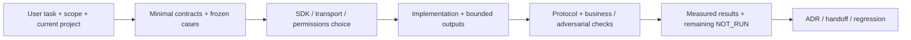

# /mcp:build — инструменты, которыми удобно пользоваться агенту

Сначала [sources](sources.md), [tool design](tool-design.md), [context](context-efficiency.md), [protocol/security](protocol-security.md), [evals](evaluation.md), [workflow](workflow.md) и [decision memory](../../skills/decision-memory.md). Вход: business task, target README/AGENTS/accepted ADR, actual API/data rights и existing stack. Выход: narrow tool contracts + implementation + independent scenario evidence, не обещание универсального доступа.

Runtime-v001 в ai-tools: standalone scaffold/validate/smoke и dependency-free read-only catalog stdio server, pinned MCP2025-11-25 profile. Это первая concrete MCP server implementation, не HTTP/auth/SDK framework. Other project tools строятся по выбранному стеку/официальному SDK; generated example не автоматически становится production интеграцией. Нет auto activation/install/deploy/paid API calls. --plan оставляет только planning artifacts.
