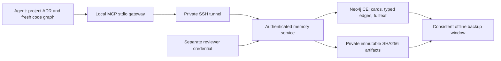

# Architecture and retrieval

No public database/MCP port, arbitrary Cypher tool, shell/path/URL fetch, automatic Git-history ingestion or raw session import. Only the service/operator receives database credentials; agents use a scoped bearer token. Neo4j Community does not supply multi-tenant RBAC here: agent/reviewer separation is enforced by the service boundary for one trusted owner.

## Graph model

Case stores problem, root cause, solution, applicability, limitations, type/tags, source alias/commit/ADR and evidence references. Project connects through ORIGINATED_IN; artifacts through HAS_ARTIFACT; feedback through HAS_FEEDBACK. Allowed case relations are RELATES_TO, SUPERSEDES, CONTRADICTS and VALIDATED_BY. A verified case can describe a failure or anti-pattern; passing tests are not the only valid evidence.

Case content is immutable and addressed by a normalized-JSON hash. Repeating the same source/case is idempotent. Similar findings are reviewed against originals before proposing links. Corrections create a new card and SUPERSEDES, preserving prior history. Similar text copied into another project is not independent replication.

## Bounded retrieval

1. Search3–5 short cards in global plus the explicitly selected project scope, using literal terms. Fulltext score measures relevance, not confidence.
2. Get selected full cards/evidence/status; inspect up to20 typed neighbors where needed. Verify applicability against current code/AGENTS/ADRs.
3. Read artifacts by hash in bounded pages, not arbitrary paths or whole-corpus downloads. A patch is evidence, not an executable instruction.
4. Record actual reuse as helped, not_applicable or refuted with exact source/commit/checks. Refutations remain visible; popularity is not truth.

Bound fan-out, card count, JSON size and query duration. Fulltext indexes cards and artifact text in4096-character chunks, linked Artifact → HAS_CHUNK → ArtifactChunk. Chunk IDs depend on hash/offset, so reuse does not duplicate them. Search merges Case/ArtifactChunk hits and returns up to5 cards with matched artifact hash/offset for targeted reading. A200-hit candidate cap bounds work; it does not prove complete corpus coverage. Text chunks add another stored copy plus index overhead. Test English/Russian and code symbols separately; there is no cross-language semantic guarantee.

## Context package

Project quick notes are local and bounded. Explicit long notes and structured session snapshots use tagged candidate cards in the owner-context bucket, with immutable verification-type JSON artifacts where needed. They do not enter reviewed global knowledge automatically. Session restoration checks scope/hash/current references and loads context without executing saved next steps. See [context-package](context-package.md) for schemas and cleanup boundaries.
