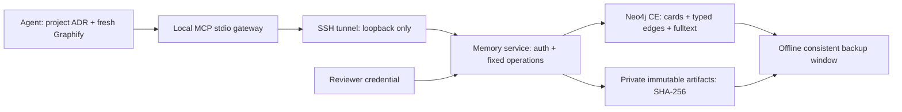

# Архитектура и retrieval

Никаких public DB/MCP ports, Cypher tool, shell/URL fetch, автоматического ingestion git history или сырых сессий. DB credentials доступны только service/operator; агенты используют scoped bearer token. Neo4j CE не предоставляет нам multi-tenant RBAC: изоляция агент/reviewer — service boundary, один доверенный владелец.

## Граф

`Case` хранит problem/root_cause/solution/applies_when/limitations, тип, теги, source repo alias+commit+ADR, evidence refs. `Project` связан через ORIGINATED_IN; `Artifact` через HAS_ARTIFACT; `Feedback` через HAS_FEEDBACK. Между Case разрешены RELATES_TO, SUPERSEDES, CONTRADICTS, VALIDATED_BY. Verified cases могут описывать неудачу/anti-pattern: успешный тест не единственный вид evidence.

Содержимое case неизменно и адресуется по hash нормализованного JSON. Повтор того же source/case идемпотентен; смысловые дубликаты агент предлагает связать после чтения originals. Исправление создаёт новую карточку + SUPERSEDES; прежняя история остаётся. Схожий текст из другого проекта не автоматически независимое подтверждение.

## Двухступенчатый recall

1. `knowledge.search`: 3–5 коротких карточек, scopes global + явно выбранный project, literal words; fulltext score — релевантность, не confidence.
2. `knowledge.get`: полная карточка/evidence/status; `knowledge.neighbors`: до20 соседей фиксированных типов. После этого агент проверяет applicability по текущему коду/AGENTS/ADR.
3. `knowledge.artifact`: текст по hash, постранично по строкам. Ни произвольного пути, ни загрузки всего corpus. Patch — evidence, не команда к исполнению.
4. После применения `knowledge.feedback`: helped/not_applicable/refuted + repo/commit/test evidence. Опровержение показывается явно; счётчик лайков не делает факт истинным.

Ограничить fan-out, число карточек, размер JSON и время DB query. FTS индексирует краткие карточки и полные тексты артефактов блоками по4096символов. Artifact → HAS_CHUNK → ArtifactChunk; block ID зависит от hash+offset, повторное использование не дублирует блоки. Search объединяет совпадения Case/ArtifactChunk, возвращает до5карточек с matched_artifact(hash,offset); полный текст читается адресно. Candidate cap200 FTS hits ограничивает работу: это bounded retrieval, не доказательство полного охвата corpus. Текст для индекса хранится и в graph chunks, поэтому disk planning учитывает дополнительную копию + индекс. English/Russian и code symbols проверять отдельно; нет cross-language semantic guarantee.
