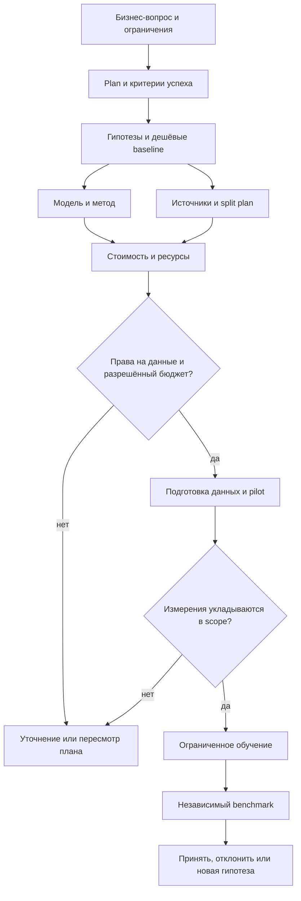

# ML: от вопроса до проверенного эксперимента

Это обязательная база ML-скиллов. Сначала прочитать этот маршрут, [workflow](workflow.md), [контракты](contracts.md), [кейсы](cases.md), [источники](sources.md) и guide выбранного этапа. Отсутствующие документы — blocker, их нельзя подменять общей памятью модели. Читай профильные guides по необходимости: для классификатора не нужен весь материал по LLM post-training.

| Команда | Результат | Граница |
| --- | --- | --- |
| `/ml:plan {задача}` | [Experiment spec, gates, бюджет и DoD](plan.md) | Только планирование |
| `/ml:hypotheses {проблема}` | [Проверяемые H-IDs, baseline, абляции](hypotheses.md) | Без вычислительного поиска |
| `/ml:model {задача/план}` | [Выбор baseline, модели и метода](model.md) | Без загрузки весов/обучения |
| `/ml:data {план}` | [Поиск, dataset card, split/quality recipe](data.md) | По умолчанию research; `--prepare` — разрешённая подготовка |
| `/ml:cost {план}` | [Modal low/base/high estimate и caps](cost.md) | Offline расчёт, не GPU pilot |
| `/ml:train {план}` | [Запуск, обучение и наблюдение](train.md) | `--plan` — без запуска; `--status` — read-only разрешённого run |
| `/ml:benchmark {checkpoint/план}` | [Baseline comparison по frozen protocol](benchmark.md) | `--plan` — только протокол; выполнение в разрешённой среде |

Codex использует `$ml-plan`, `$ml-hypotheses`, `$ml-model`, `$ml-data`, `$ml-cost`, `$ml-train`, `$ml-benchmark`. Slash-адаптеры — интерфейс Claude, не встроенные команды Codex. Standalone skills независимы; явный [runtime pipeline](pipeline.md) связывает их в семь preparation stages и два supervised execution tasks: local или [Modal Sandbox](modal-adapter.md).

Порядок допускает итерации: найденная лицензия или недостаток памяти меняют model/cost revision. Никакой автоматической цепочки вызовов, поиска гиперпараметров до исчерпания бюджета или перехода от benchmark к deploy.

## Основа подхода

[Karpathy, Recipe](https://karpathy.github.io/2019/04/25/recipe/): посмотреть данные, отладить простой pipeline, добиться обучения на малой выборке, затем усложнять. Переносим последовательность диагностики; советы 2019 года о конкретных архитектурах/unsupervised learning не объявляем сегодняшней универсальной истиной. [Google Rules of ML](https://developers.google.com/machine-learning/guides/rules-of-ml) поддерживает простой первый baseline и проверку training-serving consistency. Наша рекомендация: разрешить результат «обучение пока не нужно» и потратить бюджет на более полезные данные/оценку.

Suite охватывает tabular, ranking/retrieval, time series, CV/audio и LLM; конкретные методы выбираются по [model guide](model.md). Скилл не обязан выбирать крупнейшую модель или GPU. Хороший результат — объяснимое решение с evidence, включая отрицательный эксперимент.

## Что сохранять

В target `.ai-development/ml/<task>/`: context, decisions, immutable revisions, progress, безопасные отчёты и handoff. Код — в штатном коде проекта, большие/чувствительные данные и веса — в разрешённом artifact store. [Контракт](contracts.md) связывает plan → data/model/config → attempts → checkpoint → benchmark. [Шаблоны](../../templates/ml/experiment.md) не запускают обучение и не являются готовой конфигурацией target.

DoD suite: профильный результат содержит ссылки/версии/evidence/unknowns, объясняет применимость исследовательских кейсов, фиксирует решения до зависимых изменений и передаёт следующий шаг. `planned`, `running`, `trained`, `benchmarked` и `accepted` — разные состояния. Падение loss не доказывает полезность продукта, а лабораторный benchmark не подтверждает production SLO.

## Данные и сохранение возможностей

[Data preparation](data/README.md): scientific data-first planning, cleaning/exact dedup/grouped splits, joint domain/language token exposure, general capability preservation и полные ответы. Existing `/ml:data` расширен; defaults research/--plan не вызывают helpers.

## Диагностика обучения

[Training debugging design](debugging/README.md): task-specific метрики, tracked heuristics, full generation snapshots и обязательный rolling/terminal report при любом исходе. Status design-v001; runtime integration [pending](debugging/integration-plan.md).
