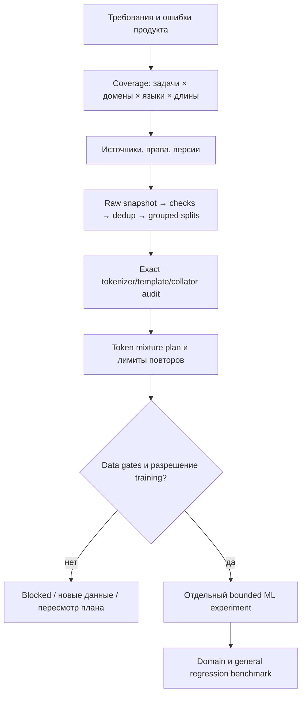

# Данные для обучения: план, качество, смесь и целостность

Это углублённая обязательная база `/ml:data`, а не новый training runner. Сначала [научные источники](sources.md), [планирование потребности](planning.md), затем [очистка](cleaning.md), [домены и языки](mixtures.md), [сохранение полных ответов](answer-integrity.md), [контракт инструментов](tools.md) и [критерии приёмки](evaluation.md). Общий ML [контракт](../contracts.md) и [память решений](../../skills/decision-memory.md) сохраняются.

Garbage in → garbage out — полезная инженерная эвристика, не теорема, не гарантия после очистки и не количественный закон масштабирования. Шумная разметка, утечки, неверный sampling и обрезанные completions способны испортить результат; «чистый» корпус ещё не доказывает достаточность покрытия или полезность модели. Проверяем данные и downstream поведение отдельно.

Первая реализация — stdlib CPU CLI `scripts/ml_data.py`: profile, prepare, audit-tokens, mix-plan. Только локальные разрешённые JSONL, без download/API/GPU/install. Text/chat adapters реализованы; изображения, аудио, preference pairs, near-dedup at web scale и собственно tokenizer/trainer требуют профильных адаптеров. Не выдавать эту ограниченную реализацию за FineWeb/Dolma или гарантию отсутствия PII/contamination.

## Local text data gate

[Реальный tokenizer/collator и mandatory preparation gate](pipeline.md). Explicit data_preparation policy; legacy non-text не получает фиктивный PASS.

Runtime adapter использует [verified local tokenizer/collator pipeline](pipeline.md), отдельный от standalone provided-tensor audit.
