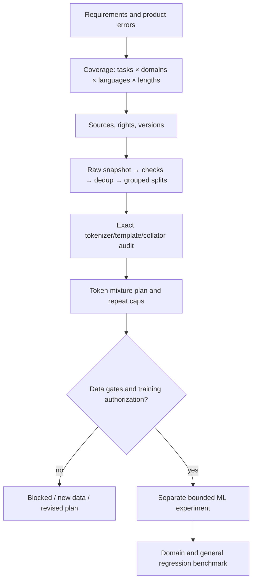

# Training data: planning, quality, mixtures and integrity

This is the detailed mandatory foundation for `/palarran:ml:data`, not a new training runner. Start with [scientific sources](sources.md), [data requirements](planning.md), then [cleaning](cleaning.md), [domains and languages](mixtures.md), [complete answers](answer-integrity.md), [tool contracts](tools.md) and [acceptance criteria](evaluation.md). The shared ML [contract](../contracts.md) and [decision memory](../../skills/decision-memory.md) still apply.

Garbage in → garbage out is a useful engineering heuristic, not a theorem, a post-cleaning guarantee or a quantitative scaling law. Noisy labels, leakage, incorrect sampling and truncated completions can damage outcomes; a “clean” corpus does not establish sufficient coverage or model usefulness. Check data and downstream behavior separately.

Initial implementation is stdlib CPU CLI `scripts/ml_data.py`: profile, prepare, audit-tokens, mix-plan. Authorized local JSONL only; no download/API/GPU/install. Text/chat adapters exist; images, audio, preference pairs, web-scale near-dedup and actual tokenizer/trainer need specialist adapters. Do not present this limited implementation as FineWeb/Dolma or a guarantee of no PII/contamination.

## Local text data gate

[Real tokenizer/collator and mandatory preparation gate](pipeline.md). Explicit data_preparation policy; legacy non-text receives no fictitious PASS.

The runtime adapter uses the [verified local tokenizer/collator pipeline](pipeline.md), separate from the standalone provided-tensor audit.
