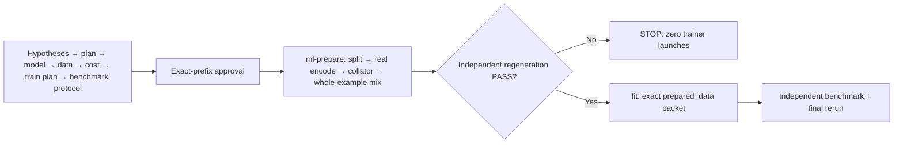

# Text preparation in the ML runtime

First read [sources](sources.md), [integrity](answer-integrity.md), [mixtures](mixtures.md) and the [runtime contract](../pipeline-contract.md). Basis: Karpathy — check real data; DoReMi/XLM-R — control exposure and languages; HF — model-native templates and correct labels. Our bounded adapter does not reproduce those papers' results.

## Launch contract

New execution policies must specify `data_mode=text|non_text`. `text` requires `data_preparation`; `non_text` forbids text config. `data_preparation` contains absolute canonical `python`, `source`, `tokenizer`, `template`, `split`, `mixture`; `tokenizers_version`; `objective=assistant|causal`, `max_sequence_tokens`, `end_token_ids`, `pad_token_id`, `batch_size`, `length_bins`, `max_share_deviation` (decimal string), `max_output_bytes`. The compiler pins each file's SHA, the Python executable and executable files of the optional tokenizers distribution; missing dependencies fail before a run. No credentials in the packet. The interpreter must already have the specified optional `tokenizers` version; runtime/tests never install/download. `python` must be a real executable, not a symlink; resolve a normal venv/python symlink to its canonical path beforehand.

Data/tokenizer/config lineage JSON each contains `preparation_sha256` = canonical SHA of the frozen policy, including file pins. This binds plans to real inputs and prevents recipe substitution after approval. Context exposes policy metadata to planning agents, not the raw corpus in prompts. Old workflows without mode are legacy/not_configured; new non_text is not_applicable. Neither is PASS. Select this contract explicitly for text training.

After seven planning stages: operator approval of the exact prefix → `ml-prepare` → verified data → fit → evaluate → final verification. Preparation is deterministic, local and bounded by existing task/run wall time; AI/train/evaluate reserves and total USD ceiling stay unchanged. Source/tokenizer/config drift and missing dependencies FAIL before trainer launch. Unknown spending still requires reconciliation before a new run.

## Real tokenizer and collator

Load `tokenizer.json` through `tokenizers.Tokenizer.from_str` from a verified local tokenizer.json byte snapshot (semantics correspond to from_file), without Hub access. Disable tokenizer padding/truncation; special tokens already live in the template, `add_special_tokens=False`. Literal template JSON: `version=1`, `bos`, `text_suffix`, `roles` with exactly system/user/assistant, each `{prefix,suffix}`. Check the template against the native model contract; arbitrary Jinja/tool/multimodal layouts are unsupported. Every messages record needs completion={complete:true,finish_reason:stop|eos|authored}. Missing claims and length/content_filter/unknown block before EOT insertion; authored means an author-verified full export, never an automatically assigned default. Assistant suffix must end with a supervised end token. No universal EOS ID or default template.

Encode one complete rendered string; offsets assign tokens to assistant content+suffix. A token crossing prompt/assistant boundaries, zero-length offsets, UNK and lost substantive target tokens are blockers. No silent truncation/packing. Full answer text is not cut, but source semantic completeness still needs review: adding EOT cannot repair an already truncated raw answer.

The collator returns batches `input_ids`, `attention_mask`, `assistant_mask`, `labels` and `ids`. Right-pad to length; labels=-100 for padding and non-assistant tokens in SFT. With pad_id==eos_id, real end tokens retain loss. Labels are unshifted: the trainer must perform exactly one causal shift. Tokenize/check every train/validation/test record; mixtures use train only.

## Realized mixture and evidence

Source JSONL and split recipes use the [tools schema](tools.md). First exact dedup/group splits, then encode/audit every survivor. Any quarantine except exact_duplicate blocks the gate: bad records cannot disappear silently. The existing [mixture recipe](mixtures.md) defines joint domain/language input-token quotas. A deterministic seed orders whole examples; never cut a record to meet quota. Per-record repeat ceiling = floor(max_repeats); a fractional limit grants no extra repetition. Total exposure shortfall/share deviations are allowed only under explicit `max_share_deviation`; check actual cell shares and domain/language floors against materialized input tokens. No holdout borrowing or silent fallback. A zero-exposure cell with positive weight FAILs even if its quota rounds to zero. After selection, deterministic occurrence-level shuffle mixes domains rather than emitting entire domains in blocks; exact per-batch shares are not guaranteed. Hard limits: source/output ≤64MiB, total encoded and padded tokens ≤1 million, requested mixture ≤1 million input tokens, context ≤8192 tokens, batch ≤32, JSONL line ≤1MiB. Never fill quotas with truncated answers. Requested tokens/outputs are bounded; large corpora need a separate streaming adapter.

Private state `prepared-data/` stores shards/decision ledger/token rows/train+holdout batches/audit/mixture/receipt. An independent verifier in a separate bounded process rereads pinned sources, reruns prepare/encode/collate/sampling and compares exact bytes. Before resource reservation the gate matches a private stable verifier receipt against every file digest; repeat immediately before actual launch. Fit/evaluate receive JSON `prepared_data` with directory, hashes and receipt digest. The trusted trainer must read those exact batches; an arbitrary external program remains a trust boundary, and a hash does not prove training used a file.

## Limits

Local text backend only. Reject `backend=modal` with data_preparation before run: remote dataset materialization and Volume-content verification are not implemented. Legacy Modal execution stays unchanged. No cloud calls, model-weight downloads or paid tests. Gate PASS establishes mechanical integrity/mixture/lineage, not legal license review, content language, PII audit, semantic quality, no forgetting or trained-model quality. A frozen benchmark remains mandatory.

## Local optional-adapter verification

The operator installs dependencies separately; runtime/tests do not install. `AI_TOOLS_TOKENIZER_PYTHON=/absolute/canonical/python python3 -m unittest tests.test_ml_data_gate -v` uses an existing environment with `tokenizers==0.22.1`. Without it, real integration tests honestly SKIP/NOT RUN while stdlib checks run. The fixture builds a tiny byte-level BPE locally, without Hub/corpus downloads. End-to-end text_job is a CPU unigram, not an LLM or evidence of no forgetting.

Example input config: [data-preparation.example.json](../../../templates/ml/data-preparation.example.json). Paths/versions/EOS/template are model-specific placeholders, not a ready preset. Add data_mode=text and the template's data_preparation object to execution policy; the compiler creates actual review/pins. Required model-native special tokens must already exist in the tokenizer vocabulary.

Failure recovery: failed preparation never overwrites an existing private directory. First verify the known outcome/process termination; retain partial artifacts for diagnosis. Changed frozen inputs require a new reviewed revision carrying already spent budget, not an automatic retry/ceiling reset.
