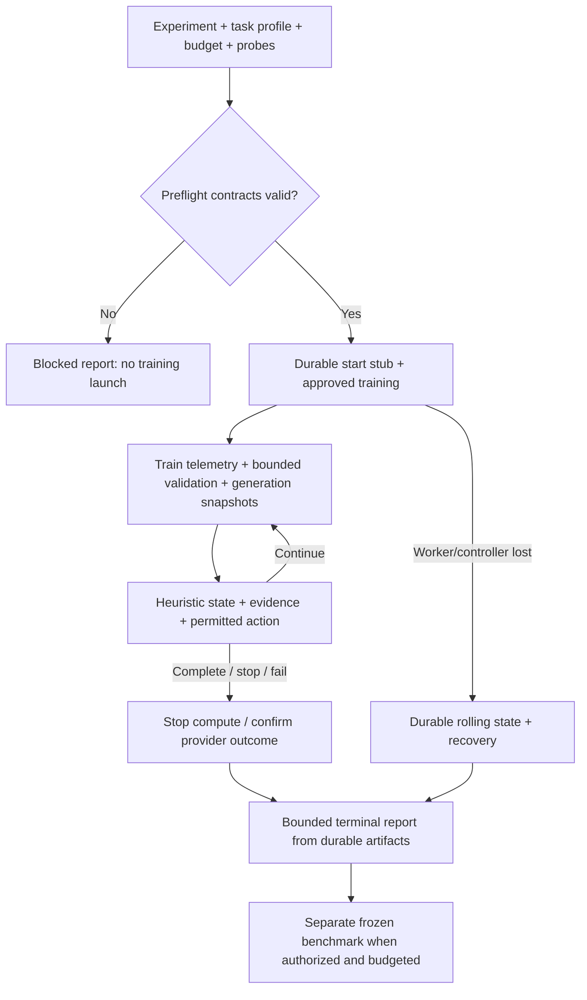

# Training diagnostics design

**Status: runtime-v001.** The [runtime contract](runtime.md) implements optional frozen diagnostics policies, bounded collectors, tracked rules, immutable generation snapshots and rolling/terminal reports. The data gate checks preparation separately. Task/framework scorers and safe tensor-state capture remain each trainer hook's responsibility; the full design exceeds generic runtime scope.

The goal is to determine whether training is correct, improves the target task, preserves useful behavior and at what cost. Loss remains one signal. Lower loss/PPL alongside more errors, truncations or regressions is not success.

## Route

| Document | Responsibility |
| --- | --- |
| [Sources](sources.md) | Primary sources, dates and transfer limits |
| [Artifacts](artifacts.md) | Preserved data, lineage, streams, privacy and cost |
| [Task metrics](task-metrics.md) | Train/validation, PPL, primary metrics and task slices |
| [Heuristics](heuristics.md) | Each heuristic's purpose, applicability and actions |
| [Generation probes](generations.md) | Comparable behavior examples by checkpoint/time |
| [Reports](reports.md) | Rolling/terminal reports on success/stop/failure/unknown |
| [Integration plan](integration-plan.md) | Required implementation, task DAG and offline DoD |

Basis: [Karpathy Recipe](https://karpathy.github.io/2019/04/25/recipe/) — small verifiable steps, data inspection and fixed-example observation; [Google Rules of ML](https://developers.google.com/machine-learning/guides/rules-of-ml) — check the pipeline and goal alignment. For this project adapt fixed probes on development data, never hidden final tests. Storage/stop schemas are our engineering choices, not scientific results.

## What to freeze before launch

In an immutable experiment revision: task profile, hypothesis, supervised-target basis, train/dev/final-test policy, primary metric and practical delta, general/domain/language guardrails, diagnostic-probe version, heuristic registry with thresholds/windows, logging/evaluation/generation/checkpoint cadence and cost. Every uncertainty/disabled signal has a reason. Baselines need a diagnostic snapshot or explicit NOT RUN too; do not invent comparisons after training.

There is no universally correct “log every N steps.” Small runs use inexpensive per-update scalars and infrequent small probes. Long runs use bounded scalars + periodic validation, rotating debug cases and exported checkpoints. Full gradient/activation histograms belong only in bounded diagnostic windows. Freeze cadence before launch, measure overhead in an authorized pilot; when budget is insufficient reduce optional diagnostics by predefined policy and record why, never raise the ceiling.

## Design and implementation DoD

Documentation DoD: all fields, states, decision rules and failure paths defined; examples explicitly not_run, packaged links resolve. Runtime DoD additionally requires collectors/normalizers, finalizer/recovery, artifact integrity and the plan's offline failure-injection tests. This guide or a tracker screenshot does not establish runtime PASS.

Templates for the next implementation: [diagnostics policy JSON](examples/diagnostics-policy.example.md), [generation snapshot JSON](examples/generation-snapshot.example.md), [training report](examples/training-report.md), [validation report](examples/validation-report.md). JSON is embedded in Markdown for the portable docs package; every example is NOT RUN.
