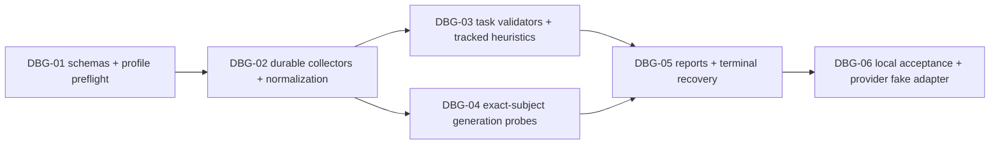

# План подключения diagnostics — design-v001

**Реализация pending.** Текущий код не запускался/не менялся ради этого дизайна. Существующие finite bounded Modal metrics и usage ledger переиспользуются; `metrics_snapshot` не умеет произвольные new fields/nonfinite значения и не заменяет storage/probes/finalizer. Новые wire formats требуют versioned adapter migration, не тихого изменения v1.

## DAG

| ID | Inputs → output | Acceptance / DoD | State |
| --- | --- | --- | --- |
| DBG-01 | Approved design → strict versioned policy/event/report schemas + frozen diagnostics hash in launch packet | Task applicability/required thresholds/reserves/probe rights; unknown config rejected pre-dispatch; legacy readable без invented PASS | pending |
| DBG-02 | Existing leases/usage + schemas → per-writer collector, streaming bounded chunks, reducer, integrity receipts | Sums/counts correct after causal shift; no mean-of-means; DDP/replay/resume no duplicate progress; finite-only transports keep typed nonfinite events | pending |
| DBG-03 | Subject-bound aggregates → task scorers, rule states/actions | Every rule has applicability + version + calibrated threshold + support; hard stops preempt diagnostics; no implied LR/GPU/config changes | pending |
| DBG-04 | Frozen dev probes + immutable model subject → paired full samples/gallery | Same prompt/decoding identity, no hidden-test use, full output or explicit missing, token-limit/error retained; no mixed-state async snapshot; probes preserve train RNG/mode/optimizer/sampler | pending |
| DBG-05 | Committed streams + existing accounting → rolling/validation/terminal JSON+MD+plots and recovery | Every supported terminal path emits report/explicit unavailable, idempotency, exact refs, bounded finalization, zero additional GPU/eval on exhausted budget | pending |
| DBG-06 | All modules → local CPU fixture + fake provider + full regression | Failure matrix below, actual sample progression + task metric independent of training loss, shared budget/reserves preserved; no paid launches | pending |

Будущие зависимости файлов: `orchestrator` collector/report/gate modules, `ml_pipeline` policy binding, `ml_resources` authoritative cost refs, `modal_adapter` versioned diagnostics channel, target trainer/evaluator hooks, CLI status/report commands, tests и skill mandatory guides. Не создавать второй scheduler или финансовый ledger. Параллельные execution agents/worktrees сейчас не запускаются; при реализации разделять независимые DBG-03/04 после frozen schemas, integration owner один.

## Offline failure matrix

- Unequal batch/rank target counts, masked first target, assistant-only и pad==EOS; NLL sums/counts vs known tiny probability fixture, exp overflow и N=0; label smoothing/DPO не masquerade PPL.
- Class imbalance, rare slice support, empty retrieval relevance, invalid metric direction/units; unavailable required metric блокирует acceptance.
- Grad/AMP skipped update, min-support/patience on unique eval IDs, replayed snapshots не ускоряют early stop; false-positive cases code repetition/short correct answer.
- Bad data/masks/lineage, missing stream, corrupt/truncated writes, output cap и disk-full; no secret/raw logs in report/stdout.
- Probe success/error оставляет train RNG/mode/optimizer/sampler неизменными; distributed hook не зависает из-за unmatched collective.
- Checkpoint subject drift, decode/probe change, generated length-stop/incomplete code, cancelled generation; stored outputs uncut, mismatched comparison stale.
- Normal completion, early stop, budget/deadline/operator cancel, NaN/OOM/preemption, lost lease, worker SIGKILL и coordinator restart; report recovery из stub, unknown provider termination удерживает reserve.
- Duplicate finalizer calls, late metrics/receipt/invoice, incomplete checkpoint и missing final eval; new report revision without duplicate tokens/costs, no GPU launch during finalization.

После реализации: repository validator, full offline suite, factory acceptance и portable packaging. Измерить representative diagnostics overhead в заранее разрешённом bounded pilot; synthetic test не training SLA или scientific improvement. Live Modal/LLM run только отдельным authorized экспериментом в прежнем budget.
