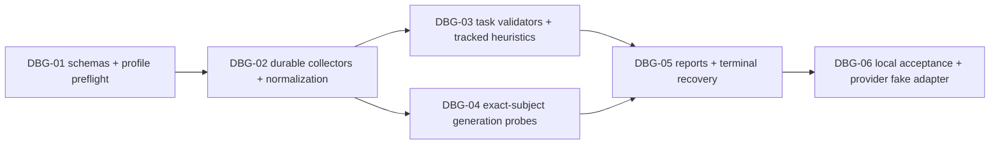

# Diagnostics integration plan — design-v001

**Runtime-v001 implemented scope:** [runtime contract](runtime.md). Preserve the original design; task/framework-specific extensions below are not verified generic hooks. Reuse existing finite bounded Modal metrics and usage ledger; `metrics_snapshot` supports neither arbitrary new fields/nonfinite values nor substitutes for storage/probes/finalizers. New wire formats need versioned adapter migration, never silent v1 changes.

## DAG

| ID | Inputs → output | Acceptance / DoD | State |
| --- | --- | --- | --- |
| DBG-01 | Approved design → strict versioned policy/event/report schemas + frozen diagnostics hash in launch packet | Task applicability/required thresholds/reserves/probe rights; unknown config rejected pre-dispatch; legacy readable without invented PASS | runtime-v001; profile limitations below |
| DBG-02 | Existing leases/usage + schemas → per-writer collector, streaming bounded chunks, reducer, integrity receipts | Sums/counts correct after causal shift; no mean-of-means; DDP/replay/resume no duplicate progress; finite-only transports keep typed nonfinite events | runtime-v001; profile limitations below |
| DBG-03 | Subject-bound aggregates → task scorers, rule states/actions | Every rule has applicability + version + calibrated threshold + support; hard stops preempt diagnostics; no implied LR/GPU/config changes | runtime-v001; profile limitations below |
| DBG-04 | Frozen dev probes + immutable model subject → paired full samples/gallery | Same prompt/decoding identity, no hidden-test use, full output or explicit missing, token-limit/error retained; no mixed-state async snapshot; probes preserve train RNG/mode/optimizer/sampler | runtime-v001; profile limitations below |
| DBG-05 | Committed streams + existing accounting → rolling/validation/terminal JSON+MD+plots and recovery | Every supported terminal path emits report/explicit unavailable, idempotency, exact refs, bounded finalization, zero additional GPU/eval on exhausted budget | runtime-v001; profile limitations below |
| DBG-06 | All modules → local CPU fixture + fake provider + full regression | Failure matrix below, actual sample progression + task metric independent of training loss, shared budget/reserves preserved; no paid launches | runtime-v001; profile limitations below |

Future file dependencies: `orchestrator` collector/report/gate modules, `ml_pipeline` policy binding, `ml_resources` authoritative cost refs, `modal_adapter` versioned diagnostics channel, target trainer/evaluator hooks, CLI status/report commands, tests and mandatory skill guides. Do not create another scheduler or financial ledger. This plan launches no parallel execution agents/worktrees; during implementation separate independent DBG-03/04 after schema freeze, with one integration owner.

## Offline failure matrix

- Unequal batch/rank target counts, masked first target, assistant-only and pad==EOS; NLL sums/counts versus a known tiny probability fixture, exp overflow and N=0; label smoothing/DPO must not masquerade as PPL.
- Class imbalance, rare-slice support, empty retrieval relevance, invalid metric direction/units; unavailable required metrics block acceptance.
- Grad/AMP skipped updates, min-support/patience on unique eval IDs; replayed snapshots must not accelerate early stopping; false positives for code repetition/short correct answers.
- Bad data/masks/lineage, missing streams, corrupt/truncated writes, output caps and disk-full; no secrets/raw logs in reports/stdout.
- Successful/failed probes preserve train RNG/mode/optimizer/sampler; distributed hooks must not hang on unmatched collectives.
- Checkpoint subject drift, decode/probe change, generated length-stop/incomplete code, cancelled generation; stored outputs uncut, mismatched comparison stale.
- Normal completion, early stop, budget/deadline/operator cancel, NaN/OOM/preemption, lost lease, worker SIGKILL and coordinator restart; recover reports from stubs, unknown provider termination retains reserves.
- Duplicate finalizer calls, late metrics/receipts/invoices, incomplete checkpoints and missing final evaluation; new report revisions without duplicate tokens/costs, no GPU launch during finalization.

After implementation: repository validator, full offline suite, factory acceptance and portable packaging. Measure representative diagnostic overhead in a preauthorized bounded pilot; synthetic tests establish neither training SLA nor scientific improvement. Live Modal/LLM runs require separate authorized experiments under the existing budget.

## Runtime-v001 boundary

Implemented: schemas/bindings, append-only collector with lease fencing/caps, sufficient-statistic NLL/PPL, generic gauge/ratio, four rule modes, fixed full-generation snapshots, Python RNG + explicit framework guard, local/fake-Modal pipeline, private rolling/terminal/recovery bundles and optional source-only LaTeX. The budget/usage ledger is unchanged and retains unknown reserves.

Not automatic: DDP collectives/rank reduction, framework tensor RNG/mode/optimizer/sampler capture, AMP callbacks, classification/retrieval scorers, best-checkpoint selection, rotating probes/histograms and statistical training-overhead estimates. These need target instrumentation and separate tests/pilots; generic fixtures do not PASS the entire expanded failure matrix above. Live Modal and scientific model quality NOT RUN.
