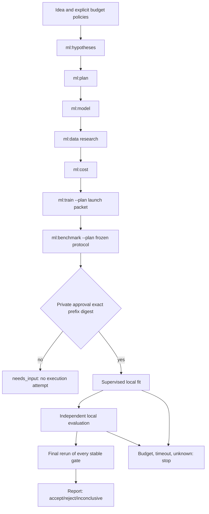

# ML pipeline in the bounded runtime

Before use: [contract](pipeline-contract.md), [ML workflow](workflow.md), and shared checkout runtime limits in docs/product-factory/contract.md and usage-accounting.md. The runtime ships in the full Palarran checkout, not the portable ML skill package. ML recommendation sources remain in [cases](cases.md) and [sources](sources.md). No integrity PASS proves model quality or invoice correctness.

## Route



Seven skills first produce a consistent packet. Two execution tasks run predefined trusted commands. The agent does not train/evaluate inside a planning stage, invoke nested model/paid APIs or download data/weights. Data preparation/acquisition belongs only to a specifically authorized execution command and its budget; a research report does not authorize it.

This uses the existing single-writer leased worker with an owned Git worktree, immutable snapshot, independent verifiers and final subject fingerprint. `create` executes nothing. A clean committed **target** and separate private state are required; the installed skills checkout may contain new local docs whose content-digest pins are checked at every stage.

## Budgets and authority

`ml-create` requires explicit `ai-policy`, `usage-policy` and `execution-policy`. No automatic AI tariffs/ceiling increases. Planning/implementation/simple roles use supplied model profiles; preparing an execution packet does not require the most expensive model. All seven AI calls have stage/run token/USD guards. Train/evaluate each receive a reserve, billed cost rate/fixed extras, max_seconds and bounded output. The shared ceiling >= AI envelope + both resource reserves; the operator must first resolve/reserve unknown extras, never replace them with zero.

After seven stages, `work` stops before fit. `status` shows the review digest; `ml-approve --prefix-sha DIGEST` binds exact manifests/lineage/commands/protocol and an unchanged budget. This is an explicit operator action after review, not agent inference or a historical ADR. Normal `work` then continues with fit without reinvoking earlier skills. Approval does not reset the run deadline.

Resource usage: supervisor wall-time estimate separately from cumulative adapter reports; provider invoices remain unknown. Reserves are spent/held across all attempts; unknown outcomes block execution/retry and require `ml-reconcile` after proven termination. `resolve` is not resource-usage reconciliation. Resume consumes the remaining shared envelope; automatic replay is disabled. On a budget stop, terminate the process group and do not start later tasks. Polling/telemetry do not guarantee an invoice hard cap.

## Supported execution boundary

v001 supports only trusted **foreground local** commands/process groups: CPU/GPU on the same host, without detach, remote launches, network billing or hidden retries. The rate is an explicit economic estimate; local cash cost may be zero only under an explicitly selected accounting scope, never because price is unknown. Actual usage reports must come from a trusted adapter, not model narrative. Final telemetry is mandatory even at zero price.

Modal execution uses a separate [Sandbox adapter](modal-adapter.md): durable remote identity, metrics, stop/lookup and held billing reserves. Do not launch remote work through a local subprocess. No live paid tests.

Offline verification only: fake CLI agents and a real tiny local training/evaluation fixture without network/LLM/GPU. This checks the runtime pipeline, not application-model quality. Developing this capability does not authorize a new paid run.

## Practical launch

Prepare idea.md and reviewed model/usage policies; adapt examples/ml-pipeline/execution.example.json with real absolute interpreter/job paths and the complete list of executable dependency files. Example zeroes describe only the synthetic local fixture's cash scope, exclude hardware/electricity and are not a free Modal tariff. Example total=3 and resource reserves=1+1 require an AI envelope <=1; this is arithmetic, not an application-model budget recommendation.

```sh
python3 -m orchestrator ml-create --idea-file /path/idea.md --target /path/target --state /path/private-state --adapter codex --agent /absolute/codex --ai-policy /path/ai-policy.json --usage-policy /path/usage-policy.json --execution-policy /path/execution.json
python3 -m orchestrator work --state /path/private-state --run RUN_ID
python3 -m orchestrator status --state /path/private-state --run RUN_ID
```

The model policy must cover seven calls: six planning and one implementation call for the training launch packet, for example max_calls=7 with sufficient weighted units. Usage stages are palarran-ml-hypotheses, palarran-ml-plan, palarran-ml-model, palarran-ml-data, palarran-ml-cost, palarran-ml-train, palarran-ml-benchmark; each has its own token/USD cap. Prices/models come from an operator-selected snapshot, not automatic retrieval. Codex incremental usage is available through --transport app-server. This step really invokes a CLI and consumes the authorized AI budget.

After reviewing all seven reports/ADRs/lineage/protocol and execution commands:

```sh
python3 -m orchestrator ml-approve --state /path/private-state --run RUN_ID --prefix-sha REVIEWED_DIGEST
python3 -m orchestrator work --state /path/private-state --run RUN_ID
```

For unknown outcomes: confirm termination of **all** local descendants, reconcile cumulative usage with ml-reconcile, then use generic resolve only if the run needs_input and scope remains authorized. Reconciliation does not reactivate a terminal budget-exhausted run. Recovery does not extend the run deadline or promise another attempt fits the budget. Archive prior checkpoint/evaluation outputs on an authorized retry rather than deleting them.

Status includes observed AI usage, estimated/adapter-reported resource costs, held reserves, combined observed basis and unknown invoices. Project progress.json/execution-plan.md are derived task snapshots; final verification comes from private runtime status. Large checkpoints and evaluation.json live in private artifact_root; final gates reread actual bytes, so replacing a model after PASS yields stale.

## Local text data gate

[Real tokenizer/collator and mandatory preparation gate](data/pipeline.md). Explicit data_preparation policy; legacy non-text receives no fictitious PASS.

## Training diagnostics / reports

Optional frozen `execution_policy.diagnostics` enables [runtime diagnostics](debugging/runtime.md) (within the ML section: `debugging/runtime.md`). Fit/evaluate instrumentation writes a private bounded stream; the coordinator tracks rules and assembles report/gallery/CSV/SVG. Terminal/stop/failure produces an immutable report revision; `python3 -m orchestrator ml-report --state /private/state --run RUN` recovers reports without training/provider calls. `status` is read-only. Optional `preprint=true` exports a LaTeX evidence draft without an AI call; compilation/submission NOT RUN. Legacy runs without diagnostics receive partial reports, not diagnostics PASS.
