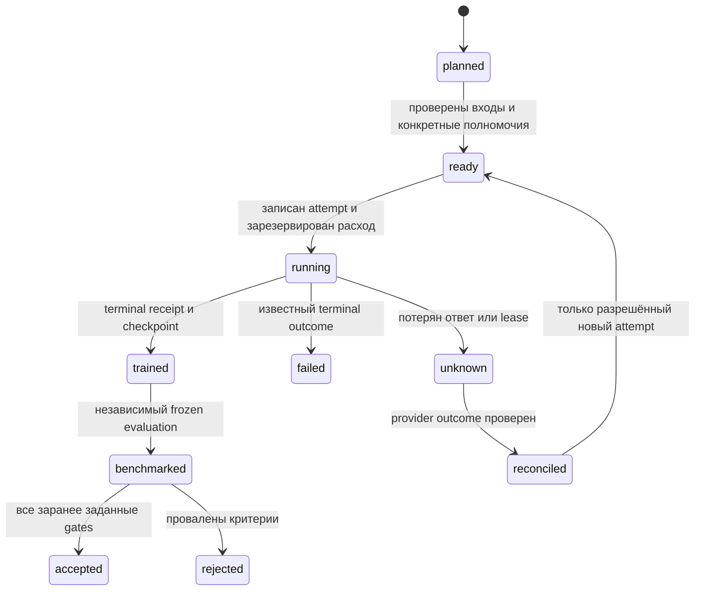

# Workflow, полномочия и память ML

## До выбора эксперимента

Определи target root отдельно от установленного checkout, прочитай target README, ML code/config, `.ai-development/INDEX.md`, связанные accepted ADR и прошлые отрицательные результаты. Не сканируй весь архив и не загружай веса ради изучения проекта. Укажи reused IDs, текущий commit/dirty patch fingerprint, факты и неизвестные требования. Если неясна prediction unit/label/продуктовая цель, задай конкретный вопрос; независимый обзор источников продолжай.

Применяется общий [decision-memory contract](../skills/decision-memory.md). Выбор датасета, модели, метрики, split, compute, остановки и итоговой интерпретации имеет concise rationale/evidence/alternatives/consequences **до** зависимого действия. Это инженерные объяснения и наблюдаемые шаги, не приватный reasoning trace.

## Режимы

Plan/hypotheses/model/cost: local context + public official research + planning artifacts/aggregate calculations. Не устанавливать dependencies, не скачивать weights/dataset shards, не запускать training/eval/application code, не создавать cloud resources. Public pricing page допустима для обновления cost assumptions; аккаунтные billing/API calls не следуют из запроса оценки.

`--plan` у data/train/benchmark сохраняет ту же границу. Data default — каталог источников/recipe; `--prepare` разрешает только согласованный объём данных, storage и локальную обработку. Protected/paid corpus, cloud uploads, генерация synthetic data через платные API требуют соответствующего scope и бюджета. Не проси секреты в чате; используй существующий secret manager/environment без вывода значений.

Train без `--plan` готовит конкретный reviewable запуск и выполняет его, если текущий запрос уже разрешает этот experiment/config/compute/budget. Если разрешения нет, сначала подготовь launch packet, затем запроси только недостающее разрешение; не переспрашивай уже разрешённое. Историческое ADR «запуск разрешён» само по себе не новые полномочия. Запрос «создай ML скиллы» не разрешает обучение. `--status` читает только указанный доступный run, не создаёт job, volume или tracker и не возобновляет работу.

Benchmark без `--plan` может выполнить утверждённый протокол в имеющейся разрешённой локальной среде. Не создавай Modal/GPU jobs, платных LLM judges или внешние uploads без budget/scope. Нет runtime — сохранить готовый протокол со статусом not_run, не изображать измерения.

## План и прогресс

Canonical `.ai-development/ml/<task>/progress.json` и исходный plan содержат revision, задачи и оставшиеся gates. Coordinator обновляет ledger и derived таблицу в плане; у каждой задачи `pending/running/completed/blocked`, evidence refs и checked subject fingerprint. Нет второй самостоятельной истины в dashboard. Это ML protocol: существующий `execution_progress.py` обслуживает backend/frontend и автоматически сюда не применяется.

Experiment spec получает неизменяемую revision/hash. Изменение source/model/data/tokenizer/split/hyperparameters/метрики — новая revision; прежний PASS не наследуется без проверки влияния. Run attempt привязан к одному набору hashes. Нельзя задним числом поменять threshold для прохода уже увиденного test.

Unknown outcome блокирует повторный запуск: сначала сверить provider job ID, checkpoint и расход. Failed/rejected не стирать из сравнений и бюджета. Resume — новый attempt c parent, общим ceiling и подтверждённым checkpoint; не новая бесплатная история.

## Handoff

Передай source refs/ADR/H-IDs, checkpoint URI+hash без tokens, измеренные метрики с размером/единицами, все attempts и cost dispositions, что реализовано/проверено/не запускалось, blockers и следующий самый дешёвый тест. Обнови target INDEX. Plan-ready/trained не authorizes deploy/publication/model upload; данные не пересылаются внешнему tracker по умолчанию.
