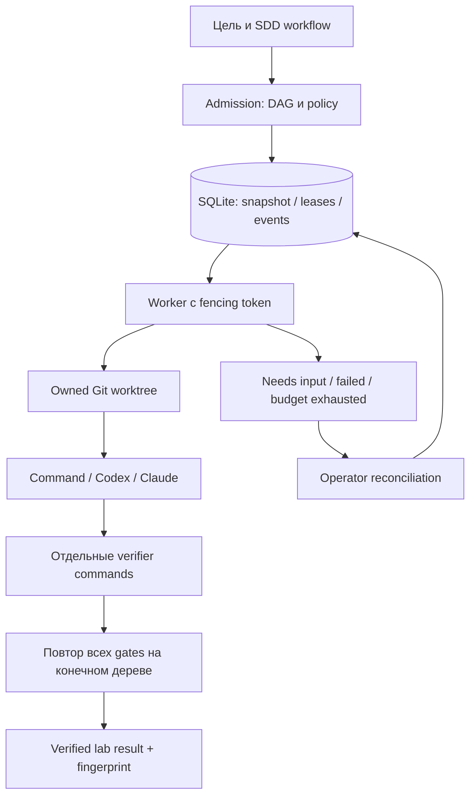

# Архитектура и границы

## Два цикла

Product loop отвечает за evidence спроса, scope, KPI и остановку продукта. Engineering loop выполняет принятый план. v001 реализует только второй: человек передаёт trusted DAG, numerical limits и проверяемый DoD. Генерация DAG из произвольной идеи пока не реализована.

## Выбор для текущего масштаба

Python stdlib + SQLite WAL на одном хосте. Это наш выбор для запуска без сервисов, не заявление о стеке Google. SQLite допускает concurrent readers и одного writer; WAL требует общего локального окружения, не сетевого диска. Используем `BEGIN IMMEDIATE`, короткие transactions и `synchronous=FULL`; DB transaction не охватывает subprocess/filesystem. Основание: [SQLite WAL](https://www.sqlite.org/wal.html), [transactions](https://www.sqlite.org/lang_transaction.html).

Нет exactly-once side effects. Claim/heartbeat/finish используют fencing token. Истёкший lease означает неизвестный outcome: run блокируется до подтверждения оператором, что старый process tree остановлен и изменения просмотрены. Автоматический retry допустим только после наблюдённого завершения и явного `replay_safe=true`, с cap/backoff. Такая осторожность следует из проблемы повторов side effects, описанной [Amazon](https://aws.amazon.com/builders-library/timeouts-retries-and-backoff-with-jitter/).

Один активный task на run: общий integration worktree не имеет нескольких писателей. Независимые runs могут обслуживаться разными workers; max parallel runs задаётся числом процессов. Полноценные parallel task worktrees + merge queue — следующий revision; существующие build skills уже применяют этот подход при разработке самого runtime. Task dependencies нужны и при последовательном исполнении: явно задают readiness и propagation failure.

State — authoritative execution database. Target `.ai-development/` — rationale/spec/handoff, `.delivery/` — исполняемая environment configuration. Generic runtime state не подменяет existing skill `progress.json`: адаптеры обязаны обновлять его по skill contract; runtime JSON export имеет другую schema и не объявляется совместимым ledger.

PostgreSQL/отдельный scheduler нужны при multi-host workers, HA или измеренном writer contention. До этого не добавляем очередь, Redis, event bus и cache: DB достаточно, а cache статусов создаёт риск stale PASS.

## Проверка и масштабирование

Каждая задача имеет independent verifier argv. Финальная проверка повторяет все gates на общем конечном worktree. Сохраняются exit/timeout/output digest, Git HEAD и hash tracked+untracked content (ignored files исключены, кроме product memory и общего decision INDEX). Статус становится stale после изменения subject. Это laboratory code acceptance, не deploy и не market validation. Verifiers являются доверенной частью спецификации; произвольная команда `true` качества не доказывает.

Следующие этапы: task worktree integration queue → multi-host PG/leases → typed research/opportunity contracts → evidence-driven product loop → разрешённый GitOps delivery/observation. Каждый этап с отдельными DoD, budget и stop conditions, без автоматического production доступа.
