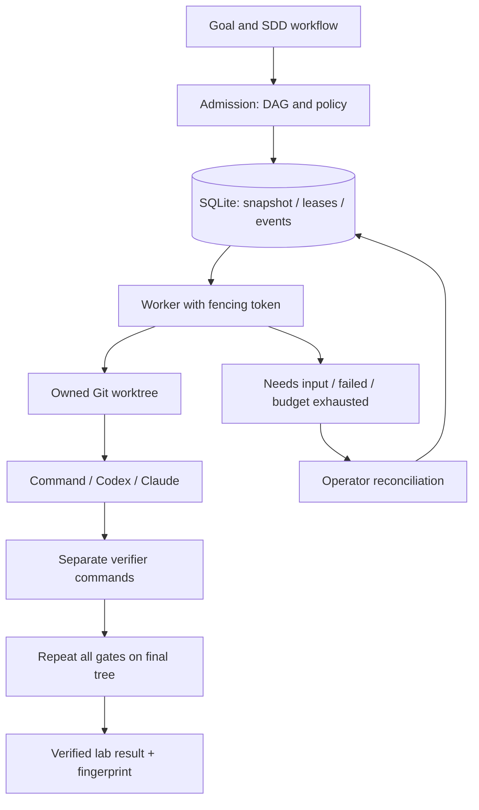

# Architecture and boundaries

## Two loops

Product loop owns demand evidence, scope, KPIs and product stopping decisions. Engineering loop executes an accepted plan. v001 implements only the latter: humans supply trusted DAGs, numerical limits and verifiable DoD. Arbitrary-idea DAG generation is not implemented yet.

## Selection for current scale

Python stdlib + SQLite WAL on one host. Our service-free launch choice, not a statement about Google's stack. SQLite supports concurrent readers/one writer; WAL requires shared local environment, not network disks. Use `BEGIN IMMEDIATE`, short transactions and `synchronous=FULL`; DB transactions do not include subprocess/filesystem effects. Basis: [SQLite WAL](https://www.sqlite.org/wal.html), [transactions](https://www.sqlite.org/lang_transaction.html).

No exactly-once side effects. Claim/heartbeat/finish use fencing tokens. Expired leases imply unknown outcomes: block the run until operators confirm old process-tree termination/reviewed changes. Automatic retries require observed completion and explicit `replay_safe=true`, with cap/backoff. This caution follows the repeated-side-effect problem described by [Amazon](https://aws.amazon.com/builders-library/timeouts-retries-and-backoff-with-jitter/).

One active task/run: no concurrent writers in the shared integration worktree. Independent runs may use different workers; process count sets maximum parallel runs. Full parallel task worktrees/merge queues are a later revision; existing build skills already use this approach to develop runtime itself. Dependencies matter even in serial execution: they explicitly define readiness/failure propagation.

State is authoritative execution DB. Target `.palarran/` holds rationale/spec/handoff; `.delivery/` executable environment configuration. Generic runtime state never replaces skill `progress.json`: adapters must update it under skill contracts; runtime JSON export uses another schema and claims no compatible ledger.

PostgreSQL/a separate scheduler becomes necessary for multi-host workers, HA or measured writer contention. Until then no extra queue, Redis, event bus or cache: DB suffices; status caches risk stale PASS.

## Verification and scaling

Every task has independent verifier argv. Final verification repeats every gate on the shared final worktree. Save exit/timeout/output digest, Git HEAD and tracked+untracked content hash (ignored files excluded except product memory/shared decision INDEX). Subject changes make status stale. This is laboratory code acceptance, not deployment/market validation. Verifiers are trusted specification components; arbitrary `true` commands prove no quality.

Next stages: task-worktree integration queue → multi-host PG/leases → typed research/opportunity contracts → evidence-driven product loop → authorized GitOps delivery/observation. Each needs separate DoD, budget and stop conditions without automatic production access.
