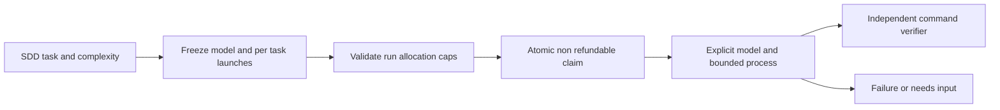

# Модели и бюджеты до запуска

Исходная политика: планирование/исследование — сильная модель; реализация узкой задачи по готовому контракту — экономная; извлечение/форматирование — дешёвая. Commands/validators работают без LLM. Роль определяется сложностью, не расширением файла. Security/architecture и неоднозначные решения не отправлять простой модели ради экономии.

| Роль | Codex default | Claude default | Effort Codex / Claude | Units / launch | Deadline |
|---|---|---|---|---|---|
| planning | gpt-6.1-sol | opus | high / high | 5 | 600 s |
| implementation | gpt-6-luna | sonnet | high / medium | 2 | 300 s |
| simple | gpt-6-luna | haiku | low / low | 1 | 60 s |

Это наша стартовая политика, не рейтинг/benchmark и не гарантия доступности. Planning Sol выбран как компромисс сильного reasoning и расходов; Astra доступна через explicit custom profile. Более дешёвая реализация допустима для чётких SDD tasks с независимыми gates; failure останавливает workflow, не переключает модель. Claude aliases могут менять underlying version: для воспроизводимости задавать доступный полный ID. [OpenAI models](https://developers.openai.com/codex/models), [Claude flags](https://code.claude.com/docs/en/cli-reference); проверено 2026-10-19. Effort не сопоставим напрямую между моделями; качество validate на representative задачах.

## Workflow contract

Optional top-level `ai_policy` (в managed workflow обязателен для всех AI tasks):

```json
{
  "max_calls": 6,
  "max_units": 30,
  "max_prompt_bytes": 32768,
  "profiles": {
    "planning": {"model":"gpt-6.1-sol","effort":"high","weight":5,"seconds":600},
    "implementation": {"model":"gpt-6-luna","effort":"high","weight":2,"seconds":300},
    "simple": {"model":"gpt-6-luna","effort":"low","weight":1,"seconds":60}
  }
}
```

Каждая AI task: `model_role` из трёх ролей, `model_calls` от 1 до `limits.max_attempts`. Command task не имеет model fields. Profiles строго все три, без произвольных полей. Model ID непустой <=128 символов, ASCII `[A-Za-z0-9][A-Za-z0-9._:/-]*`; effort low/medium/high. Weight integer 1..100, seconds finite >0 <=3600. max_calls integer 1..1000; max_units integer 1..100000; max_prompt_bytes integer 1024..1048576. Сумма `model_calls` и взвешенных allocations всех AI tasks не превышает caps; неиспользуемый запас не означает разрешение на escalation. Prompt UTF-8 проверяется и при admission, и с runtime handoff перед spawn.

Claim под BEGIN IMMEDIATE списывает launch до subprocess через durable attempts; spawn failure, timeout, needs_input, cancellation, expired lease сохраняют charge. Restart/resolve не обнуляют счётчик. У каждой задачи собственный cap, retry не может забрать долю следующих этапов. Exhaustion даёт terminal failed/model_budget_exhausted, ничего автоматически не пополняется. Final verifiers и command tasks стоят ноль units. Снимок policy входит в workflow digest; менять его у существующего run нельзя. Новую конфигурацию создают отдельным reviewed run. Старые generic workflows без policy остаются unmanaged, status это явно показывает.

Product-create по умолчанию выделяет шести research/synthesis этапам по одному planning launch: **6 launches / 30 units**, без автоматически выделенных повторов. max_attempts — дополнительный верхний предел, не дополнительное финансирование. Runtime create ещё не вызывает модель. `status`/`export` показывают requested model/effort, allocations/charged/remaining и pending задачи; charged означает резерв, не фактический расход провайдера. Пользовательский JSON `--ai-policy` заменяет policy до create; бюджет задачи product остаётся один launch. Для retry allocation нужен явный generic workflow.

## Граница гарантии

Units — условные веса, не USD, токены, credits или проценты недельной подписки. Один CLI launch может содержать много внутренних API calls и дочерних агентов. Runtime гарантирует свои launch allocations, prompt-size и process deadlines, но не API token cap и не итоговый счёт. Размер prompt не ограничивает файлы/инструменты, которые агент прочитает. Inherited CLI config/hooks/MCP не sandboxed этим счётчиком. Выделяйте trusted environment и provider/account-side ограничения, когда нужен финансовый предел.

Codex поддерживает explicit model и JSONL usage ([noninteractive](https://developers.openai.com/codex/noninteractive)), но текущий runtime не сохраняет и не интерпретирует raw provider stream. `usage` отсутствует, а не ноль. Claude `--max-budget-usd` — client estimate, допускающий overshoot, поэтому не используем его как portable hard cap. Реальные расходы/remaining subscription quota здесь unknown; market validation и operational SLA также не выводятся из offline acceptance.



Managed worker получает запрет nested model/agent invocations и model escalation; coordinator заранее выделяет отдельные tasks. Это инструкция доверенному worker, не OS enforcement. Наш scheduler не настраивает fallback, но inherited provider config/router способен переключать backend самостоятельно: status сообщает requested model, не фактическую attestation. Claude effort поддерживается не всеми версиями/моделями; сверять установленный client и provider mapping ([model configuration](https://code.claude.com/docs/en/model-config), проверено 2026-10-19).

Готовые policy-файлы: [Codex](../../examples/product-factory/codex-ai-policy.json), [Claude](../../examples/product-factory/claude-ai-policy.json). Например добавить `--ai-policy examples/product-factory/codex-ai-policy.json` к product-create; пути разрешаются относительно cwd оператора. Для самостоятельного engineering workflow [пример](../../examples/product-factory/backend-agent.json) выделяет implementation launch, но executable/feature/verifiers сначала адаптировать.
