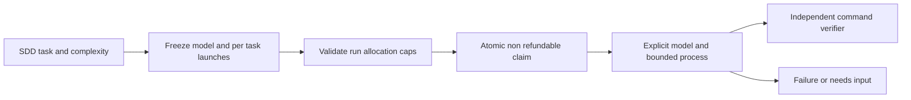

# Models and budgets before launch

Initial policy: strong models for planning/research; economical models for narrow implementation under established contracts; cheap models for extraction/formatting. Commands/validators need no LLM. Complexity determines role, not file extension. Never route security/architecture/ambiguous decisions to simple models merely to save cost.

| Role | Codex default | Claude default | Effort Codex / Claude | Units / launch | Deadline |
|---|---|---|---|---|---|
| planning | gpt-6.1-sol | opus | high / high | 5 | 600 s |
| implementation | gpt-6-luna | sonnet | high / medium | 2 | 300 s |
| simple | gpt-6-luna | haiku | low / low | 1 | 60 s |

Our starting policy, not a ranking/benchmark/availability guarantee. Planning Sol balances strong reasoning/spend; Astra remains available via explicit custom profiles. Cheaper implementation fits clear SDD tasks with independent gates; failures stop workflows, never switch models. Claude aliases may change underlying versions; use available full IDs for reproducibility. [OpenAI models](https://developers.openai.com/codex/models), [Claude flags](https://code.claude.com/docs/en/cli-reference), checked 2026-10-19. Effort is not directly comparable across models; validate quality on representative tasks.

## Workflow contract

Optional top-level `ai_policy` (mandatory for every AI task in managed workflows):

```json
{
  "max_calls": 6,
  "max_units": 30,
  "max_prompt_bytes": 32768,
  "profiles": {
    "planning": {"model":"gpt-6.1-sol","effort":"high","weight":5,"seconds":600},
    "implementation": {"model":"gpt-6-luna","effort":"high","weight":2,"seconds":300},
    "simple": {"model":"gpt-6-luna","effort":"low","weight":1,"seconds":60}
  }
}
```

Each AI task has one of three `model_role` values and `model_calls` 1..`limits.max_attempts`. Command tasks have no model fields. Profiles must include exactly all three roles/no unknown fields. Model ID nonempty <=128 chars, ASCII `[A-Za-z0-9][A-Za-z0-9._:/-]*`; effort low/medium/high. Weight integer1..100, seconds finite >0 <=3600. max_calls integer1..1000; max_units integer1..100000; max_prompt_bytes integer1024..1048576. Total `model_calls`/weighted allocations across AI tasks must fit caps; spare allowance is no escalation permission. Check UTF-8 prompt at admission and with runtime handoff before spawn.

BEGIN IMMEDIATE claims durably charge launches before subprocess; spawn failures, timeouts, needs_input, cancellation and expired leases retain charges. Restart/resolve never resets counters. Each task has its own cap; retries cannot take later stages' shares. Exhaustion yields terminal failed/model_budget_exhausted, with no automatic refill. Final verifiers/commands cost zero units. Policy snapshot enters workflow digest; never alter existing runs. New configurations need separate reviewed runs. Legacy generic workflows without policy remain unmanaged, explicitly shown in status.

Product-create defaults allocate one planning launch to each of six research/synthesis stages: **6 launches / 30 units**, no automatic retries. max_attempts adds an upper bound, not funds. Runtime create calls no model. `status`/`export` show requested model/effort, allocations/charged/remaining/pending tasks; charged means reserved, not actual provider spend. User JSON `--ai-policy` replaces policy before create; product tasks retain one launch. Retry allocations need explicit generic workflows.

## Guarantee boundary

New [usage accounting](usage-accounting.md) adds actual CLI counters, reported/rate-card costs and stage/run cap stops. Below are legacy launch-only limitations; `budget.provider_usage` remains legacy null, current telemetry lives in `usage`.

Units are conditional weights, not USD/tokens/credits/weekly subscription percentages. One CLI launch can contain many internal API calls/child agents. Runtime guarantees its launch allocations, prompt size/process deadlines, not API-token caps/final invoices. Prompt size does not limit files/tools read by agents. Inherited CLI config/hooks/MCP are not sandboxed by counters. Use trusted environments/provider-account limits when financial ceilings are needed.

Codex supports explicit models/JSONL usage ([noninteractive](https://developers.openai.com/codex/noninteractive)); launch-only mode does not interpret streams. With `usage_policy`, bounded parsing extracts numeric allowlists into a separate `usage` ledger, never raw streams. Claude `--max-budget-usd` is a client estimate allowing overshoot, not a portable hard cap. Actual spend/remaining subscription quota are unknown here; offline acceptance establishes no market validation/operational SLA.



Managed workers are instructed not to nest model/agent launches or escalate models; coordinators preallocate separate tasks. This is trusted-worker instruction, not OS enforcement. Our scheduler configures no fallback, but inherited provider config/routers may switch backends independently: status shows requested model, not attestation. Claude effort is not supported by all versions/models; check installed client/provider mapping ([model configuration](https://code.claude.com/docs/en/model-config), checked 2026-10-19).

Ready policy files: [Codex](../../examples/product-factory/codex-ai-policy.json), [Claude](../../examples/product-factory/claude-ai-policy.json). For example add `--ai-policy examples/product-factory/codex-ai-policy.json` to product-create; paths resolve from operator cwd. The standalone engineering [example](../../examples/product-factory/backend-agent.json) allocates implementation launches; adapt executable/feature/verifiers first.
