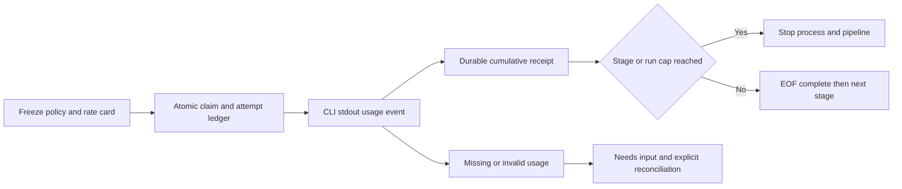

# Token and cost accounting

First read [launch budgets](model-budgets.md); usage accounting is an additional guard. CLI token receipts are separate from conditional units. [OpenAI JSONL](https://developers.openai.com/codex/noninteractive), [Claude result usage](https://code.claude.com/docs/en/agent-sdk/cost-tracking), checked 2026-10-19. Source-stream values are provider/CLI claims, not independent billing reconciliation.

## Workflow policy

Optional `usage_policy` requires `ai_policy` and at least one AI task. Exact object:

```json
{
  "max_tokens": 600000,
  "max_cost_usd": "12.00",
  "stages": {
    "TASK_ID": {"max_tokens":100000,"max_cost_usd":"2.00"}
  },
  "pricing": {
    "gpt-6.1-sol": {
      "input":"4", "cached_input":"0.2", "cache_creation":"5", "output":"15",
      "source_url":"https://developers.openai.com/api/docs/pricing",
      "as_of":"2026-10-19", "scope":"standard-long-context-conservative"
    }
  }
}
```

Stages keys must equal all AI task IDs, excluding command/final. Max tokens integer1..10^12; positive decimal USD string<=10000, <=9 fractional digits, no exponent/NaN/bool. Pricing map<=32 entries: model IDs follow model contract; input/cached_input/cache_creation/output are USD/million decimal strings0..10000 with <=9 fractional digits; metadata source_url HTTP(S) without auth/query/fragment, as_of ISO date, scope nonempty<=128 ASCII. Every requested Codex model needs a matching rate card; Claude uses reported cost and needs no pricing entry. Unknown fields forbidden. Stage caps<=run caps; their sum may exceed the shared cap, whose guard still applies. Policy is immutable in workflow digest.

Product defaults: 600000 tokens/$12/run; 100000/$2/stage including retries. Provisional runtime-user caps, not spending forecasts/universal norms. `--usage-policy /path/to/policy.json` replaces policy before create. Create/status/export show configuration, observed per-attempt/stage/run totals/completeness; create calls no models. Old snapshots without usage_policy remain unchanged with disabled/unknown telemetry. New product runs enable accounting by default.

[API pricing](https://developers.openai.com/api/docs/pricing), 2026-10-19: default Codex uses conservative Standard long-context rates. Sol input/cache-read/cache-write/output =4/0.2/5/15, Luna=0.2/0.02/0.25/0.75 USD/1M. Explicit rate-card estimates on actual usage counts: CLI does not expose each internal API call's context tier. Users may replace snapshots for their gateway/provider/service tier. Fast/region/tool fees/subscriptions are not automatically inferred. Claude total_cost_usd is reported CLI estimate, not invoice. Always expose cost source.

## Normalized telemetry

Input includes cache reads/writes; output includes reasoning, never added twice. Total tokens=input+output. Cached/cache_creation are input subsets. Optional reasoning null means unavailable. Cumulative normalized snapshot **for the current attempt**, exact fields:

`sequence, input_tokens, cached_input_tokens, cache_creation_input_tokens, output_tokens, reasoning_output_tokens, total_tokens, reported_cost_nano_usd`.

All main counters integer0..10^12 (sum<=10^12); Codex cache_creation_input_tokens may be null for unavailable breakdown; bool forbidden; sequence1..10000; cost null for Codex, integer0..10^15 for Claude. Unknown cache-creation count prices ambiguous noncached input at max(input,cache_creation) rate: conservative estimate, not zero-write claims. Aggregate write counter is null if any attempt lacks it. Completeness concerns total input/output accounting, not all optional breakdowns. Money is integer nanodollars (1 USD=10^9), Decimal/ceil; USD/1M rates multiply disjoint token buckets. Snapshots only increase. Price cached/creation/uncached once. Store no raw source/message/tool payloads/provider IDs. Discard temporary chunks; bound lines<=1MiB/<=10000 lines, with additional output cap.

Codex turn.started → turn.completed.usage: input_tokens already includes cached_input_tokens; optional cache_creation_input_tokens/reasoning_output_tokens (missing cache_creation=null, reasoning=null). If any turn lacks write breakdown, cumulative cache_creation stays null. Sum completed turns; duplicate terminal without new start is a protocol error; unfinished active turns cannot complete. Failed turns without trustworthy usage remain unknown. Claude stream-json --verbose: account for one result with nonempty modelUsage map, summing inputTokens+cacheReadInputTokens+cacheCreationInputTokens into inclusive input. Output uses outputTokens; total_cost_usd from result. Do not add assistant per-step usage to result; error_during_execution/missing modelUsage are unknown. Store summed counters, not model-map keys; reported cost includes models/subagents if included in CLI result. [Claude counter limitations](https://code.claude.com/docs/en/agent-sdk/cost-tracking).

## Durable stopping and recovery

SQLite v2 `usage_attempts` stores PK run/task/attempt, fenced token/sequence/cumulative metrics and active/complete/unknown state. Create rows on claim. Callbacks transactionally save snapshots before process continuation; same-sequence/same-metrics duplicates are idempotent; conflicting sequences/decreasing counters rejected. Lease/token/state fencing prevents stale workers overwriting reconciliation. Crash/cancel/lease-expired unfinished attempts stay unknown with their last lower bound, never zero.

At >= stage/run token or USD cap, stop the supervised group, run failed/usage_budget_exhausted, no downstream AI. Signals arrive only after usage events; completed requests may exceed budget. Observed-spend stopping, not hard provider-invoice caps. Internal requests before the first CLI receipt remain invisible; deadline/launch guards still apply.

EOF without complete trustworthy telemetry → needs_input/usage_unknown. Unknowns block new AI claims even after ordinary resolve. `usage-reconcile --usage-file ... --task ... --attempt ... --reason ... --processes-stopped` accepts operator-verified normalized snapshots/restores completeness; explicit safe reason/stopped-process assertion required. Existing resolve then permits another attempt within original launch allocation. Budgets/launches never reset; exceeded caps are terminal. Reconcile invokes no model/permits no policy change. Preserve old receipts/reconciliation history.

## Frozen implementation interfaces

Parser lane `orchestrator.usage.UsageStream(adapter)`:

- `feed(chunk: bytes) -> list[dict]` accepts stdout bytes (not stderr), arbitrary boundaries, returning new cumulative snapshots with the exact fields above.
- `finish() -> list[dict]` processes final unterminated lines and verifies at least one completed turn/result/no unfinished turn. Malformed/duplicate/overflow/missing data raises ValueError without source text. Further feed after finish is rejected.
- Codex snapshot sequence=completed-turn count; Claude has one result sequence=1. No float money parsing: json.loads(parse_float=Decimal), total_cost_usd→ceil nanodollars; bounded mixed-model counters.

Runner lane:

- `invocation(task, workspace, *, profile=None, telemetry=False, max_cost_usd=None)` preserves legacy argv exactly without telemetry; telemetry adds Codex --json, changes Claude output-format to stream-json + --verbose. Supplied Claude max_cost_usd adds --max-budget-usd (estimate guard, not hard invoice cap). No permission bypass.
- `execute(..., usage_adapter=None, on_usage=None)` uses optional parsing only for explicit usage_adapter; callback(snapshot)->bool after each snapshot; false kills group/reason usage_stop. Callback/parser exceptions yield usage_error. stderr only enters digest. finish runs on normal EOF; missing/broken completion gives usage_error. Optional `usage_complete: bool|None = None`: True only at trustworthy EOF; interrupted/malformed telemetry False. Existing execute/Result arguments remain compatible.

Coordinator owns accounting policy/pricing validation/calculation, SQLite ledger/migration/reconciliation, engine callbacks/report, product/CLI/docs/test integration. Lanes never edit shared contracts/progress. Tests are fixtures; live providers/billing NOT_RUN.



## Safe CLI diagnostics

`Result.diagnostics` contains fixed diagnostic codes only, JSON-event count, observed turn.started and allowlisted terminal events. Bounded stdout error-event/stderr classification covers auth/model/config/network/sandbox/rate-limit errors without messages/URLs/IDs/prompts. Observation/classification is not billing-outcome proof. Drop oversized lines; never buffer indefinitely. Spending stays unknown without receipts even with a known error code.

Save process outcomes in fenced transactions before complete_usage/usage_unknown pause, exposing returncode/reason/seconds/digest/bytes in status/export even without counters. Legacy results without diagnostics remain compatible. No automatic replay/zero reconciliation. Separate attended diagnostic canaries require explicit user scope/budget and do not replace previous-attempt spend; trustworthy successful canary usage is needed before full recovery. Previous-run unknowns remain separately visible, never zeroed by a new run.

### Observable steps and few-shot

Diagnostics saves up to32 enum-only step records (turn/item/error/result, allowlisted tool category, bounded exit code), total-event/dropped-step counts. No reasoning text/items, arguments, commands, URLs, file paths or model output. This is an external-action journal, not chain-of-thought. `steps_dropped>0` explicitly signals incompleteness.

For later few-shot prepare a **reviewed case card**: sanitized task summary; applicable scope/model/source revision; observed steps; actual checks/result; failure/root cause versus hypothesis; confirmed fix or unknown; evidence references; lesson/limits; draft/reviewed/rejected status. Success requires independent checks/fingerprint; failure does not prove a remedy. Raw logs cannot automatically become trusted examples. Before another prompt, deidentify/review/check freshness/select1–3relevant short cards under a separate token cap. This change enables no automatic training/case injection.

### Highlighting public decision traces

For material decisions, managed workers optionally write `decision-trace.json` beside handoff: version1, review_status=draft, task (short public description), steps (1..32). Each step: id, action<=120 chars, summary<=600 (concise choice rationale, not internal deliberation), evidence<=10 source/E/receipt refs, decision_ref, outcome proposed/succeeded/failed/unknown. No hidden reasoning, raw commands/arguments/tool output/personal data. Summaries are separate public artifacts, not reasoning-item extraction from provider streams.

`python3 -m orchestrator.decision_trace --trace /path/decision-trace.json --output /path/review.html` creates responsive local HTML without overwrite/network/scripts. Outcome colors/#step-id anchors highlight steps. Escape input text; rendering never converts author-reported outcomes/review_status to independent proof. Draft is never ready few-shot: sanitation/evidence review/freshness remain mandatory. Authors must use unknown without actual checks. Core pipeline schema unchanged; traces never replace stage gates.

Parser failures expose safe codes: line/JSON/event/invariant/incomplete/provider, duplicate-key, integer-limit, nonfinite-value. No source values. Allowlisted ignored provider events cannot alter numeric usage; terminal accounting remains mandatory. Parsing-policy changes need offline regressions/separate bounded compatibility probes.

## Incremental transport and inherited budget

Optional Codex task `transport: app-server` uses a stdio bridge with one ephemeral thread/turn. `thread/tokenUsage/updated.tokenUsage.total` is cumulative for the fresh thread; do not add `last`. Callbacks save receipts before subsequent events. Completion requires `turn/completed` status completed and at least one usage update. Interrupted/missing/invalid telemetry retains lower bounds/unknowns. Preserve workspace-write/approval never; never approve unexpected server requests. Thread/turn IDs are transient only. Public summaries stay separate; private reasoning/tool payloads are not exported.

This is an intermediate stop after response updates, not a hard pre-request cap: one request may cross threshold. Legacy exec remains explicitly terminal-only transport. Source: [OpenAI App Server](https://developers.openai.com/codex/app-server), installed0.163.0 schema, checked2026-10-19.

Optional usage_policy `carry` contains reviewed inherited source/observed_tokens/observed_cost_usd/reserved_tokens/reserved_cost_usd/unknown entries. Reserved values>=known lower bounds; complete entries equal observed. Caps include reserved carry; actual aggregate stays unknown with unknown entries. Never alter old ledgers/call reserves actual invoices. Exhausted carry blocks admission/claims. Preserve monetary ceilings; token ceilings change only after explicit review. Reserves themselves cannot establish strict lost-historical-billing upper bounds.

Current continuation requires nonempty reviewed carry and max_cost_usd<=explicit original budget-ceiling; missing transferable accounting is rejected, not replaced with fresh funds. Unknown reserves=max(old stage allocation, observed lower bound), complete entries=observed: agreed conservative scheduling reserves, not verified old-invoice upper bounds. New receipts stay separate from carry. `available_reserved_cost_usd` shows allowance after reserves; historical unknowns keep actual completeness false.

Supervisor failures preserve safe outcomes: exception class/location in owned runtime, without error text/arguments/locals. Counters received before failure remain lower bounds; markers/handoffs never replace terminal receipts.

### Process-group cleanup after root exit

On cleanup-signal PermissionError, suppress only if root has exited and readonly `/bin/ps -axo pgid=` confirms no group. Inventory timeout2s, numeric-only; never store raw output. Active root/group, unavailable ps or unclear output fails closed. Neither permission bypass nor reconciliation of old unknown receipts. Verified absence permits pipe draining/terminal telemetry; assumptions cannot recover past lost receipts.

### Complete guide packets in tool history

App Server sets task-local `tool_output_token_limit=100000` to preserve mandatory source packets against history truncation. [OpenAI config reference](https://learn.chatgpt.com/docs/config-file/config-reference), checked2026-10-19: setting affects individual tool/function outputs in history.100000 is our engineering policy, not vendor advice. It authorizes no100000new tokens: normal stage/run spending guards, raw-output1MiB bound and permissions remain. Nested functions.exec also needs an explicit outer-output budget; remaining truncation requires only missing bounded chunks, preferably parallel. Never reread entire packets or skip unread mandatory docs.
