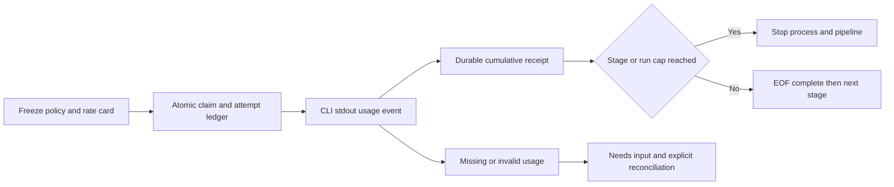

# Учёт токенов и стоимости

Сначала [launch budgets](model-budgets.md); usage accounting — дополнительный guard. Полученные CLI token receipts сохраняются отдельно от условных units. [OpenAI JSONL](https://developers.openai.com/codex/noninteractive), [Claude result usage](https://code.claude.com/docs/en/agent-sdk/cost-tracking), проверено 2026-10-19. Сведения в source потоке — provider/CLI claims, не независимая billing сверка.

## Workflow policy

Optional `usage_policy` требует `ai_policy` и хотя бы одну AI task. Точный объект:

```json
{
  "max_tokens": 600000,
  "max_cost_usd": "12.00",
  "stages": {
    "TASK_ID": {"max_tokens":100000,"max_cost_usd":"2.00"}
  },
  "pricing": {
    "gpt-6.1-sol": {
      "input":"4", "cached_input":"0.2", "cache_creation":"5", "output":"15",
      "source_url":"https://developers.openai.com/api/docs/pricing",
      "as_of":"2026-10-19", "scope":"standard-long-context-conservative"
    }
  }
}
```

Stages keys ровно все AI task IDs, не command/final. Max tokens integer 1..10^12; positive decimal string USD <=10000, максимум 9 digits after dot, без exponent/NaN/bool. Pricing map <=32 entries: model ID по model contract; поля input/cached_input/cache_creation/output — USD per million, decimal string 0..10000 <=9 fractional digits, metadata source_url HTTP(S) без auth/query/fragment, as_of ISO date, scope nonempty <=128 ASCII. Для каждого Codex requested model нужен matching rate card; Claude использует reported cost, pricing для него не обязательно. Unknown fields запрещены. Stage caps <=run caps, их сумма может превышать общий cap: общий guard всё равно действует. Policy immutable в workflow digest.

Product defaults: 600000 tokens/$12 на run; 100000/$2 на этап, включая его retry attempts. Это provisional cap пользователя runtime, не предсказание расходов или универсальная норма. `--usage-policy /path/to/policy.json` заменяет policy до create. Create/status/export показывают configuration, observed per-attempt/per-stage/run totals и completeness; create модели не вызывает. Старые snapshots без usage_policy не меняются и показывают disabled/unknown telemetry. Новые product runs включают accounting по умолчанию.

[API pricing](https://developers.openai.com/api/docs/pricing), 2026-10-19: для default Codex используем консервативные Standard long-context rates. Sol input/cache-read/cache-write/output = 4/0.2/5/15, Luna = 0.2/0.02/0.25/0.75 USD/1M. Это explicit rate-card estimate по реальным usage counts: CLI не сообщает context-tier каждой внутренней API call. User может заменить snapshot согласно своему gateway/provider/service tier. Fast/region/tool fees и подписки не выводятся автоматически. Claude total_cost_usd — reported CLI estimate, не invoice. Cost source всегда виден.

## Нормализованная telemetry

Input включает cache read/write; output включает reasoning, reasoning никогда не добавляется повторно. Total tokens = input+output. Cached/cache_creation — подмножества input. Optional reasoning count null означает unavailable. Нормализованный cumulative snapshot **по текущей attempt**, точные поля:

`sequence, input_tokens, cached_input_tokens, cache_creation_input_tokens, output_tokens, reasoning_output_tokens, total_tokens, reported_cost_nano_usd`.

Все основные counters integer 0..10^12 (sum <=10^12); cache_creation_input_tokens у Codex может быть null при unavailable breakdown, bool запрещён; sequence 1..10000; cost null для Codex, integer 0..10^15 для Claude. При неизвестной cache creation count ambiguous noncached input оценивается по max(input,cache_creation) rate; это консервативная оценка, не заявление нулевых writes. Aggregate write counter null, если unavailable хотя бы в одной attempt. Completeness относится к полному total input/output accounting, а не доступности всех optional breakdowns. Money integer nanodollars (1 USD = 10^9), Decimal и ceil; rates USD/1M умножаются на disjoint token buckets. Snapshot может только расти. Цена cached/creation/uncached учитывается один раз. No raw source/message/tool payloads/provider IDs сохраняются. Прочитанный временный chunk удаляется; memory bounded line <=1MiB, <=10000 lines, output cap остаётся дополнительным.

Codex turn.started → turn.completed.usage: input_tokens уже включает cached_input_tokens; optional cache_creation_input_tokens и reasoning_output_tokens (missing cache_creation=null, reasoning=null). Если хотя бы один turn не сообщил write breakdown, cumulative cache_creation остаётся null. Суммируем завершённые turns, duplicate terminal без нового start — protocol error, активный незавершённый turn не complete. Turn failure без trustworthy usage unknown. Claude stream-json --verbose: учитывать один result с непустым modelUsage map, суммируя inputTokens + cacheReadInputTokens + cacheCreationInputTokens в inclusive input. Output из outputTokens; total_cost_usd из result. Assistant per-step usage не складываем с result; error_during_execution и missing modelUsage считаются unknown. Model map keys не сохраняются, только суммы; reported cost includes models/subagents, если CLI включил их в result. [Ограничения Claude counters](https://code.claude.com/docs/en/agent-sdk/cost-tracking).

## Durable stop и recovery

SQLite v2 `usage_attempts` хранит PK run/task/attempt, fenced token/sequence/cumulative metrics, state active/complete/unknown. Row создаётся при claim. Callback пишет snapshot transactionally до продолжения процесса; duplicate same seq+same metrics идемпотентен, conflicting seq/decreasing counters rejected. Lease/token/state fencing не даёт старому worker переписать reconciliation. Незавершённая attempt после crash/cancel/lease expiry остаётся unknown с последним lower bound; не превращать её в ноль.

При >= stage/run token или USD cap: supervised process group останавливается, run failed/usage_budget_exhausted, downstream AI не запускается. Сигнал доступен только после usage event; уже выполненные запросы могут превысить budget. Это stop по наблюдаемому расходу, не hard provider-side invoice cap. Внутренние requests до первого CLI receipt остаются невидимыми; deadline и launch guards продолжают действовать.

EOF без full trustworthy telemetry → needs_input/usage_unknown. Unknown блокирует новые AI claims даже после обычного resolve. `usage-reconcile --usage-file ... --task ... --attempt ... --reason ... --processes-stopped` принимает проверенный оператором normalized snapshot, восстанавливает completeness; нужен explicit safe reason и stopped-process assertion. Затем existing resolve разрешает новую attempt в изначальном launch allocation. Бюджет/launches не обнуляются, exceeded caps терминальны. Reconcile не исполняет модель и не разрешает менять policy. Старые receipts/reconciliation history сохраняются.

## Frozen implementation interfaces

Parser lane `orchestrator.usage.UsageStream(adapter)`:

- `feed(chunk: bytes) -> list[dict]` принимает stdout bytes (не stderr), произвольные chunk boundaries, возвращает новые cumulative snapshots (строго выше).
- `finish() -> list[dict]` обрабатывает последнюю line без newline и валидирует хотя бы один завершённый turn/result и отсутствие незавершённого turn. На malformed/duplicate/overflow/missing data raises ValueError без source text. После finish дальнейший feed rejected.
- Codex snapshots sequence=number of completed turns; Claude one result sequence=1. Не парсит деньги через float: json.loads(parse_float=Decimal), total_cost_usd → ceil nanodollars; mixed model counters bounded.

Runner lane:

- `invocation(task, workspace, *, profile=None, telemetry=False, max_cost_usd=None)` — без telemetry legacy argv exact; telemetry Codex добавляет --json, Claude меняет output-format на stream-json + --verbose. Если Claude max_cost_usd передан, добавить --max-budget-usd (estimate guard, не hard invoice cap). No permission bypass.
- `execute(..., usage_adapter=None, on_usage=None)` — optional парсер только при explicit usage_adapter; callback(snapshot)->bool после каждого snapshot, false → kill group reason usage_stop. Callback/parser exception → usage_error. stderr только digest. finish вызывается на EOF normal path, parser missing/broken completion usage_error. Результат расширяется optional `usage_complete: bool|None = None`, True только при trustworthy EOF; False на interrupted/malformed telemetry. Existing execute/Result arguments remain compatible.

Coordinator owns accounting policy/pricing validation/calculation, SQLite ledger/migration/reconciliation, engine callbacks/report, product/CLI/docs/test integration. Lanes не меняют shared contracts/progress. Все тесты fixtures, live providers/billing NOT_RUN.



## Безопасная диагностика CLI

`Result.diagnostics` содержит только fixed diagnostic codes, число JSON events, наблюдённый turn.started и allowlisted terminal event. Bounded parser stdout error events/stderr классифицирует auth/model/config/network/sandbox/rate-limit ошибки, не сохраняет сообщения/URLs/IDs/prompts. Это observation/classification, не доказательство billing outcome. Oversized lines отбрасываются, не буферизуются без ограничения. Без usage receipt расход unknown даже при известном коде ошибки.

Process outcome сохраняется fenced transaction до complete_usage/usage_unknown pause, поэтому status/export доступны returncode/reason/seconds/digest/bytes даже при отсутствующих counters. Старые результаты без diagnostics совместимы. Никакого automatic replay/zero reconciliation. Отдельный attended diagnostic canary допускается только при явном user scope/budget и не заменяет расход прежней попытки; successful canary с trustworthy usage нужен прежде полного recovery. Unknown прежнего run сохраняется отдельно и раскрывается, а не обнуляется новым run.

### Observable steps и few-shot

Diagnostics сохраняет до32 enum-only step records (turn/item/error/result, allowlisted tool category, bounded exit code), общее число events и число отброшенных steps. Reasoning text/items, arguments, commands, URLs, file paths и model output не сохраняются. Это журнал внешних действий, не chain-of-thought. `steps_dropped>0` явно показывает неполноту trace.

Для последующего few-shot подготовить **reviewed case card**: sanitized task summary; applicable scope/model/source revision; observed steps; actual checks/result; ошибка/root cause vs hypothesis; подтверждённое исправление либо unknown; evidence refs; lesson и ограничения; status draft/reviewed/rejected. Success требует independent checks/fingerprint, failure не доказывает remedy. Сырые логи нельзя автоматически превращать в trusted examples. Перед включением в следующий prompt — deidentify/review, проверить актуальность и выбрать 1–3 релевантных коротких карточки под отдельный token cap. Автоматическое обучение/инъекция cases этим изменением не включены.

### Подсветка публичного decision trace

Для существенных решений managed worker получает optional инструкцию написать рядом с handoff `decision-trace.json`: version1, review_status=draft, task (публичное краткое описание), steps (1..32). Step: id, action (до120 символов), summary (до600; краткое основание выбора, не внутренний ход рассуждений), evidence (до10 source/E/receipt refs), decision_ref, outcome proposed/succeeded/failed/unknown. Никаких скрытых рассуждений, raw commands, аргументов, tool output или персональных данных. Summaries — отдельный публичный артефакт, не извлечение reasoning items из provider stream.

`python3 -m orchestrator.decision_trace --trace /path/decision-trace.json --output /path/review.html` создаёт локальный адаптивный HTML без overwrite/network/scripts. Цвет outcome и якорь `#step-id` позволяют подсвечивать шаги. Input text экранируется; renderer не превращает author-reported outcome или review_status в independent proof. Draft никогда не означает готовый few-shot: очистка/evidence review и актуальность обязательны. Автору нужно указать outcome unknown, если фактических проверок нет. Core pipeline schema не меняется; наличие trace не заменяет stage gates.

Parser failure codes уточняют безопасную причину: line/JSON/event/invariant/incomplete/provider, duplicate-key, integer-limit, nonfinite-value. Они не содержат исходных значений. Разрешённые ignored provider events не должны менять numeric usage; terminal accounting остаётся обязательным. Любое изменение parsing policy требует offline regression и отдельного bounded compatibility probe.

## Incremental transport и inherited budget

Optional Codex task `transport: app-server` использует stdio bridge с одним ephemeral thread/turn. `thread/tokenUsage/updated.tokenUsage.total` — cumulative snapshot текущего fresh thread; `last` не прибавляется. Callback сохраняет receipt прежде следующего события. `turn/completed` со status completed и хотя бы одним usage update необходимы для complete. Interrupted/missing/invalid telemetry сохраняет lower bounds и unknown. Сохраняются workspace-write/approval never, unexpected server requests не approve. Thread/turn IDs только transient. Публичные summaries отдельно; private reasoning/tool payloads не экспортируются.

Это промежуточный stop после response update, не hard cap до provider request: один запрос ещё может перейти threshold. Legacy exec остаётся terminal-only и явно отличается transport. Source: [OpenAI App Server](https://developers.openai.com/codex/app-server), installed0.163.0 schema, checked2026-10-19.

Optional usage_policy `carry` — reviewed inherited entries source/observed_tokens/observed_cost_usd/reserved_tokens/reserved_cost_usd/unknown. Reserved values >=known lower bound; complete entries равны observed. Caps включают reserved carry; actual aggregate остаётся unknown при unknown entry. Не менять старый ledger и не называть reserve фактическим счётом. Carry exhausted блокирует admission/claim. Monetary ceiling сохраняется; token ceiling меняется только после явного review. Сами reserves не дают строгой верхней границы утраченного historical billing.

Continuation в текущем контракте требует nonempty reviewed carry и max_cost_usd<=explicit original budget-ceiling; отсутствие переносимого учёта отклоняется, а не создаёт чистый бюджет. Unknown reserves берутся max(old stage allocation, observed lower bound), complete entries ровно observed; это согласованный консервативный scheduling reserve, не подтверждённая верхняя граница старого invoice. Новые receipts выводятся отдельно от carry. `available_reserved_cost_usd` показывает allowance после резервов; actual completeness остаётся false при старых unknown.

Ошибки supervisor сохраняют безопасный outcome: класс исключения и место в собственном runtime, без текста ошибки, аргументов или локальных переменных. Полученный перед сбоем счётчик остаётся lower bound; marker/handoff не заменяют terminal receipt.

### Завершение process group после выхода

При PermissionError на cleanup signal runtime подавляет ошибку только если root уже вышел и read-only `/bin/ps -axo pgid=` подтверждает отсутствие группы. Inventory timeout2s, numeric-only, результат не сохраняется как raw log. Active root/group, недоступный ps или непонятный output — fail closed. Это не обход permission и не reconciliation старых unknown receipts. Проверенное отсутствие позволяет дочитать pipe и terminal telemetry; прошлые lost receipts не восстанавливаются предположением.
