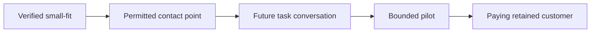

# B2B: small first customers

Mandatory foundation: [shared go-to-market](go-to-market.md), [cases](cases/b2b-first-customers.md), [cost](pricing.md), [sources](go-to-market-sources.md). Deliver a sales plan and outreach drafts, not sent messages.

## 1. Narrow buyer

Derive ICP from actual project context: industry, country/language, task, current substitute, problem frequency/loss, user, decision-maker and payer. Explicitly label pre-build / post-polish stage and capabilities supported by the product revision. Do not promise nonexistent integrations.

Operational default for this task: an independent team of **1–30 people or 1–3 locations**, with an accessible owner/decision-maker. This is our user-requested small-fit boundary, not a legal SME classification. A corporate chain, large holding's subsidiary brand and enterprise procurement fail this filter even with a small local location. A different limit requires rationale and an accepted decision; do not silently expand it to fill the list. Unknown size or parent ownership means conditional, not qualified.

## 2. Find and verify candidates

Start with free public sources: company website/about/contacts, maps and industry directories, an official registry if available, vacancies, public reviews/owner posts. Record URL, date and exactly what is confirmed. Directories can be stale: cross-check current business presence. Usually two independent signals suffice where size/role/pain is disputed; mirrors of one database are not independent.

Aim for up to 10 suitable candidates in a small pilot batch, **without padding with irrelevant entries**. Three confirmed companies beat 10 invented ones. Keep qualified / conditional / rejected tables separately and explicitly preserve any shortfall. Card: company and geography, website, size/locations/ownership evidence, buyer role, publicly listed business-contact URL, observed trigger, pain hypothesis, existing solution, product fit/limitations, next verification. Do not guess personal emails, revenue, budget or internal processes.

Similarweb is an optional source of channel/traffic estimates if authorized access already exists. Small sites often lack data; **N/A is neither zero traffic nor an absent customer** ([provider explanation](https://support.similarweb.com/hc/en-us/articles/207698639-What-does-Not-enough-data-mean)). Traffic is not team size/ability to pay. With N/A continue verifying local facts; do not purchase access for the first list.

## 3. Pain, offer and economics

For every pain hypothesis: observed fact → possible problem → verification question → supported product promise. A review saying “could not get through” does not prove lost revenue or willingness to buy SaaS. Compare the manual substitute/competitor; offer one concrete outcome, bounded pilot, expected price or unknown, success criterion and exit terms. Do not copy Yclients' historical lifetime free support: onboarding/support and cost boundaries are mandatory.

Calculate value/cost transparently: task frequency × time × hourly cost, using known data or explicitly labeled ranges only. Separately account for sales time, implementation/onboarding, support and gross contribution. Do not price against an invented prospect turnover; a future conversation/test validates price.

## 4. Sales/outreach plan

Choose 1–2 free accessible paths: warm introduction/partner, an industry community under its rules, public business contact, useful case/demo content. A list of contact points/triggers is research, not permission to write. First-message draft: why this company, observed context without an unsupported diagnosis, one value proposition, one short question. No mass personalization using invented pain. Propose a small batch and reasoned cadence, such as one follow-up as a scenario; rejection/a request not to write stops future contact.

The funnel remains a hypothesis: eligible prospects → attempted contacts → delivered → replies → qualified conversations → pilots → paying → retained. Give each conversion a denominator/window; never conflate replies with sales. Assign owner, time/cash cap, a reasoned proposed target, stop and next step after zero replies. Do not invent candidate readiness or present “leads” as consenting buyers.

## DoD

Use the [template](../../templates/product/b2b-sales.md). Include qualified/conditional/rejected candidates with size/ownership evidence; separate observed pain from hypotheses; match the offer to the revision and bound the pilot; include public access paths, drafts, funnel, cash/time caps, stop, gaps and ADRs. Unavailable information explicitly limits readiness; no actual contacts/sales without separate scope. Before MVP answer “who do we sell to and how”; after polish update the same plan.
