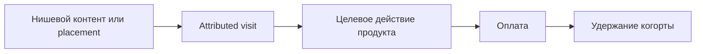

# B2C: аудитория и дешёвое привлечение

Сначала [go-to-market](go-to-market.md), [кейсы России и других рынков](cases/b2c-frugal-growth.md), [цены](pricing.md) и [реестр](go-to-market-sources.md). Оптимизируем доступ к первым целевым пользователям и платящим клиентам, а не красивые охваты.

## Аудитория до разработки

Узкий сегмент: geo/язык, ситуация и job, текущая замена, trigger, пользователь/плательщик, ожидаемая частота/цена/retention. Где эти люди уже ищут решение и кому доверяют? Подтверждать источниками/observed behavior; «все молодые в TikTok» не сегмент. Если monetization/география неясны, уточнить; не выдумывать LTV. Подготовить offer и короткий CTA, соответствующий actual product stage. До build можно планировать проверку проблемы/интереса, но не обещать готовый продукт или собирать платежи этим скиллом.

## Порядок поиска каналов

1. Cash-free варианты: свой контент/демонстрации, нишевые сообщества по их правилам, доступные основателю партнёрства/рефералы, полезный материал под запросы аудитории. Проверить наличие доступа и модерацию; бесплатность не гарантирует distribution. У SEO есть срок и трудозатраты.
2. Native creator/TikTok/short video: маленькие релевантные авторы и локальные аудитории, предложение бартера/совместного контента. Это **гипотеза сделки**, пока нет опубликованных условий/quote. Посчитать себестоимость товара, доставку, съёмку, editing, права и время. Исторический BuduFood — пример механизма, не актуальный прайс.
3. Telegram: конкретные тематические каналы/посты и публичные media kits, авторская аудитория, формат/длительность/удаление/маркировка/fees. Проверить median comparable post views, geo/topic fit, suspicious spikes и ограничения данных; subscribers ≠ guaranteed reach. Нативный пост, прямой заказ и Telegram Ads — разные продукты/цены.
4. Paid search/social — только если минимальный **полный** тест помещается в реальный cap, доступен географически и есть проверяемое измерение. Не отводить ему бюджет по привычке. Высокую цену отсеять сразу, не строить вокруг неё кампанию.

Исследовать российский и иностранный startup case, объяснить переносимость аудитории, стадии, платформы и расходов. Не масштабировать зрелый Flowwow или vendor-selected success KPI на новый продукт. Native ≠ organic: рекламная интеграция остаётся платной, даже если выглядит как обычный ролик.

## Конкретный shortlist и тесты

Для 2–3 лучших кандидатов максимум: аудитория и observed fit, URL конкретной площадки/автора или обоснованной search intent группы, format/creative/offer/CTA, price quote и дата либо unknown, full cash/time costs, existing access/eligibility, первичная метрика, denominator/window, attribution/dedup, cap/stop и owner. Не заполнять quota платными каналами при cash cap=0. Неизвестная цена/право размещения остаётся conditional; если нет ни одного доступного теста, честно needs_input.

Не обещать CPM/CAC из публичного rate card. Известная цена / наблюдаемые сопоставимые views = scenario CPM, не гарантированный; views → visits → activation → paid → retained требует отдельных измерений. CAC считается на новых платящих клиентах с указанным набором затрат; до них допустим proposed target/sensitivity, не actual CAC. Маржа и retention неизвестны → экономическая готовность conditional.

Все стрелки обозначить observed/disclosed/hypothesis; до запуска значения unknown. Для будущих тестов предложить campaign-specific ссылки/коды и cohort window; не устанавливать tracking сейчас. Остановить тест по cap, нерелевантной аудитории, недоступному измерению или невыполненному activation guardrail. Точные пороги — наши обоснованные proposals, не факты из стартапов.

## DoD и после polish

[Шаблон](../../templates/product/b2c-growth.md): сегмент/плательщик, конкретные доступные точки входа, foreign/Russian cases, free-first shortlist, price/rejection register, полные caps и тест-карточки, attribution, unknowns/ADR. Перед implementation — sellability checkpoint; после polish — ревизия offer/landing/onboarding/payment и свежих quotes. Тесты not_run, customer validated=false. Публикация, outreach, barter negotiation, закупки и рекламные кабинеты требуют отдельного execution scope. Текущую eligibility страны/платформы проверять; неизвестность не обходить.
