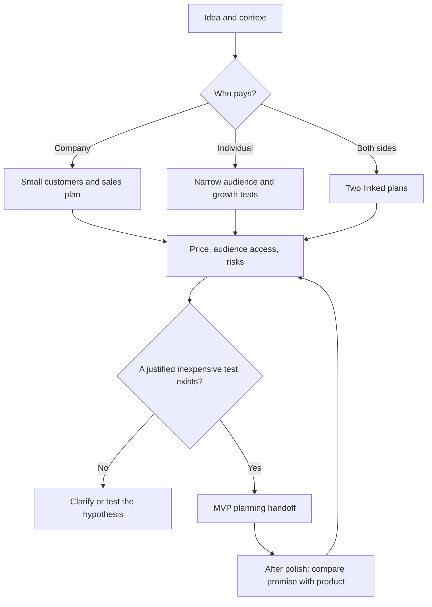

# Who to sell to and how — before implementation

Plan the first customers before engineering implementation. After polish, repeat the check against actual capabilities and the product revision: never promise missing functionality. These are two checkpoints in one plan, not discovery postponed until the end.

## Choose a path

B2B: an organization buys — [small first customers](b2b.md). B2C: an individual buys — [audience and inexpensive traffic](b2c.md). For marketplaces/B2B2C, separately describe the payer, user and each side; available supply is not automatically established demand. If the model is unclear, ask one question while preserving independent findings. Do not substitute a more convenient business.

## Budget and permissions

First establish currency, geography, total cash cap, per-test cap, available time and production costs. Without a stated budget, **cash cap = 0**; paid options remain conditional and stay out of the executable shortlist. Model research budget and future sales/media budget are different limits. Prioritize existing audience access, founder-led work, partnerships and owned content; only then consider confirmed affordable paid tests. Do not complicate research with paid APIs when public sources suffice.

Reject expensive options before detailed planning: minimum feasible test + production + commissions + mandatory costs must fit both caps. An unknown mandatory price component means needs_quote, not zero cost. Include founder time, barter goods/delivery and support. Label time estimates scenarios. Quote-register rules: [pricing](pricing.md).

Figures of RUB 3,000/test and RUB 10,000/14 days are permitted only as explicitly synthetic calculation examples if examples are needed; they are not market prices, global defaults or spending authorization. A concrete plan uses actual agreed constraints. Without margin/retention data, the CAC ceiling is a hypothesis with sensitivity, not a market benchmark.

## Evidence and decisions

Before selecting a segment/channel/offer, preserve rationale, sources, alternatives, consequences and review trigger under the [workflow](workflow.md). Read target README, INDEX, accepted ADRs and current product/UX/UI plans; write to target `.palarran/product/<task>/`, not the installed package. Exact product/report revisions, E-IDs and ADRs enter the handoff. Preserve rejected options and reasons: expensive, enterprise, unsuitable geography, no accessible channel, unknown price.

A successful case grounds a hypothesis, not a promised result: [B2B](cases/b2b-first-customers.md), [B2C](cases/b2c-frugal-growth.md). Separate company claims, our estimates and observations. Similarweb/directories/ad libraries do not prove pain, buyer budget or sales.

## Review checkpoint

Before recommending engineering planning, require buyer/user/geography/job, a concrete offer and accessible audience paths; B2B requires qualified small prospects with verifiable sources; B2C requires specific platforms/segments rather than “all TikTok users”; cash/time limits, at least one justified accessible test, attribution, stop criteria and product-promise checks. Otherwise report conditional/needs_input and the next validation rather than build-ready. A test plan is not demand, sales or PMF.

After polish verify product revision, landing/onboarding/payment readiness, permissible claims, current prices/placements and channel eligibility. Refresh expired quotes; unknowns remain blockers. Add a delta to the previous revision without erasing earlier rationale. Operational advertising/sales readiness is checked separately under explicit execution scope.

Research sends no outreach, purchases no ads, registers no accounts, publishes no posts and connects no tracking. Drafts and plans are allowed. Before an executable paid plan, check current platform rules, country availability and advertising/disclosure/fee terms; unavailable checks mean conditional, without bypassing restrictions.

## Output and DoD

Report: draft / research_complete / needs_input / blocked. Separately, execution readiness: ready_to_test / conditional / needs_input; all future tests are **not_run**. Ready_to_test means a complete proposed test within constraints, not permission to launch. Every accepted choice has an ADR; the handoff includes exact references, unknowns, owners and the next inexpensive test. Runtime schema checks artifact integrity, not customer-research truth or substantive sales-plan sufficiency: those require review.
