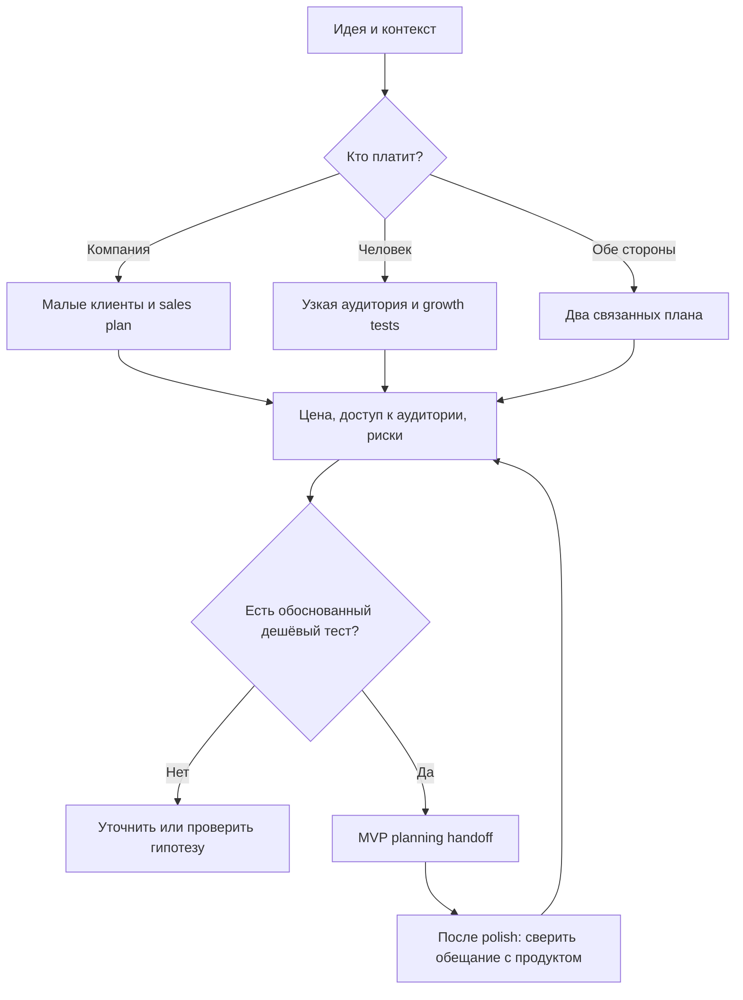

# Кому и как продавать — до реализации

Планирование первых клиентов начинается до инженерной реализации. После polish повторить проверку по фактическим возможностям и revision продукта: не обещать отсутствующий функционал. Это два checkpoint одного плана, а не перенос discovery на конец.

## Выбрать путь

B2B: покупает организация — [небольшие первые клиенты](b2b.md). B2C: покупает человек — [аудитория и недорогой трафик](b2c.md). Для marketplace/B2B2C отдельно описать плательщика, пользователя и каждую сторону; нельзя считать supply автоматически найденным спросом. При неясной модели задать один вопрос, сохранив независимые результаты. Не заменять заданный бизнес более удобным.

## Бюджет и разрешения

Сначала выяснить валюту, географию, общий cash cap, cap одного теста, доступное время и стоимость производства. Если бюджет не указан — **cash cap = 0**, платные варианты остаются conditional, не попадают в исполнимый shortlist. Модельный бюджет исследования и будущий бюджет продаж/медиа — разные лимиты. Приоритет: существующий доступ к аудитории, founder-led работа, партнёрство, собственный контент; затем только подтверждённые доступные платные тесты. Не усложнять исследование платными API, когда достаточно публичных источников.

Отсекать дорогие варианты до подробного плана: минимальный исполнимый тест + производство + комиссии + обязательные расходы должны помещаться в оба cap. Неизвестная обязательная часть цены → needs_quote, не нулевая стоимость. Учитывать время основателя, бартерный товар/доставку и поддержку. Оценки времени помечать scenario. Правила quote register — [pricing](pricing.md).

Числа 3 000 ₽/тест и 10 000 ₽/14 дней допустимы только как явно синтетический пример расчёта, если нужны примеры; это не тарифы рынка, не глобальные defaults и не разрешение тратить. Конкретный план использует фактически согласованные ограничения. Без данных о марже/удержании CAC ceiling — гипотеза с sensitivity, не рыночный benchmark.

## Evidence и решения

До выбора сегмента/канала/оффера сохранить rationale, источники, альтернативы, последствия и условие пересмотра по [workflow](workflow.md). Прочитать target README, INDEX, accepted ADR, текущие product/UX/UI планы; записывать в target `.ai-development/product/<task>/`, не в установленный пакет. Точные product/report revisions, E-IDs и ADR переходят в handoff. Сохранять отклонённые варианты и причины: дорого, enterprise, неподходящая география, нет доступного канала, unknown price.

Успешный кейс — основание гипотезы, не обещание результата: [B2B](cases/b2b-first-customers.md), [B2C](cases/b2c-frugal-growth.md). Claim компании, собственная оценка и наблюдение разделяются. Similarweb/каталоги/ads libraries не доказывают боль, бюджет покупателя или продажи.

## Review checkpoint

Перед рекомендацией engineering planning нужны: buyer/user/geo/job, конкретный оффер и доступные способы дойти до аудитории; B2B — квалифицированные малые кандидаты с проверяемыми источниками; B2C — конкретные площадки/сегменты, а не «все пользователи TikTok»; cash/time ограничения, хотя бы один обоснованный доступный тест, attribution, критерии остановки и проверка обещания продукта. Если этого нет — conditional/needs_input и ближайшая проверка вместо утверждения build-ready. План теста не равен спросу, продажам или PMF.

После polish сверить product revision, готовность landing/onboarding/payment, допустимость claims, текущие цены/размещения и eligibility канала. Просроченные quotes обновить; неизвестное оставить blocker. Добавить delta к предыдущей revision, не стирать причины прежнего выбора. Операционная готовность к рекламе/продажам проверяется отдельно при явном execution scope.

Исследование не отправляет outreach, не покупает рекламу, не регистрирует accounts, не публикует посты и не подключает tracking. Подготовить черновики и план — разрешено. Текущие правила площадок, доступность страны, условия рекламы/маркировки/сборов проверять перед исполнимым платным планом; недоступная проверка = conditional, без обхода ограничений.

## Выход и DoD

Report: draft / research_complete / needs_input / blocked. Отдельно execution readiness: ready_to_test / conditional / needs_input; все будущие тесты **not_run**. Ready_to_test означает полноту предложенного теста в рамках ограничений, не разрешение запускать его. Каждый accepted choice имеет ADR; handoff содержит exact refs, unknowns, владельцев и следующий дешёвый тест. Схема runtime проверяет целостность артефактов, но не истинность customer research и не содержательную достаточность sales plan: последнее требует review.
