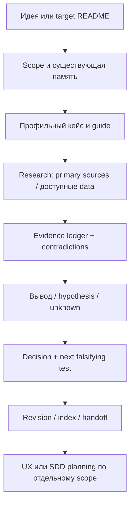

# Product workflow, память и handoff

Начать с [общей памяти](../skills/decision-memory.md), target README и product/UX/backend/frontend indexes/accepted ADR. Installed skill checkout и target project — разные roots. Исследования/решения/выходы пишутся в target, не внутрь plugin. Standalone invocation не запускает другие stages. Явный [pipeline](pipeline.md) последовательно связывает пять skills в existing runtime и synthesis; бесконечный product loop не включается.



1. Определить запрос одного скилла, target root, выбранные продукт/аналоги, регион/язык/time window и resource envelope. Неизвестный бизнес/критичная scope ambiguity → один конкретный вопрос; доступный context/research продолжать. Если пользователь дал analogues — сохранить их, расширения объяснять.
2. Прочитать mandatory case + профильный guide + evidence/data-sources; указать использованный case и **почему применим/что не переносим**. Не ссылаться на successful company как на достаточное обоснование.
3. Переиспользовать target research revisions с проверкой актуальности. Провести bounded evidence gathering: сначала primary и официальные disclosures, затем оценочные providers при доступе/бюджете; записать actual queries/statuses/coverage и inaccessible gaps. Не имитировать интервью, account use или подключённый API.
4. Построить профильный report/diagrams/ledger и варианты решения. Явно связать E→H→Decision→Test IDs. Каждое принятое решение до зависимого изменения записать canonical ADR с rationale/evidence/alternatives/consequences; unresolved remains proposed. Рекомендация агента не превращается в пользовательское согласие на расходы/публикацию.
5. Проверить research DoD: все существенные числа/source dates/definitions, арифметика/единицы, contradictions, переносимость кейсов, existing context, unresolved blockers и предлагаемые experiments. Нет evidence — честный unknown/conditional conclusion. Краткий summary не заменяет ledger.
6. Сохранить revision без перезаписи истории, обновить общий INDEX и product catalog/handoff. При новом source/решении отметить затронутые downstream UX/UI/SDD artifacts как needing review; не переписывать их автоматически. Research complete ≠ market validated, build-ready или deployed.

```text
.ai-development/product/
  INDEX.md
  <task>/
    context.md
    decisions/                      # canonical accepted records
    revisions/v001/
      report.md                     # профильный output / scoped question
      evidence.md                   # E-IDs, method, dates, limits
      handoff.md                    # recommendation, dependencies, blockers
      artifacts/                    # safe charts / permitted aggregates
    scratch/                        # temporary; не durable context
```

В target `.ai-development/INDEX.md` — canonical decision links; product INDEX — каталог report revisions/scope/status/dependency refs, не второй журнал ADR. Для linked report из другого task явно сохранить path/revision/date, не молчаливо использовать latest. В common handoff: что исследовано, actual evidence/queries/API status, что осталось unknown, source revisions, decision owner, next cheapest test, limits/permissions и downstream applicability.

`research_complete` возможно с явно неизвестной выручкой: качественный report не обязан выдумывать недоступное число. Но critical input для конкретного build/test решения удерживает это решение conditional/needs_input. Автоматический запуск экспериментов/engineering work из отчёта запрещён без соответствующего scope.
