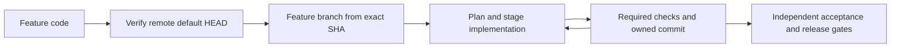

# Feature identity, branches and stage commits

A new feature receives the user's explicit code, such as PAY-123, or a generated code `PAL-YYYYMMDD-XXXXXX` with six random uppercase hexadecimal characters. Check the target's private feature registry and existing branches for collisions; reuse an existing ID only for the same feature. The ID is stable across plans, tasks, commits, documentation and handoffs. Store the mapping in target .palarran, not in the public framework repository.

For a normal authorized feature-design/build task, discover the remote default branch with `git ls-remote --symref origin HEAD`, fetch its exact ref and verify the fetched commit against current remote HEAD. Create the feature branch from that verified remote commit, not a stale local default branch. Use `codex/<lowercase-feature-code>-<short-slug>` unless the project/user specifies another convention. Record remote, default ref and exact base SHA. Never git-pull, stash, reset or transplant unrelated local work implicitly; use an isolated owned checkout/worktree when current work prevents a safe start.

Explicit offline `--plan` cannot verify remote freshness or create a branch. Record feature identity and the pending remote/branch prerequisite, and do not claim it completed. This is the only planning exception: standing user authorization for a regular feature task permits its branch preparation, while app execution/deployment/paid work still requires its own scope. Existing tasks retain their original branch/base unless explicitly migrated; do not restart active runs from a newer default branch.

End each coherent implementation stage with an owned, reviewable commit after its required checks. Commit only the stage's files/hunks, preserve unrelated staged/unstaged edits and never add private journals, secrets or generated agent state. A checkpoint with unresolved checks records them honestly and is not production-ready. Do not create empty commits for reads or use a commit as evidence of independent acceptance.

Commit trailers carry `Feature: <code>` and relevant `ADR: <stable-decision-id>` entries. ADR content remains private; the ID allows local/long-term recall without publishing the whole journal. Stage progress records the resulting commit and remaining gates. Push and MR creation remain distinct actions under actual user scope.

These branch/ID/trailer rules are Palarran policy requested by the owner. Git's [contribution guide](https://git-scm.com/book/en/v2/Distributed-Git-Contributing-to-a-Project), checked2026-10-24, supports coherent changes and useful commit explanations; it does not require this feature-code format.
