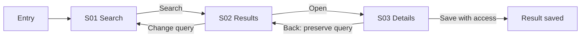
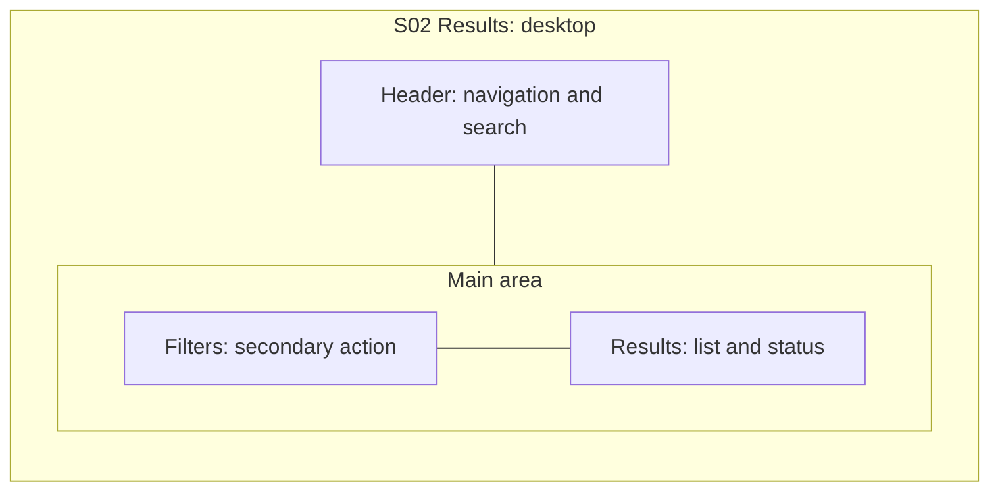
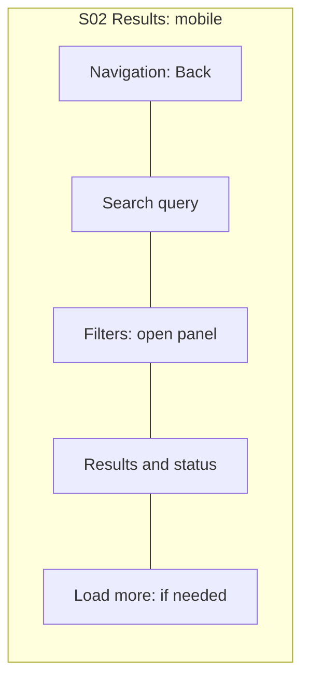
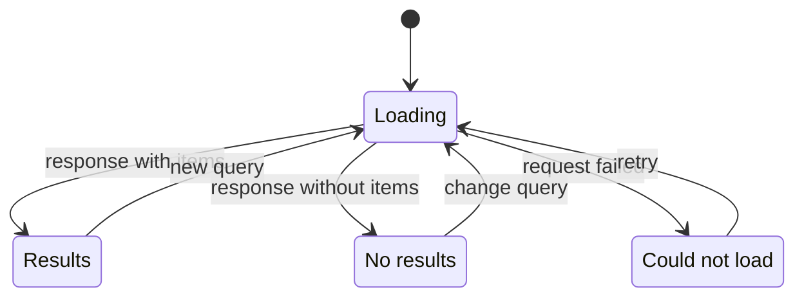

# Build UX diagrams

Markdown+Mermaid is the primary portable format. With an available renderer, save and inspect preview/SVG; export `.mmd` for handoff when useful. Figma/tldraw or a prototype is a separately selected output, not a skill prerequisite. Neither a sitemap nor a backend API sequence diagram replaces screen UX.

## Three levels

| Level | Shows | Required output |
|---|---|---|
| User flow | Role, entry, task, transitions, guards, exit and recovery | Linked Screen IDs and action labels |
| Screen layout | Functional blocks and their order/proximity | Desktop and mobile diagrams for **every** screen + explanation/tablet adaptation |
| State flow | Loading/empty/ready/error/permission/pending/success and transitions | State graph for interactive screens; explicit N/A rationale for static screens |

Stable IDs: journeys `J01`, screens `S01`, blocks `B01`, states `S01.loading`. A screen card describes role/goal/data/actions/layout/states/entry/exit/evidence/ADR; unrelated goals must not hide behind one ID. Reused screens retain IDs across revisions. Every transition arrow has an action/event and guard if needed; do not depict block placement as user clicks.

## Educational user flow

This is a fictional structural example, not an observation of Google/Yandex. If saving requires auth, the business must define return after login and intent preservation; do not add a login screen merely because it is familiar. Separately record deep links, back/browser back, dismissed overlays, timeout and retry semantics.

## Educational layout for screen S02

`---` means proximity/reading order, **not a transition**. This is a semantic diagram, not a guarantee of exact placement after Mermaid automatic layout. The block table below the diagram is the exact order/priority contract. Do not use styling/colors/fonts/spacing tokens as UX decisions.

Desktop:

Mobile:

Explanation: results are the main task; filters remain available without a permanent sidebar. Closing the panel returns focus to its button and preserves parameters. Tablet: show a sidebar only if the list remains readable; otherwise use the mobile pattern. This is **our proposed** responsive contract for the example, not a borrowed proven pattern.

For a real screen, list priority/region/order, sticky/scroll behavior, keyboard reading order, touch/hover alternatives and `show / move / collapse / omit` for each block. Do not hide a mandatory mobile function without an alternative path.

## Educational state graph for S02

Each graph has a state table: trigger/guard, visible blocks and concise strings, available actions, preserved input/position and focus destination. Not every state needs a separate screen; an error within a form usually keeps the same Screen ID. Pending submission prevents double submit; retry must not duplicate payments/sends. Applicable failures come from the process, not a universal hundred-item checklist.

## Hygiene and checks

[Flowchart syntax](https://mermaid.js.org/syntax/flowchart.html) and [state diagrams](https://mermaid.js.org/syntax/stateDiagram.html) are primary references. Unique ASCII node IDs, user strings in quoted labels, simple graph types and short labels reduce renderer incompatibility. Do not add navigation URLs with auth tokens, external assets, custom JS or inline HTML for decoration.

Avoid a single unreadable graph for the entire application. Journey index + flow per journey + screen/state cards connect overview and detail. Check syntax with a parser; render and visually read when possible. If only syntax was parsed, state that instead of claiming visual verification.

Connectivity checks: all in-scope screens appear in catalog and diagrams; every arrow has a known target, action/guard; every required state has entry/exit/recovery or an explanation of terminal status; no orphan screens, unreachable success, role leaks or unexplained loss of input. User-facing UI regions contain no technical endpoint/debug labels.
