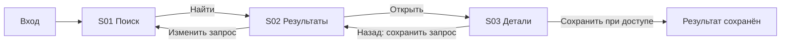
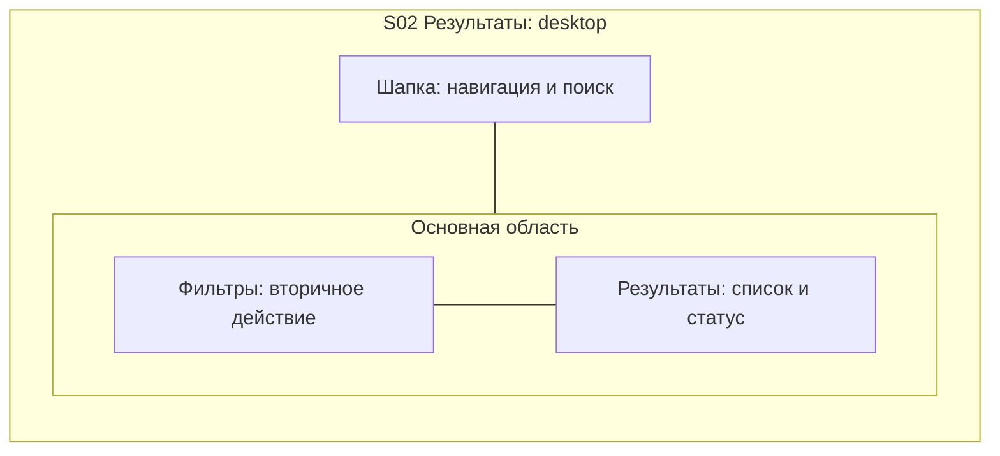
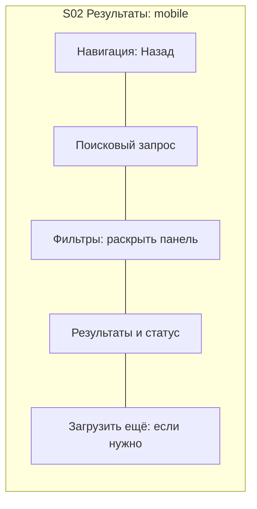
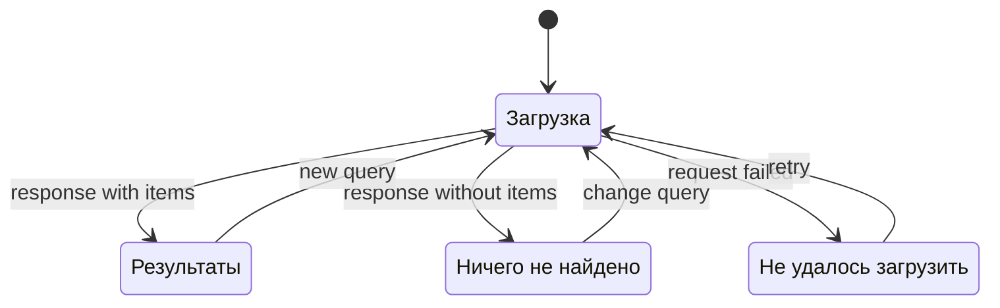

# Как строить UX-диаграммы

Markdown+Mermaid — основной переносимый формат. При доступном renderer сохранять и проверять preview/SVG; для передачи можно экспортировать `.mmd`. Применение Figma/tldraw или прототипа — отдельный выбранный output, не prerequisite этого скилла. Ни sitemap, ни sequence diagram backend API не заменяют экранный UX.

## Три уровня

| Уровень | Что показывает | Обязательный результат |
|---|---|---|
| User flow | Роль, вход, задача, переходы, guards, выход и recovery | Связанные Screen ID и подписи действий |
| Screen layout | Какие функциональные блоки и в каком порядке/соседстве | Desktop и mobile схемы **каждого** экрана + пояснение/адаптация tablet |
| State flow | Loading/empty/ready/error/permission/pending/success и переходы | State graph для интерактивного экрана; статический имеет явное обоснование N/A |

Stable IDs: journeys `J01`, screens `S01`, blocks `B01`, states `S01.loading`. Один screen card описывает role/goal/data/действия/layout/состояния/entry/exit/evidence/ADR; unrelated цели не прячутся за одним ID. Повторно используемые экраны сохраняют ID через revisions. Каждая стрелка перехода имеет действие/event и, если нужно, guard; расположение блоков не изображать как пользовательские клики.

## Учебный user flow

Это вымышленный пример структуры, не наблюдение Google/Яндекса. Если сохранение требует auth, бизнес должен определить возврат после входа и сохранение intent; не добавлять login-screen только потому, что он привычен. Отдельно записать deep links, back/browser back, dismissed overlays, timeout и retry semantics.

## Учебный layout одного экрана S02

`---` означает соседство/порядок чтения, **не переход**. Схема семантическая: не обещает точное расположение после автоматической раскладки Mermaid. Таблица блоков под схемой — точный контракт их порядка/приоритета. Не использовать styling/colors/fonts/spacing tokens как UX-решения.

Desktop:

Mobile:

Пояснение: результаты — основная задача; фильтры доступны без постоянной боковой колонки. При закрытии панели focus возвращается кнопке, параметры сохраняются. Tablet: боковая колонка появляется только если список остаётся читаемым, иначе mobile pattern. Это **наш предложенный** responsive contract для примера, не заимствованный доказанный паттерн.

Для реального экрана перечислить priority/region/order, sticky/scroll behavior, keyboard reading order, touch/hover alternatives и `show / move / collapse / omit` для каждого блока. Нельзя прятать обязательную функцию на mobile без альтернативного пути.

## Учебный state graph S02

У graph есть state table: trigger/guard, видимые блоки и короткие строки, доступные действия, какой ввод/позиция сохраняются, куда направляется focus. Не все состояния требуют отдельных screens; error внутри формы обычно остаётся тем же Screen ID. Pending submit защищён от double submit; retry не должен дублировать платёж/отправку. Какие failures применимы определяется процессом, а не универсальным списком из ста пунктов.

## Гигиена и проверка

[Flowchart syntax](https://mermaid.js.org/syntax/flowchart.html) и [state diagrams](https://mermaid.js.org/syntax/stateDiagram.html) — первичные references. Уникальные ASCII node IDs, пользовательские строки в quoted labels, простые graph types и короткие подписи уменьшают renderer incompatibility. Не использовать навигационные URLs с auth tokens, external assets, custom JS или inline HTML ради красоты.

Не строить один нечитаемый граф на всё приложение. Journey index + flow per journey + screen/state cards дают переход между обзором и деталями. Проверить syntax parser; при возможности render и визуально прочитать. Если только syntax parse — прямо так и назвать, не писать «визуально проверено».

Проверки связности: все in-scope screens есть в catalog и диаграммах; для каждой стрелки известен target, action/guard; у каждого required state есть вход/выход/recovery или объяснение terminal; нет orphan screens, unreachable success, role leaks и потери введённого без решения. На схеме нет технических endpoint/debug labels в пользовательских UI областях.
