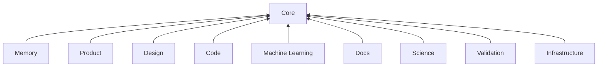

# Palarran packages

Each package owns capabilities. Each capability owns its implementation and the resources needed to use it; there is no separate central domain-documentation tree.

```text
packages/
  <package>/
    AGENTS.md
    README.md
    <capability>/
      skills/       agent workflows
      docs/         contracts, sources and guides
      runtime/      importable implementation where needed
      scripts/      bounded helper implementations
      templates/    inert starting points
      plugins/      portable manifests where applicable
      commands/     command adapters
      examples/     explicit offline examples
```

Create only directories with real resources. Package status and optional runtime service deployment are separate facts. Core is shared infrastructure; domain code belongs to its package. Shared orchestration uses explicit domain adapters rather than copying their implementations.

| Package | Installer ID | Responsibility |
| --- | --- | --- |
| [Core](core/README.md) | `core` | Shared agent foundations, runtime, setup and safe package discovery. |
| [Memory](memory/README.md) | `memory` | Local notes, session context and optional reviewed cross-project knowledge. |
| [Product](product/README.md) | `product` | Evidence-backed product definition, market and customer planning. |
| [Design](design/README.md) | `design` | Adaptive UX concepts and visual UI design. |
| [Code](code/README.md) | `code` | Specification-driven frontend and backend planning and implementation. |
| [Machine Learning](machine-learning/README.md) | `machine-learning` | Bounded experiment design, data, training and independent benchmarks. |
| [Docs](docs/README.md) | `docs` | Human-readable documentation and portable review artifacts. |
| [Science](science/README.md) | `science` | Evidence-grounded scientific reporting from existing experiments. |
| [Validation](validation/README.md) | `validation` | Independent application acceptance and measured agent evaluation. |
| [Infrastructure](infrastructure/README.md) | `infrastructure` | Infrastructure design, delivery, VPS operations and scoped incidents. |

| [Security](security/README.md) | `security` | Evidence-backed infrastructure, request, logging, egress, code and CVE audits. |

[Strict catalog](catalog.json) owns selection/dependencies and canonical skill paths. [Move manifest](layout.json) owns legacy source references. [Registry contract](core/packages/docs/README.md) and [source-path contract](core/packages/docs/layout.md) describe validation.



Arrows show required package dependencies. Optional services such as Neo4j memory and the coordination API are configured separately; package selection does not deploy them.

Root `scripts/`, `orchestrator/`, `memory/` and `mcp/` retain fixed compatibility entrypoints. Root `tests/` is the shared integration acceptance suite. Root `docs/` and `skills/` contain navigation only. Portable exports intentionally retain stable legacy paths and rebase links from canonical source.
